# KONTROLÖR RAPORU — NB_SIHHI_DENEME_R4.dxf

Üretildi: 14.10.2026 19:21 — `python3 motor/kontrolor/kontrolor.py proje/denemeler/_arsiv/uctan_uca/NB_SIHHI_DENEME_R4.dxf --mimari ornekler/new_block.dxf.xz --rapor kutuphane/arastirma/KONTROLOR_R4_RAPORU.md --png-ust 2`

## SONUÇ: **RED — 237 madde**

Düzeltme listesi (üreten ajana geri):
1. [T01 Z] balkon süzgeci (balkon) PİS SU kolonuna bağlanmış (P9) hat 99 cm — kural: yalnız balkondaki yağmur inişine, kısa hatla @ (7891, 2113)
2. [T01 Z] balkon süzgeci (balkon) – yağmur inişi hattı 345 cm > 300 cm @ (8453, 359)
3. [T01 1] balkon süzgeci (balkon) PİS SU kolonuna bağlanmış (P9) hat 99 cm — kural: yalnız balkondaki yağmur inişine, kısa hatla @ (10391, 2113)
4. [T01 1] balkon süzgeci (balkon) – yağmur inişi hattı 345 cm > 300 cm @ (10953, 359)
5. [T01 2] balkon süzgeci (balkon) PİS SU kolonuna bağlanmış (P9) hat 99 cm — kural: yalnız balkondaki yağmur inişine, kısa hatla @ (12891, 2113)
6. [T01 2] balkon süzgeci (balkon) – yağmur inişi hattı 346 cm > 300 cm @ (13454, 359)
7. [T02 Z] DUS (banyo) → P5 branşmanı: uzun: 342 cm > 300 @ (8425, 1586)
8. [T02 Z] CM (banyo) → P5 branşmanı: uzun: 377 cm > 300 @ (8541, 1572)
9. [T02 1] LV (wc-duş) → P9 branşmanı: mahal dışından dolaşıyor: 57 cm (oda) @ (10527, 2029)
10. [T02 1] DUS (banyo) → P5 branşmanı: uzun: 342 cm > 300 @ (10925, 1586)
11. [T02 1] CM (banyo) → P5 branşmanı: uzun: 376 cm > 300 @ (11041, 1572)
12. [T02 2] DUS (banyo) → P5 branşmanı: uzun: 342 cm > 300 @ (13425, 1586)
   … T02 için toplam 7 bulgu (ayrıntı aşağıda)
13. [T03 Z] eğik pis su parçası 165 cm (banyo) — oda içinden çapraz uzun hat @ (8476, 1514)
14. [T03 Z] pis su hattı banyo içinden, duvardan > 30 cm uzakta 124 cm geçiyor (ÇAPRAZ UZUN HAT) @ (8992, 1412)
15. [T03 Z] eğik pis su parçası 174 cm (banyo) — oda içinden çapraz uzun hat @ (8942, 1362)
16. [T03 Z] eğik pis su parçası 165 cm (banyo) — oda içinden çapraz uzun hat @ (8945, 1514)
17. [T03 1] eğik pis su parçası 165 cm (banyo) — oda içinden çapraz uzun hat @ (10976, 1514)
18. [T03 1] pis su hattı wc-banyo içinden, duvardan > 30 cm uzakta 105 cm geçiyor (ÇAPRAZ UZUN HAT) @ (10829, 1875)
   … T03 için toplam 12 bulgu (ayrıntı aşağıda)
19. [T04 1] daire 6 sıcak su hattının 716 cm'si daire dışında: ortak alan / başka daire / bina dışı (merdiven, wc-duş) — ortak alanda 384 cm — kural: sıcak su daire içinden, kombiden; merdiven holü/koridordan besleme yok @ (11456, 1704)
20. [T04 2] daire 9 sıcak su hattının 418 cm'si daire dışında: ortak alan / başka daire / bina dışı (merdiven) — ortak alanda 432 cm — kural: sıcak su daire içinden, kombiden; merdiven holü/koridordan besleme yok @ (13772, 1124)
21. [T07 Z] etiket hat üstüne biniyor: "7 SB" (28 cm hat yazı kutusunda) @ (8409, 1511)
22. [T07 Z] etiket hat üstüne biniyor: "7 SB" (28 cm hat yazı kutusunda) @ (8418, 1511)
23. [T07 Z] etiket hat üstüne biniyor: "9 SB" (24 cm hat yazı kutusunda) @ (8418, 1444)
24. [T07 Z] etiket hat üstüne biniyor: "9 SB" (28 cm hat yazı kutusunda) @ (8409, 1446)
25. [T07 Z] etiket hat üstüne biniyor: "Ø70" (16 cm hat yazı kutusunda) @ (8436, 1415)
26. [T07 Z] etiket hat üstüne biniyor: "13 SB" (18 cm hat yazı kutusunda) @ (8429, 1413)
   … T07 için toplam 180 bulgu (ayrıntı aşağıda)
27. [T08 ŞEMA] su sayacı KAT BANDINDA (1. KAT +3,00) — kural: sayaçlar yalnız zemin bandında, şebeke girişinde @ (15552, 1130)
28. [T08 ŞEMA] su sayacı KAT BANDINDA (2. KAT +6,00) — kural: sayaçlar yalnız zemin bandında, şebeke girişinde @ (15552, 1460)
29. [T08 ŞEMA] su sayacı daire bloğu içinde / kapı önünde (x=19162) — kural: sayaç grubu zemin bandının SOLUNDA, şebeke girişinde @ (19162, 800)
30. [T08 ŞEMA] su sayacı KAT BANDINDA (1. KAT +3,00) — kural: sayaçlar yalnız zemin bandında, şebeke girişinde @ (19162, 1130)
31. [T08 ŞEMA] su sayacı KAT BANDINDA (2. KAT +6,00) — kural: sayaçlar yalnız zemin bandında, şebeke girişinde @ (19162, 1460)
32. [T08 ŞEMA] su sayacı daire bloğu içinde / kapı önünde (x=21962) — kural: sayaç grubu zemin bandının SOLUNDA, şebeke girişinde @ (21962, 800)
   … T08 için toplam 17 bulgu (ayrıntı aşağıda)
33. [T09 Z] duş: yer süzgeci 0 (her ıslak hacimde tam 1) @ (7959, 2047)
34. [T09 1] wc-duş: yer süzgeci 0 (her ıslak hacimde tam 1) @ (10525, 2060)
35. [T09 2] duş: yer süzgeci 0 (her ıslak hacimde tam 1) @ (12999, 2055)
36. [T10 Z] kolon P1 ıslak hacim dışında (ortak alan / dış) — kural: kolon ıslak hacmin köşesinde @ (8733, 569)
37. [T10 Z] kolon P1 ıslak hacim dışında (ortak alan / dış) — kural: kolon ıslak hacmin köşesinde @ (8687, 569)
38. [T10 Z] kolon P7 ıslak hacim dışında (ortak alan / dış) — kural: kolon ıslak hacmin köşesinde @ (8897, 2453)
39. [T10 1] kolon P1 ıslak hacim dışında (ortak alan / dış) — kural: kolon ıslak hacmin köşesinde @ (11233, 569)
40. [T10 1] kolon P1 ıslak hacim dışında (ortak alan / dış) — kural: kolon ıslak hacmin köşesinde @ (11187, 569)
41. [T10 1] kolon P7 ıslak hacim dışında (ortak alan / dış) — kural: kolon ıslak hacmin köşesinde @ (11397, 2453)
   … T10 için toplam 10 bulgu (ayrıntı aşağıda)

## Kullanıcının RED görüntüleri ↔ bu raporda yakalanan (doğrulama)

| RED görüntüsü (`kutuphane/arastirma/geri_bildirim/`) | R4'te yakalayan bulgu | Kanıt (`KONTROLOR_R4_RAPORU_png/`) |
|---|---|---|
| `RED_sihhi_balkon_suzgeci_banyo_kolonuna_bagli.png` — balkon süzgeci P9 pis su kolonuna | T01 Z/1/2: "balkon süzgeci PİS SU kolonuna bağlanmış (P9) hat 99 cm" + T10 "kolon P9 ıslak hacim dışında (oda)" + T09 duş süzgeci 0 | `T01_Z_01.png` (sol R4, sağ new_block: kullanıcıda süzgeç 30 cm ile yağmur inişine) |
| `RED_sihhi_kolon_semasi_sayac_kapida_yanlis_tarz.png` — her katta "Dn SAYAÇ (KAPIDA)" | T08 ×17: sayaç 1./2. kat bandında (y=1130/1460), sayaç daire bloğu içinde (x=19162/21962), "SAYAÇ (KAPIDA)" yazıları; zemin solunda yalnız ana sayaç | `T08_SEMA_01.png`, `T08_SEMA_02.png`; tarz: `GENEL_SEMA.png` ↔ `ornekler/new_block_onizleme/c_s4.jpg` |
| `RED_sihhi_sicak_su_daire_disindan.png` — sıcak su merdiven holünden, banyoda çapraz pis su | T04 [1] daire 6: 716 cm daire dışında (merdiven, wc-duş), ortak alanda 384 cm; T04 [2] daire 9: 418 cm (merdiven); T03 [1] banyo 113 cm çapraz + eğik 165 cm | `T04_1_01.png`, `T04_2_01.png`, `T03_1_01.png` |
| `RED_sihhi_wcbanyo_capraz_pissu_etiket_ust_uste.png` (R3 görüntüsü) — wc-banyo çapraz pis su, etiketler üst üste | T03 [1] "wc-banyo içinden 105 cm ÇAPRAZ UZUN HAT"; T07 ×180 etiket hat üstüne (R4'te etiket-etiket 0: etiket4 yerleşimi); aynı test R3'te etiket-etiket 91, etiket-mimari yazı 59, etiket-hat 131 (1. kat) | `T03_1_02.png`, `T07_1_01.png`, `T07_Z_01.png` |

Ek yakalananlar (görüntülerde olmayan): T02 DUŞ/ÇM → P5 branşmanı 342-377 cm (> 300), LV (wc-duş) branşmanı odadan dolaşıyor;
T09 duş/wc-duş mahallerinde süzgeç 0 (süzgeç balkona konmuş); T10 P2 yüklükte, P1/P4/P7 ıslak hacim köşesi dışında.

## Özet

| Test | Ne ölçer | Sonuç | FAIL | INFO | Referans new_block FAIL/INFO (aynı ölçüm) |
|---|---|---|---|---|---|
| T01 | Balkon süzgeci bağlantı hedefi (yağmur inişi, kısa hat; pis su kolonuna ASLA) | ✗ FAIL | 6 | 0 | 0 / 0 |
| T02 | Pis su branşmanı: uzunluk ≤ 300 cm, açı {0,45,90}, mahal dışından dolaşmaz, her armatür bağlı | ✗ FAIL | 7 | 0 | 59 / 3 |
| T03 | Oda içi çapraz pis su hattı (duvardan > 30 cm iç bölge) | ✗ FAIL | 12 | 23 | 0 / 21 |
| T04 | Sıcak su daire dışı uzunluk = 0, kombiden başlar | ✗ FAIL | 2 | 0 | 1 / 0 |
| T05 | Sıcak–soğuk paralellik (sabit ofset) ve kesişme | ✓ PASS | 0 | 0 | 0 / 6 |
| T06 | Koridor hatları koridor ortasında | bilgi | 0 | 28 | 0 / 39 |
| T07 | Etiket–etiket / etiket–mimari yazı / etiket–hat çakışması, etiket boyu | ✗ FAIL | 180 | 3 | 175 / 3 |
| T08 | Kolon şeması: sayaçlar zemin bandında, şebeke girişinde (solda); kat bantlarında sayaç yok | ✗ FAIL | 17 | 0 | 0 / 1 |
| T09 | Islak hacim başına yer süzgeci = 1 | ✗ FAIL | 3 | 0 | 16 / 0 |
| T10 | Pis su kolonu ıslak hacim köşesinde (betonarme dışında) | ✗ FAIL | 10 | 0 | 0 / 3 |
| T11 | denetle.py: MTY 0, ROTAS- öneki, köprü 0, kesişme 0, elektrik 0, yazı çakışması 0, lejant, audit | ✓ PASS | 0 | 1 | 34 / 1 |

Referans sütunu: kullanıcının kendi `new_block.dxf` çizimi aynı testlerden geçirildiğinde çıkan sayılar (14.10.2026). Referansın kendisinde de görülen türden bulgular (ör. T07 etiket-hat, T02 serbest açı) tarz farkı değil kural C ihlali olarak listelenir; T11 MTY sayıları referans için beklenen durumdur.

## Dosya ve mimari eşleme

- dosya: proje/denemeler/_arsiv/uctan_uca/NB_SIHHI_DENEME_R4.dxf — çerçeve 11, kat paftası ['1', '2', 'Z'], şema paftası var
- mimari kaynak: ornekler/new_block.dxf.xz (30942 kayıt)
- kat Z: öteleme (-244847.9, 444000.0) 78 yazı eşleşmesi; mahal 32 (ıslak 9, ortak 2, balkon 4), daire [1, 2, 3], armatür 29, betonarme 32 — 2.5 s
- kat 1: öteleme (-244381.8, 444000.0) 77 yazı eşleşmesi; mahal 32 (ıslak 9, ortak 2, balkon 4), daire [4, 5, 6], armatür 29, betonarme 32 — 2.5 s
- kat 2: öteleme (-243929.8, 444000.0) 77 yazı eşleşmesi; mahal 32 (ıslak 9, ortak 2, balkon 4), daire [7, 8, 9], armatür 28, betonarme 32 — 2.3 s

Süre 89 s.

## Ayrıntı (koordinatlar çizim birimi, cm)

### T01 — Balkon süzgeci bağlantı hedefi (yağmur inişi, kısa hat; pis su kolonuna ASLA)

- **FAIL** [Z]: balkon süzgeci (balkon) PİS SU kolonuna bağlanmış (P9) hat 99 cm — kural: yalnız balkondaki yağmur inişine, kısa hatla @ (7891, 2113)  
  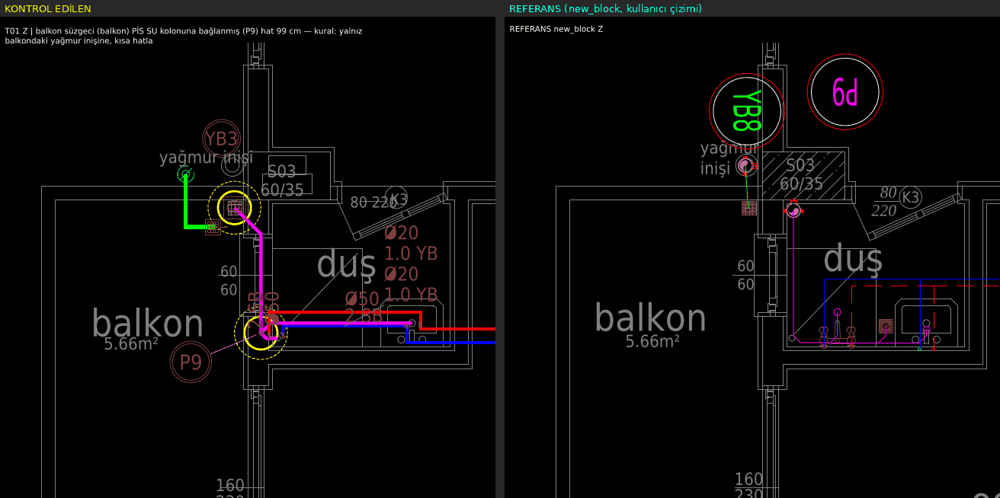
- **FAIL** [Z]: balkon süzgeci (balkon) – yağmur inişi hattı 345 cm > 300 cm @ (8453, 359)  
  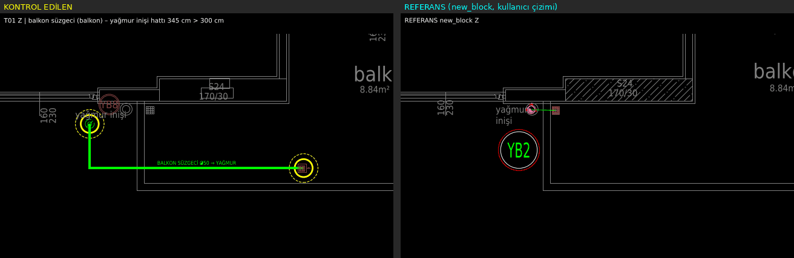
- **FAIL** [1]: balkon süzgeci (balkon) PİS SU kolonuna bağlanmış (P9) hat 99 cm — kural: yalnız balkondaki yağmur inişine, kısa hatla @ (10391, 2113)  
  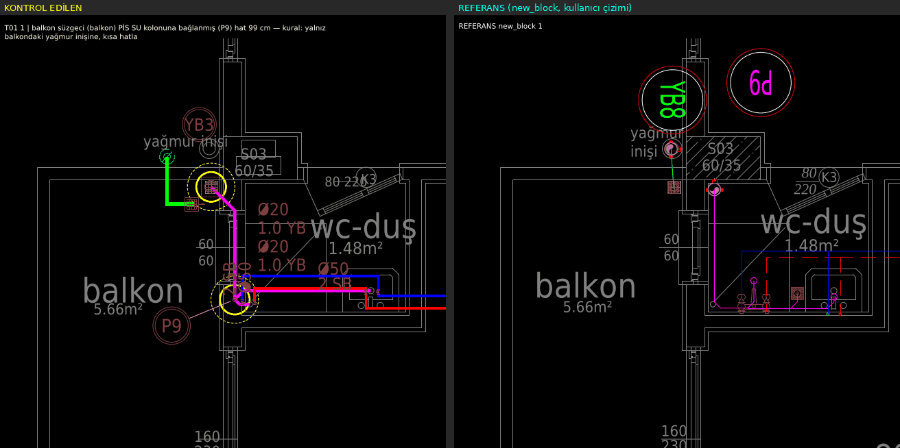
- **FAIL** [1]: balkon süzgeci (balkon) – yağmur inişi hattı 345 cm > 300 cm @ (10953, 359)  
  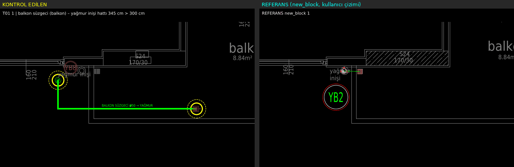
- **FAIL** [2]: balkon süzgeci (balkon) PİS SU kolonuna bağlanmış (P9) hat 99 cm — kural: yalnız balkondaki yağmur inişine, kısa hatla @ (12891, 2113)  
  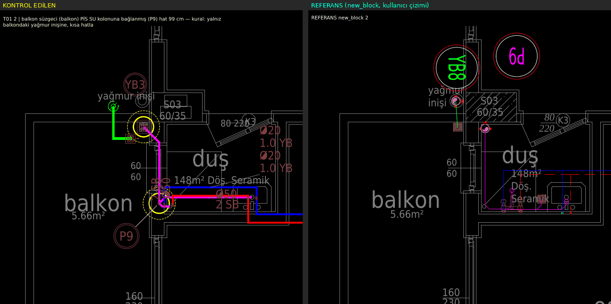
- **FAIL** [2]: balkon süzgeci (balkon) – yağmur inişi hattı 346 cm > 300 cm @ (13454, 359)  
  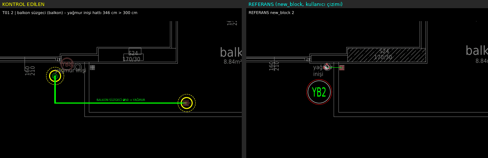

### T02 — Pis su branşmanı: uzunluk ≤ 300 cm, açı {0,45,90}, mahal dışından dolaşmaz, her armatür bağlı

- **FAIL** [Z]: DUS (banyo) → P5 branşmanı: uzun: 342 cm > 300 @ (8425, 1586)  
  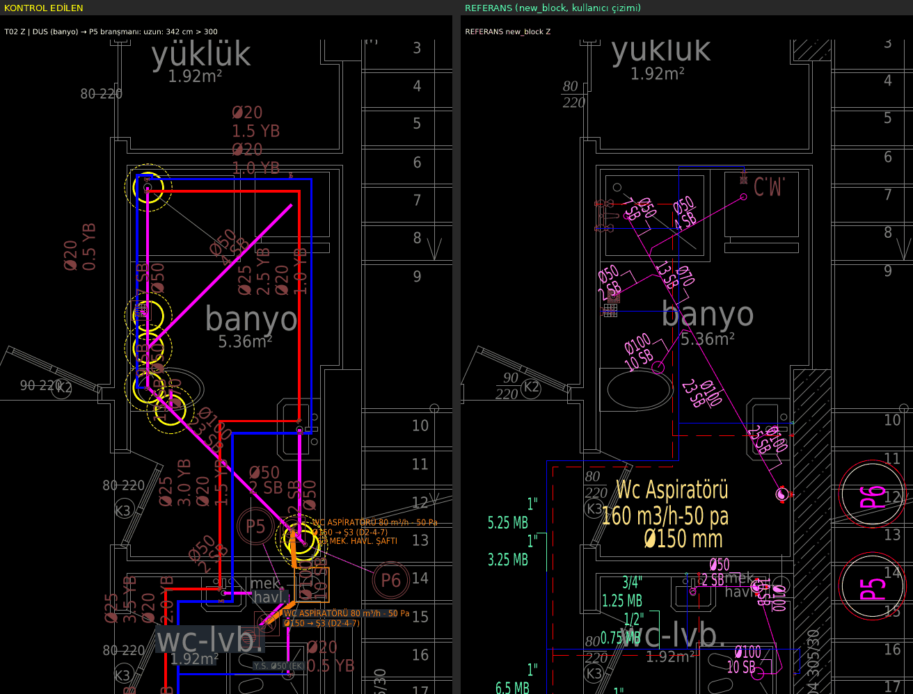
- **FAIL** [Z]: CM (banyo) → P5 branşmanı: uzun: 377 cm > 300 @ (8541, 1572)  
  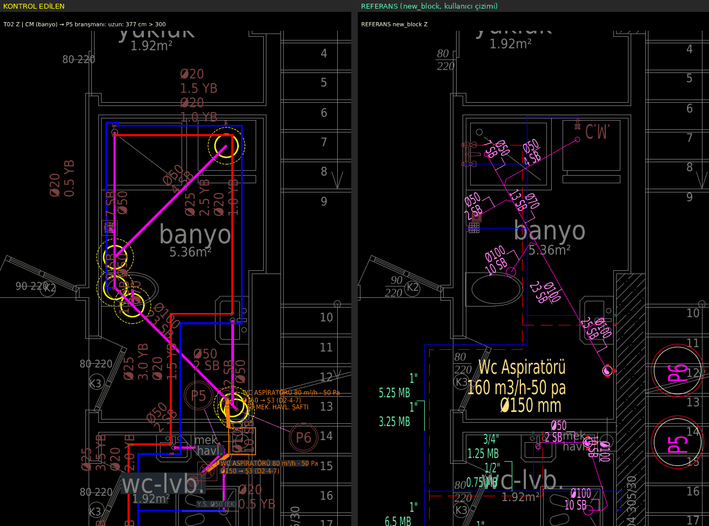
- **FAIL** [1]: LV (wc-duş) → P9 branşmanı: mahal dışından dolaşıyor: 57 cm (oda) @ (10527, 2029)  
  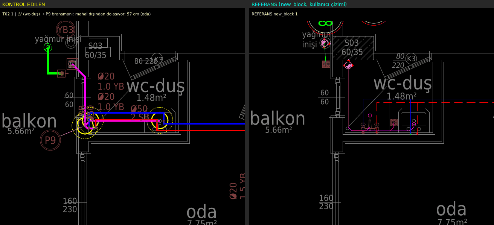
- **FAIL** [1]: DUS (banyo) → P5 branşmanı: uzun: 342 cm > 300 @ (10925, 1586)  
  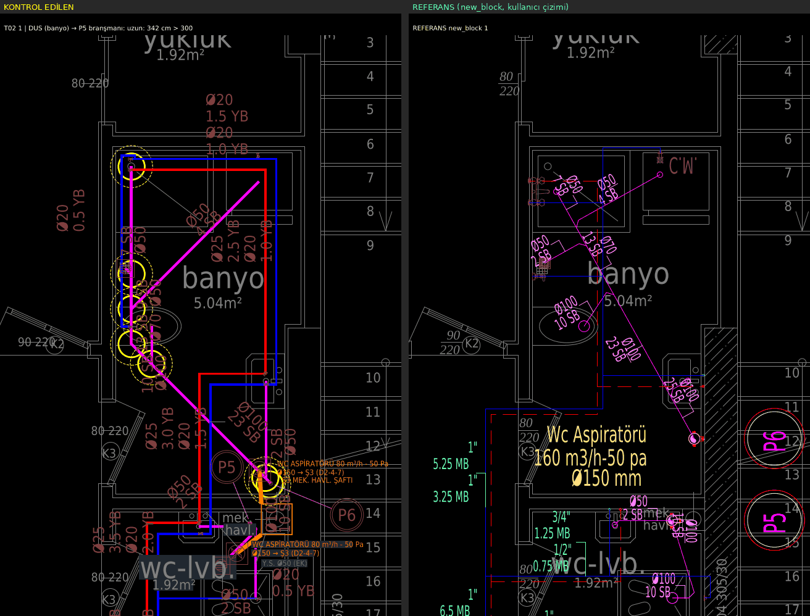
- **FAIL** [1]: CM (banyo) → P5 branşmanı: uzun: 376 cm > 300 @ (11041, 1572)
- **FAIL** [2]: DUS (banyo) → P5 branşmanı: uzun: 342 cm > 300 @ (13425, 1586)  
  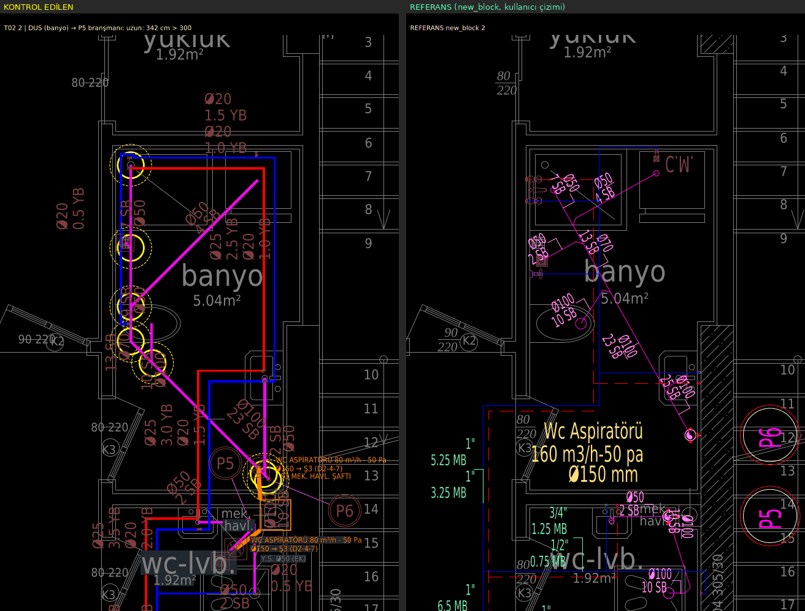
- **FAIL** [2]: CM (banyo) → P5 branşmanı: uzun: 376 cm > 300 @ (13542, 1572)  
  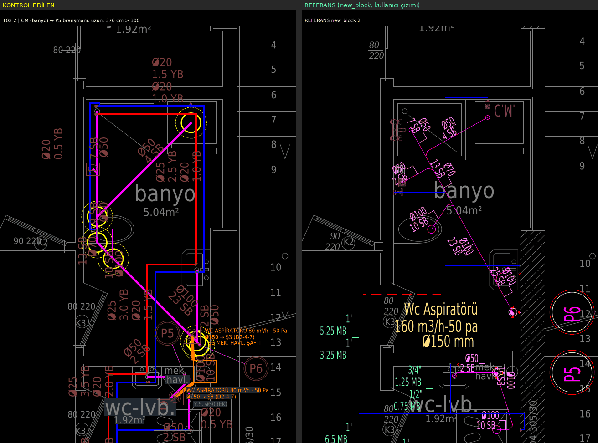

### T03 — Oda içi çapraz pis su hattı (duvardan > 30 cm iç bölge)

- **INFO** [Z]: pis su hattı banyo içinden, duvardan > 30 cm uzakta 87 cm geçiyor (kısa çapraz, bilgi) @ (8469, 1373)
- **INFO** [Z]: pis su hattı banyo içinden, duvardan > 30 cm uzakta 42 cm geçiyor (kısa çapraz, bilgi) @ (8474, 1512)
- **FAIL** [Z]: eğik pis su parçası 165 cm (banyo) — oda içinden çapraz uzun hat @ (8476, 1514)  
  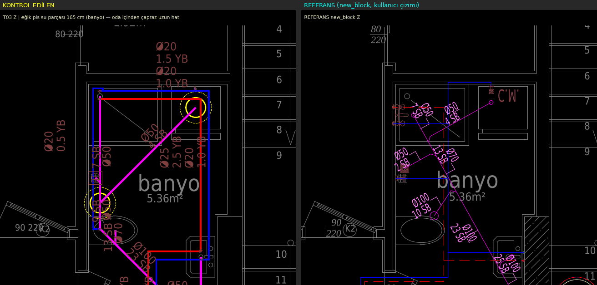
- **INFO** [Z]: pis su hattı wc-lvb. içinden, duvardan > 30 cm uzakta 46 cm geçiyor (kısa çapraz, bilgi) @ (8531, 1192)
- **INFO** [Z]: pis su hattı wc+banyo içinden, duvardan > 30 cm uzakta 40 cm geçiyor (kısa çapraz, bilgi) @ (8297, 1881)
- **INFO** [Z]: pis su hattı wc+banyo içinden, duvardan > 30 cm uzakta 38 cm geçiyor (kısa çapraz, bilgi) @ (8329, 1875)
- **INFO** [Z]: pis su hattı wc+banyo içinden, duvardan > 30 cm uzakta 37 cm geçiyor (kısa çapraz, bilgi) @ (8297, 1881)
- **FAIL** [Z]: pis su hattı banyo içinden, duvardan > 30 cm uzakta 124 cm geçiyor (ÇAPRAZ UZUN HAT) @ (8992, 1412)  
  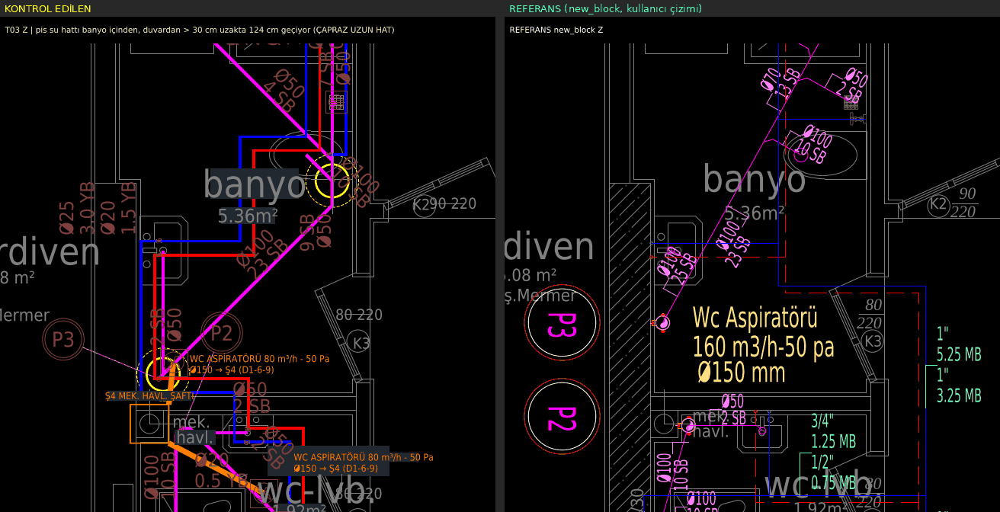
- **FAIL** [Z]: eğik pis su parçası 174 cm (banyo) — oda içinden çapraz uzun hat @ (8942, 1362)
- **INFO** [Z]: pis su hattı banyo içinden, duvardan > 30 cm uzakta 71 cm geçiyor (kısa çapraz, bilgi) @ (8955, 1503)
- **FAIL** [Z]: eğik pis su parçası 165 cm (banyo) — oda içinden çapraz uzun hat @ (8945, 1514)
- **INFO** [Z]: pis su hattı wc-lvb. içinden, duvardan > 30 cm uzakta 64 cm geçiyor (kısa çapraz, bilgi) @ (8968, 1193)
- **INFO** [1]: pis su hattı banyo içinden, duvardan > 30 cm uzakta 87 cm geçiyor (kısa çapraz, bilgi) @ (10969, 1373)
- **INFO** [1]: pis su hattı banyo içinden, duvardan > 30 cm uzakta 42 cm geçiyor (kısa çapraz, bilgi) @ (10944, 1482)
- **FAIL** [1]: eğik pis su parçası 165 cm (banyo) — oda içinden çapraz uzun hat @ (10976, 1514)  
  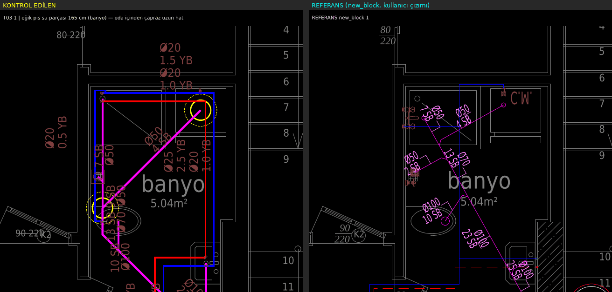
- **INFO** [1]: pis su hattı wc-banyo içinden, duvardan > 30 cm uzakta 32 cm geçiyor (kısa çapraz, bilgi) @ (10755, 1927)
- **INFO** [1]: pis su hattı wc-banyo içinden, duvardan > 30 cm uzakta 38 cm geçiyor (kısa çapraz, bilgi) @ (10770, 1904)
- **FAIL** [1]: pis su hattı wc-banyo içinden, duvardan > 30 cm uzakta 105 cm geçiyor (ÇAPRAZ UZUN HAT) @ (10829, 1875)  
  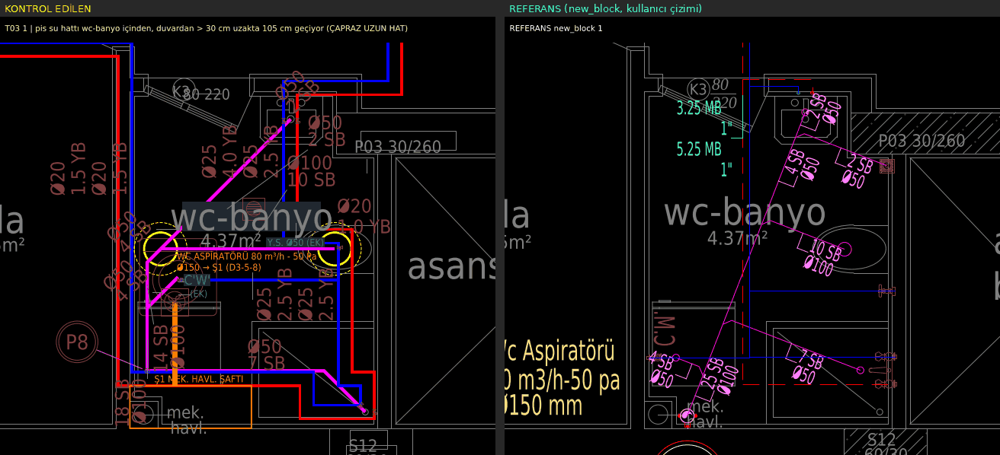
- **INFO** [1]: pis su hattı wc-duş içinden, duvardan > 30 cm uzakta 62 cm geçiyor (kısa çapraz, bilgi) @ (11456, 1680)
- **INFO** [1]: pis su hattı wc-duş içinden, duvardan > 30 cm uzakta 51 cm geçiyor (kısa çapraz, bilgi) @ (11418, 1642)
- **INFO** [1]: pis su hattı wc-duş içinden, duvardan > 30 cm uzakta 90 cm geçiyor (kısa çapraz, bilgi) @ (11472, 1606)
- **INFO** [1]: pis su hattı wc-duş içinden, duvardan > 30 cm uzakta 46 cm geçiyor (kısa çapraz, bilgi) @ (11418, 1688)
- **FAIL** [1]: pis su hattı banyo içinden, duvardan > 30 cm uzakta 113 cm geçiyor (ÇAPRAZ UZUN HAT) @ (11484, 1404)
- **INFO** [1]: pis su hattı wc-lvb. içinden, duvardan > 30 cm uzakta 46 cm geçiyor (kısa çapraz, bilgi) @ (11031, 1192)
- **INFO** [2]: pis su hattı banyo içinden, duvardan > 30 cm uzakta 87 cm geçiyor (kısa çapraz, bilgi) @ (13469, 1373)
- **INFO** [2]: pis su hattı banyo içinden, duvardan > 30 cm uzakta 42 cm geçiyor (kısa çapraz, bilgi) @ (13474, 1512)
- **FAIL** [2]: eğik pis su parçası 165 cm (banyo) — oda içinden çapraz uzun hat @ (13476, 1514)  
  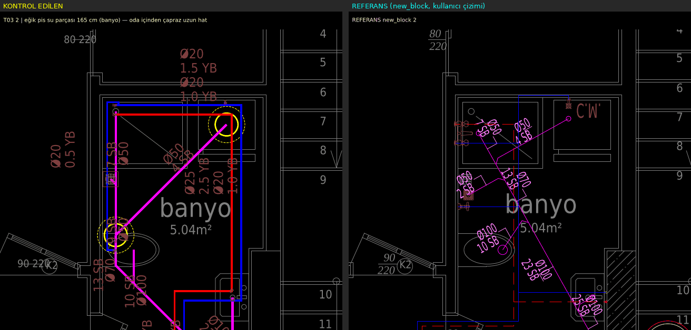
- **INFO** [2]: pis su hattı wc-banyo içinden, duvardan > 30 cm uzakta 32 cm geçiyor (kısa çapraz, bilgi) @ (13255, 1927)
- **INFO** [2]: pis su hattı wc-banyo içinden, duvardan > 30 cm uzakta 38 cm geçiyor (kısa çapraz, bilgi) @ (13271, 1904)
- **FAIL** [2]: pis su hattı wc-banyo içinden, duvardan > 30 cm uzakta 106 cm geçiyor (ÇAPRAZ UZUN HAT) @ (13330, 1875)  
  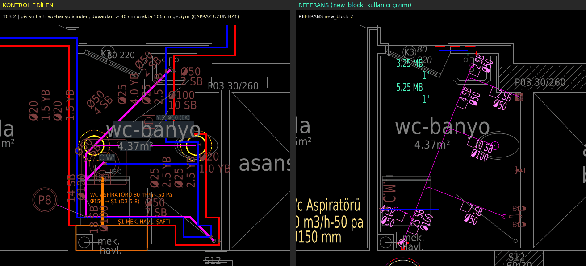
- **FAIL** [2]: pis su hattı banyo içinden, duvardan > 30 cm uzakta 124 cm geçiyor (ÇAPRAZ UZUN HAT) @ (13992, 1412)
- **FAIL** [2]: eğik pis su parçası 174 cm (banyo) — oda içinden çapraz uzun hat @ (13942, 1362)
- **INFO** [2]: pis su hattı banyo içinden, duvardan > 30 cm uzakta 70 cm geçiyor (kısa çapraz, bilgi) @ (13956, 1504)
- **FAIL** [2]: eğik pis su parçası 165 cm (banyo) — oda içinden çapraz uzun hat @ (13945, 1514)
- **INFO** [2]: pis su hattı wc-lvb. içinden, duvardan > 30 cm uzakta 46 cm geçiyor (kısa çapraz, bilgi) @ (13532, 1192)

### T04 — Sıcak su daire dışı uzunluk = 0, kombiden başlar

- **PASS** [Z]: 3 sıcak su ağı daire içinde, kombiden
- **FAIL** [1]: daire 6 sıcak su hattının 716 cm'si daire dışında: ortak alan / başka daire / bina dışı (merdiven, wc-duş) — ortak alanda 384 cm — kural: sıcak su daire içinden, kombiden; merdiven holü/koridordan besleme yok @ (11456, 1704)  
  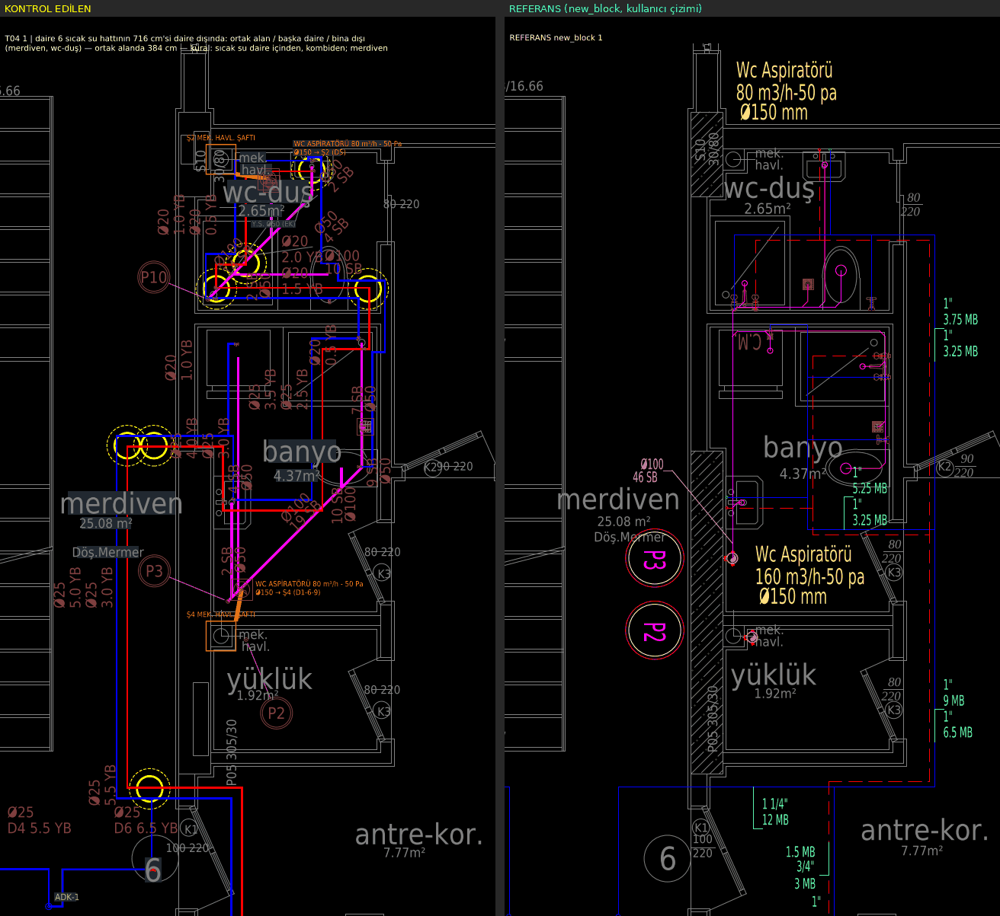
- **FAIL** [2]: daire 9 sıcak su hattının 418 cm'si daire dışında: ortak alan / başka daire / bina dışı (merdiven) — ortak alanda 432 cm — kural: sıcak su daire içinden, kombiden; merdiven holü/koridordan besleme yok @ (13772, 1124)  
  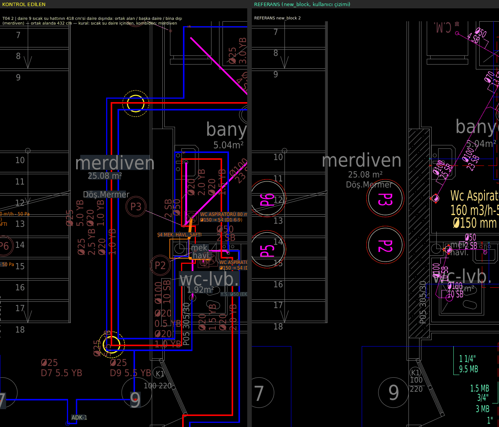

### T05 — Sıcak–soğuk paralellik (sabit ofset) ve kesişme

- **PASS** [Z]: 33 sıcak parçası soğukla sabit ofsetli paralel, kesişme yok
- **PASS** [1]: 35 sıcak parçası soğukla sabit ofsetli paralel, kesişme yok
- **PASS** [2]: 36 sıcak parçası soğukla sabit ofsetli paralel, kesişme yok

### T06 — Koridor hatları koridor ortasında

- **INFO** [Z]: 13 koridor parçası ortada, 6 duvar dibinde (BİLGİ: kullanıcının kendi new_block çiziminde antre hatları duvar dibinde; B kuralı koridor ortası — karar kullanıcıda)
- **INFO** [Z]: antre-kor. içinde temiz su hattı duvar dibinde: duvara 30 cm, koridor 142 cm (ROTAS-SOGUKSU-BORU) — kural: koridorda hatlar ORTADAN @ (8520, 1108)
- **INFO** [Z]: merdiven içinde temiz su hattı duvar dibinde: duvara 44 cm, koridor 940 cm (ROTAS-SOGUKSU-BORU) — kural: koridorda hatlar ORTADAN @ (8754, 1044)
- **INFO** [Z]: merdiven içinde temiz su hattı duvar dibinde: duvara 7 cm, koridor 234 cm (ROTAS-SOGUKSU-BORU) — kural: koridorda hatlar ORTADAN @ (8609, 1076)
- **INFO** [Z]: merdiven içinde temiz su hattı duvar dibinde: duvara 4 cm, koridor 940 cm (ROTAS-SOGUKSU-BORU) — kural: koridorda hatlar ORTADAN @ (8780, 1936)
- **INFO** [Z]: antre-kor. içinde temiz su hattı duvar dibinde: duvara 5 cm, koridor 120 cm (ROTAS-SICAKSU-BORU) — kural: koridorda hatlar ORTADAN @ (8330, 1997)
- **INFO** [Z]: antre-kor. içinde temiz su hattı duvar dibinde: duvara 2 cm, koridor 24 cm (ROTAS-SOGUKSU-BORU) — kural: koridorda hatlar ORTADAN @ (8864, 1342)
- **INFO** [1]: 11 koridor parçası ortada, 8 duvar dibinde (BİLGİ: kullanıcının kendi new_block çiziminde antre hatları duvar dibinde; B kuralı koridor ortası — karar kullanıcıda)
- **INFO** [1]: antre-kor. içinde temiz su hattı duvar dibinde: duvara 30 cm, koridor 142 cm (ROTAS-SOGUKSU-BORU) — kural: koridorda hatlar ORTADAN @ (11020, 1108)
- **INFO** [1]: merdiven içinde temiz su hattı duvar dibinde: duvara 7 cm, koridor 234 cm (ROTAS-SOGUKSU-BORU) — kural: koridorda hatlar ORTADAN @ (11109, 1076)
- **INFO** [1]: merdiven içinde temiz su hattı duvar dibinde: duvara 44 cm, koridor 940 cm (ROTAS-SOGUKSU-BORU) — kural: koridorda hatlar ORTADAN @ (11261, 1044)
- **INFO** [1]: merdiven içinde temiz su hattı duvar dibinde: duvara 111 cm, koridor 938 cm (ROTAS-SOGUKSU-BORU) — kural: koridorda hatlar ORTADAN @ (11302, 1111)
- **INFO** [1]: merdiven içinde temiz su hattı duvar dibinde: duvara 31 cm, koridor 234 cm (ROTAS-SOGUKSU-BORU) — kural: koridorda hatlar ORTADAN @ (11305, 1078)
- **INFO** [1]: antre-kor. içinde temiz su hattı duvar dibinde: duvara 5 cm, koridor 120 cm (ROTAS-SOGUKSU-BORU) — kural: koridorda hatlar ORTADAN @ (10830, 1997)
- **INFO** [1]: antre-kor. içinde temiz su hattı duvar dibinde: duvara 38 cm, koridor 314 cm (ROTAS-SOGUKSU-BORU) — kural: koridorda hatlar ORTADAN @ (11380, 1056)
- **INFO** [1]: antre-kor. içinde temiz su hattı duvar dibinde: duvara 48 cm, koridor 314 cm (ROTAS-SICAKSU-BORU) — kural: koridorda hatlar ORTADAN @ (11390, 1060)
- **INFO** [2]: 15 koridor parçası ortada, 11 duvar dibinde (BİLGİ: kullanıcının kendi new_block çiziminde antre hatları duvar dibinde; B kuralı koridor ortası — karar kullanıcıda)
- **INFO** [2]: antre-kor. içinde temiz su hattı duvar dibinde: duvara 30 cm, koridor 142 cm (ROTAS-SOGUKSU-BORU) — kural: koridorda hatlar ORTADAN @ (13520, 1108)
- **INFO** [2]: merdiven içinde temiz su hattı duvar dibinde: duvara 7 cm, koridor 234 cm (ROTAS-SOGUKSU-BORU) — kural: koridorda hatlar ORTADAN @ (13609, 1076)
- **INFO** [2]: merdiven içinde temiz su hattı duvar dibinde: duvara 44 cm, koridor 940 cm (ROTAS-SOGUKSU-BORU) — kural: koridorda hatlar ORTADAN @ (13761, 1044)
- **INFO** [2]: merdiven içinde temiz su hattı duvar dibinde: duvara 116 cm, koridor 938 cm (ROTAS-SOGUKSU-BORU) — kural: koridorda hatlar ORTADAN @ (13799, 1116)
- **INFO** [2]: merdiven içinde temiz su hattı duvar dibinde: duvara 31 cm, koridor 234 cm (ROTAS-SOGUKSU-BORU) — kural: koridorda hatlar ORTADAN @ (13805, 1080)
- **INFO** [2]: merdiven içinde temiz su hattı duvar dibinde: duvara 123 cm, koridor 938 cm (ROTAS-SICAKSU-BORU) — kural: koridorda hatlar ORTADAN @ (13802, 1123)
- **INFO** [2]: antre-kor. içinde temiz su hattı duvar dibinde: duvara 5 cm, koridor 120 cm (ROTAS-SOGUKSU-BORU) — kural: koridorda hatlar ORTADAN @ (13330, 1997)
- **INFO** [2]: antre-kor. içinde temiz su hattı duvar dibinde: duvara 15 cm, koridor 142 cm (ROTAS-SOGUKSU-BORU) — kural: koridorda hatlar ORTADAN @ (13922, 1011)
- **INFO** [2]: antre-kor. içinde temiz su hattı duvar dibinde: duvara 2 cm, koridor 24 cm (ROTAS-SOGUKSU-BORU) — kural: koridorda hatlar ORTADAN @ (13864, 1346)
- **INFO** [2]: antre-kor. içinde temiz su hattı duvar dibinde: duvara 2 cm, koridor 24 cm (ROTAS-SOGUKSU-BORU) — kural: koridorda hatlar ORTADAN @ (13864, 1193)
- **INFO** [2]: antre-kor. içinde temiz su hattı duvar dibinde: duvara 25 cm, koridor 142 cm (ROTAS-SICAKSU-BORU) — kural: koridorda hatlar ORTADAN @ (13912, 1021)

### T07 — Etiket–etiket / etiket–mimari yazı / etiket–hat çakışması, etiket boyu

- **INFO** [Z]: etiket-etiket 0, etiket-mimari yazı 0, etiket-hat 101 (toplam 238 etiket)
- **FAIL** [Z]: etiket hat üstüne biniyor: "7 SB" (28 cm hat yazı kutusunda) @ (8409, 1511)  
  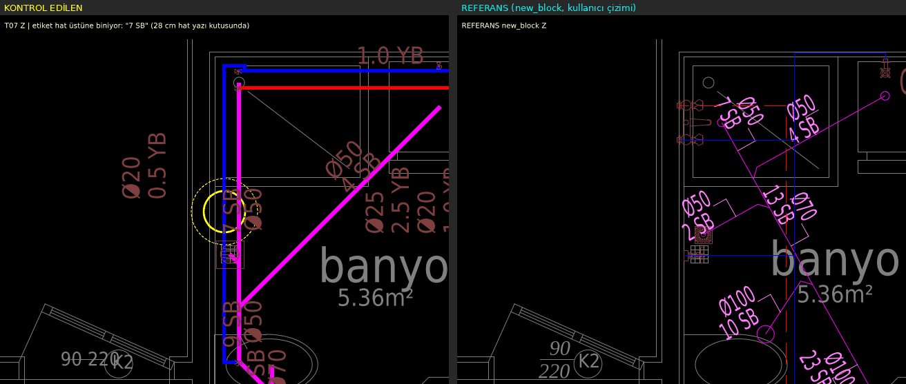
- **FAIL** [Z]: etiket hat üstüne biniyor: "7 SB" (28 cm hat yazı kutusunda) @ (8418, 1511)  
  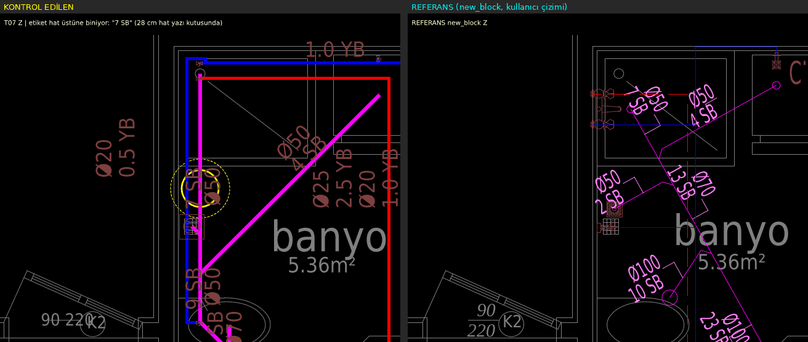
- **FAIL** [Z]: etiket hat üstüne biniyor: "9 SB" (24 cm hat yazı kutusunda) @ (8418, 1444)
- **FAIL** [Z]: etiket hat üstüne biniyor: "9 SB" (28 cm hat yazı kutusunda) @ (8409, 1446)
- **FAIL** [Z]: etiket hat üstüne biniyor: "Ø70" (16 cm hat yazı kutusunda) @ (8436, 1415)
- **FAIL** [Z]: etiket hat üstüne biniyor: "13 SB" (18 cm hat yazı kutusunda) @ (8429, 1413)
- **FAIL** [Z]: etiket hat üstüne biniyor: "Ø100" (18 cm hat yazı kutusunda) @ (8476, 1389)
- **FAIL** [Z]: etiket hat üstüne biniyor: "23 SB" (9 cm hat yazı kutusunda) @ (8476, 1376)
- **FAIL** [Z]: etiket hat üstüne biniyor: "23 SB" (36 cm hat yazı kutusunda) @ (8460, 1382)
- **FAIL** [Z]: etiket hat üstüne biniyor: "2 SB" (28 cm hat yazı kutusunda) @ (8540, 1336)
- **FAIL** [Z]: etiket hat üstüne biniyor: "4 SB" (28 cm hat yazı kutusunda) @ (8492, 1530)
- **FAIL** [Z]: etiket hat üstüne biniyor: "2 SB" (18 cm hat yazı kutusunda) @ (8476, 1290)
- **FAIL** [Z]: etiket hat üstüne biniyor: "2 SB" (10 cm hat yazı kutusunda) @ (8503, 1339)
- **FAIL** [Z]: etiket hat üstüne biniyor: "Ø50" (11 cm hat yazı kutusunda) @ (8357, 1987)
- **FAIL** [Z]: etiket hat üstüne biniyor: "Ø50" (13 cm hat yazı kutusunda) @ (8247, 1852)
- **FAIL** [Z]: etiket hat üstüne biniyor: "4 SB" (13 cm hat yazı kutusunda) @ (8234, 1852)
- **FAIL** [Z]: etiket hat üstüne biniyor: "7 SB" (28 cm hat yazı kutusunda) @ (8309, 1756)
- **FAIL** [Z]: etiket hat üstüne biniyor: "7 SB" (28 cm hat yazı kutusunda) @ (8309, 1755)
- **FAIL** [Z]: etiket hat üstüne biniyor: "7 SB" (28 cm hat yazı kutusunda) @ (8309, 1765)
- **FAIL** [Z]: etiket hat üstüne biniyor: "Ø50" (25 cm hat yazı kutusunda) @ (9013, 1523)
- **FAIL** [Z]: etiket hat üstüne biniyor: "7 SB" (28 cm hat yazı kutusunda) @ (8994, 1521)
- **FAIL** [Z]: etiket hat üstüne biniyor: "7 SB" (28 cm hat yazı kutusunda) @ (9003, 1521)
- **FAIL** [Z]: etiket hat üstüne biniyor: "9 SB" (18 cm hat yazı kutusunda) @ (8986, 1406)
- **FAIL** [Z]: etiket hat üstüne biniyor: "Ø100" (23 cm hat yazı kutusunda) @ (8943, 1390)
- **FAIL** [Z]: etiket hat üstüne biniyor: "23 SB" (36 cm hat yazı kutusunda) @ (8960, 1380)
- **FAIL** [Z]: etiket hat üstüne biniyor: "2 SB" (28 cm hat yazı kutusunda) @ (8874, 1335)
- **FAIL** [Z]: etiket hat üstüne biniyor: "2 SB" (28 cm hat yazı kutusunda) @ (8880, 1335)
- **FAIL** [Z]: etiket hat üstüne biniyor: "4 SB" (28 cm hat yazı kutusunda) @ (8961, 1498)
- **FAIL** [Z]: etiket hat üstüne biniyor: "2 SB" (28 cm hat yazı kutusunda) @ (7985, 2029)
- **FAIL** [Z]: etiket hat üstüne biniyor: "2 SB" (28 cm hat yazı kutusunda) @ (7985, 2027)
- **FAIL** [Z]: etiket hat üstüne biniyor: "2 SB" (28 cm hat yazı kutusunda) @ (7985, 2037)
- **FAIL** [Z]: etiket hat üstüne biniyor: "Ø50" (11 cm hat yazı kutusunda) @ (7920, 2029)
- **FAIL** [Z]: etiket hat üstüne biniyor: "Ø50" (20 cm hat yazı kutusunda) @ (7918, 2035)
- **FAIL** [Z]: etiket hat üstüne biniyor: "2 SB" (28 cm hat yazı kutusunda) @ (7910, 2039)
- **FAIL** [Z]: etiket hat üstüne biniyor: "Ø50" (11 cm hat yazı kutusunda) @ (8856, 2432)
- **FAIL** [Z]: etiket hat üstüne biniyor: "6 SB" (28 cm hat yazı kutusunda) @ (8860, 2416)
- **FAIL** [Z]: etiket hat üstüne biniyor: "6 SB" (12 cm hat yazı kutusunda) @ (8866, 2425)
- **FAIL** [Z]: etiket hat üstüne biniyor: "6 SB" (18 cm hat yazı kutusunda) @ (8856, 2418)
- **FAIL** [Z]: etiket hat üstüne biniyor: "Ø50" (12 cm hat yazı kutusunda) @ (8871, 2441)
- **FAIL** [Z]: etiket hat üstüne biniyor: "4 SB" (17 cm hat yazı kutusunda) @ (8882, 2319)
- **FAIL** [Z]: etiket hat üstüne biniyor: "Ø50" (25 cm hat yazı kutusunda) @ (8748, 736)
- **FAIL** [Z]: etiket hat üstüne biniyor: "4 SB" (28 cm hat yazı kutusunda) @ (8741, 734)
- **FAIL** [Z]: etiket hat üstüne biniyor: "8 SB" (20 cm hat yazı kutusunda) @ (8741, 651)
- **FAIL** [Z]: etiket hat üstüne biniyor: "Ø50" (19 cm hat yazı kutusunda) @ (8775, 719)
- **FAIL** [Z]: etiket hat üstüne biniyor: "2 SB" (28 cm hat yazı kutusunda) @ (8791, 712)
- **FAIL** [Z]: etiket hat üstüne biniyor: "4 SB" (28 cm hat yazı kutusunda) @ (8647, 735)
- **FAIL** [Z]: etiket hat üstüne biniyor: "10 SB" (36 cm hat yazı kutusunda) @ (8647, 639)
- **FAIL** [Z]: etiket hat üstüne biniyor: "Ø50" (13 cm hat yazı kutusunda) @ (8630, 711)
- **FAIL** [Z]: etiket hat üstüne biniyor: "Ø50" (18 cm hat yazı kutusunda) @ (8624, 705)
- **FAIL** [Z]: etiket hat üstüne biniyor: "4 SB" (13 cm hat yazı kutusunda) @ (8639, 703)
- **FAIL** [Z]: etiket hat üstüne biniyor: "4 SB" (20 cm hat yazı kutusunda) @ (8631, 694)
- **FAIL** [Z]: etiket hat üstüne biniyor: "4 SB" (17 cm hat yazı kutusunda) @ (8641, 705)
- **FAIL** [Z]: etiket hat üstüne biniyor: "Ø50" (11 cm hat yazı kutusunda) @ (8682, 699)
- **FAIL** [Z]: etiket hat üstüne biniyor: "2 SB" (8 cm hat yazı kutusunda) @ (8672, 691)
- **FAIL** [Z]: etiket hat üstüne biniyor: "2 SB" (18 cm hat yazı kutusunda) @ (8682, 686)
- **FAIL** [Z]: etiket hat üstüne biniyor: "Ø50" (8 cm hat yazı kutusunda) @ (8959, 1261)
- **FAIL** [Z]: etiket hat üstüne biniyor: "Ø50" (26 cm hat yazı kutusunda) @ (8966, 1250)
- **FAIL** [Z]: etiket hat üstüne biniyor: "2 SB" (11 cm hat yazı kutusunda) @ (8950, 1251)
- **FAIL** [Z]: etiket hat üstüne biniyor: "Ø50" (13 cm hat yazı kutusunda) @ (8942, 1288)
- **FAIL** [Z]: etiket hat üstüne biniyor: "2 SB" (13 cm hat yazı kutusunda) @ (8942, 1276)
- **INFO** [1]: etiket-etiket 0, etiket-mimari yazı 0, etiket-hat 123 (toplam 243 etiket)
- **FAIL** [1]: etiket hat üstüne biniyor: "7 SB" (28 cm hat yazı kutusunda) @ (10909, 1518)  
  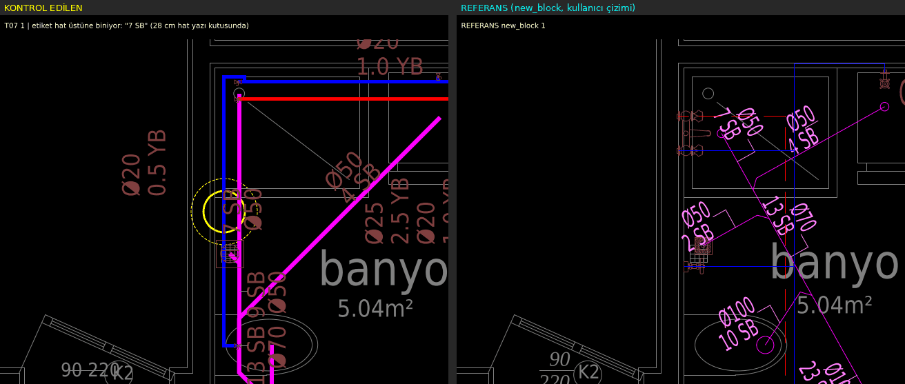
- **FAIL** [1]: etiket hat üstüne biniyor: "7 SB" (28 cm hat yazı kutusunda) @ (10918, 1518)  
  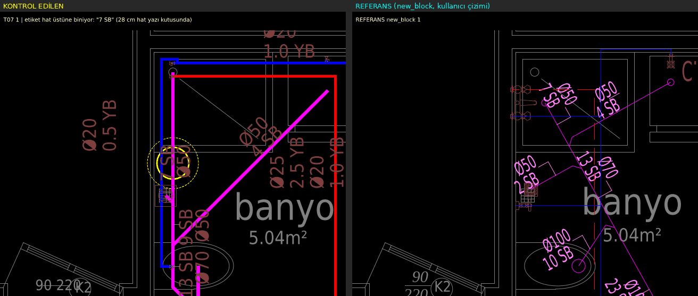
- **FAIL** [1]: etiket hat üstüne biniyor: "Ø50" (15 cm hat yazı kutusunda) @ (10940, 1478)
- **FAIL** [1]: etiket hat üstüne biniyor: "9 SB" (18 cm hat yazı kutusunda) @ (10929, 1467)
- **FAIL** [1]: etiket hat üstüne biniyor: "Ø70" (14 cm hat yazı kutusunda) @ (10937, 1433)
- **FAIL** [1]: etiket hat üstüne biniyor: "Ø100" (18 cm hat yazı kutusunda) @ (10946, 1396)
- **FAIL** [1]: etiket hat üstüne biniyor: "10 SB" (9 cm hat yazı kutusunda) @ (10937, 1410)
- **FAIL** [1]: etiket hat üstüne biniyor: "10 SB" (13 cm hat yazı kutusunda) @ (10932, 1410)
- **FAIL** [1]: etiket hat üstüne biniyor: "4 SB" (28 cm hat yazı kutusunda) @ (10992, 1530)
- **FAIL** [1]: etiket hat üstüne biniyor: "Ø50" (34 cm hat yazı kutusunda) @ (10797, 1993)
- **FAIL** [1]: etiket hat üstüne biniyor: "2 SB" (32 cm hat yazı kutusunda) @ (10806, 1983)
- **FAIL** [1]: etiket hat üstüne biniyor: "Ø50" (18 cm hat yazı kutusunda) @ (10672, 1887)
- **FAIL** [1]: etiket hat üstüne biniyor: "Ø50" (14 cm hat yazı kutusunda) @ (10682, 1895)
- **FAIL** [1]: etiket hat üstüne biniyor: "4 SB" (18 cm hat yazı kutusunda) @ (10682, 1880)
- **FAIL** [1]: etiket hat üstüne biniyor: "14 SB" (13 cm hat yazı kutusunda) @ (10704, 1786)
- **FAIL** [1]: etiket hat üstüne biniyor: "14 SB" (13 cm hat yazı kutusunda) @ (10704, 1785)
- **FAIL** [1]: etiket hat üstüne biniyor: "Ø100" (13 cm hat yazı kutusunda) @ (10688, 1775)
- **FAIL** [1]: etiket hat üstüne biniyor: "18 SB" (16 cm hat yazı kutusunda) @ (10675, 1776)
- **FAIL** [1]: etiket hat üstüne biniyor: "Ø50" (18 cm hat yazı kutusunda) @ (10672, 1854)
- **FAIL** [1]: etiket hat üstüne biniyor: "Ø50" (9 cm hat yazı kutusunda) @ (10682, 1859)
- **FAIL** [1]: etiket hat üstüne biniyor: "4 SB" (8 cm hat yazı kutusunda) @ (10672, 1842)
- **FAIL** [1]: etiket hat üstüne biniyor: "4 SB" (18 cm hat yazı kutusunda) @ (10682, 1847)
- **FAIL** [1]: etiket hat üstüne biniyor: "7 SB" (28 cm hat yazı kutusunda) @ (10780, 1786)
- **FAIL** [1]: etiket hat üstüne biniyor: "7 SB" (28 cm hat yazı kutusunda) @ (10780, 1785)
- **FAIL** [1]: etiket hat üstüne biniyor: "Ø100" (13 cm hat yazı kutusunda) @ (10802, 1936)
- **FAIL** [1]: etiket hat üstüne biniyor: "10 SB" (13 cm hat yazı kutusunda) @ (10802, 1924)
- **FAIL** [1]: etiket hat üstüne biniyor: "Ø50" (25 cm hat yazı kutusunda) @ (11308, 2371)
- **FAIL** [1]: etiket hat üstüne biniyor: "2 SB" (14 cm hat yazı kutusunda) @ (11323, 2365)
- **FAIL** [1]: etiket hat üstüne biniyor: "2 SB" (9 cm hat yazı kutusunda) @ (11323, 2377)
- **FAIL** [1]: etiket hat üstüne biniyor: "2 SB" (28 cm hat yazı kutusunda) @ (11318, 2372)
- **FAIL** [1]: etiket hat üstüne biniyor: "6 SB" (28 cm hat yazı kutusunda) @ (11352, 2408)
- **FAIL** [1]: etiket hat üstüne biniyor: "4 SB" (28 cm hat yazı kutusunda) @ (11388, 2412)
- **FAIL** [1]: etiket hat üstüne biniyor: "4 SB" (28 cm hat yazı kutusunda) @ (11360, 2336)
- **FAIL** [1]: etiket hat üstüne biniyor: "Ø50" (17 cm hat yazı kutusunda) @ (11465, 1649)
- **FAIL** [1]: etiket hat üstüne biniyor: "Ø100" (13 cm hat yazı kutusunda) @ (11373, 1617)
- **FAIL** [1]: etiket hat üstüne biniyor: "Ø100" (31 cm hat yazı kutusunda) @ (11380, 1629)
- **FAIL** [1]: etiket hat üstüne biniyor: "14 SB" (36 cm hat yazı kutusunda) @ (11389, 1620)
- **FAIL** [1]: etiket hat üstüne biniyor: "14 SB" (31 cm hat yazı kutusunda) @ (11393, 1617)
- **FAIL** [1]: etiket hat üstüne biniyor: "Ø100" (13 cm hat yazı kutusunda) @ (11475, 1616)
- **FAIL** [1]: etiket hat üstüne biniyor: "10 SB" (26 cm hat yazı kutusunda) @ (11478, 1613)
- **FAIL** [1]: etiket hat üstüne biniyor: "Ø50" (13 cm hat yazı kutusunda) @ (11413, 1593)
- **FAIL** [1]: etiket hat üstüne biniyor: "Ø50" (13 cm hat yazı kutusunda) @ (11413, 1583)
- **FAIL** [1]: etiket hat üstüne biniyor: "Ø50" (13 cm hat yazı kutusunda) @ (11413, 1606)
- **FAIL** [1]: etiket hat üstüne biniyor: "2 SB" (13 cm hat yazı kutusunda) @ (11401, 1593)
- **FAIL** [1]: etiket hat üstüne biniyor: "2 SB" (13 cm hat yazı kutusunda) @ (11401, 1583)
- **FAIL** [1]: etiket hat üstüne biniyor: "2 SB" (13 cm hat yazı kutusunda) @ (11401, 1606)
- **FAIL** [1]: etiket hat üstüne biniyor: "Ø50" (25 cm hat yazı kutusunda) @ (11513, 1488)
- **FAIL** [1]: etiket hat üstüne biniyor: "7 SB" (28 cm hat yazı kutusunda) @ (11503, 1487)
- **FAIL** [1]: etiket hat üstüne biniyor: "9 SB" (14 cm hat yazı kutusunda) @ (11512, 1427)
- **FAIL** [1]: etiket hat üstüne biniyor: "Ø100" (18 cm hat yazı kutusunda) @ (11440, 1383)
- **FAIL** [1]: etiket hat üstüne biniyor: "Ø100" (16 cm hat yazı kutusunda) @ (11449, 1393)
- **FAIL** [1]: etiket hat üstüne biniyor: "19 SB" (36 cm hat yazı kutusunda) @ (11454, 1374)
- **FAIL** [1]: etiket hat üstüne biniyor: "19 SB" (22 cm hat yazı kutusunda) @ (11459, 1383)
- **FAIL** [1]: etiket hat üstüne biniyor: "Ø50" (25 cm hat yazı kutusunda) @ (11387, 1336)
- **FAIL** [1]: etiket hat üstüne biniyor: "2 SB" (28 cm hat yazı kutusunda) @ (11380, 1335)
- **FAIL** [1]: etiket hat üstüne biniyor: "10 SB" (13 cm hat yazı kutusunda) @ (11479, 1399)
- **FAIL** [1]: etiket hat üstüne biniyor: "4 SB" (28 cm hat yazı kutusunda) @ (11387, 1413)
- **FAIL** [1]: etiket hat üstüne biniyor: "4 SB" (28 cm hat yazı kutusunda) @ (11382, 1413)
- **FAIL** [1]: etiket hat üstüne biniyor: "Ø50" (25 cm hat yazı kutusunda) @ (11248, 736)
- **FAIL** [1]: etiket hat üstüne biniyor: "4 SB" (28 cm hat yazı kutusunda) @ (11241, 734)
- **INFO** [2]: etiket-etiket 0, etiket-mimari yazı 0, etiket-hat 99 (toplam 235 etiket)
- **FAIL** [2]: etiket hat üstüne biniyor: "7 SB" (28 cm hat yazı kutusunda) @ (13409, 1541)  
  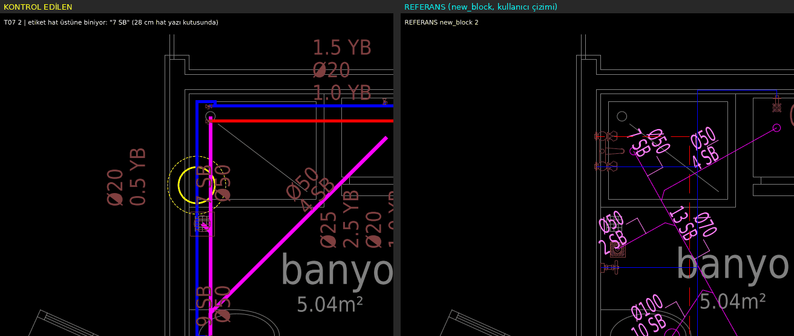
- **FAIL** [2]: etiket hat üstüne biniyor: "7 SB" (28 cm hat yazı kutusunda) @ (13418, 1541)  
  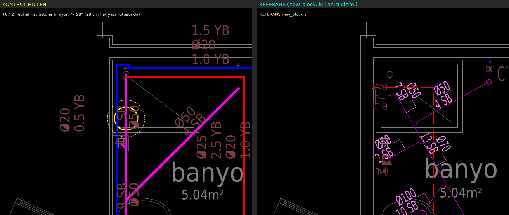
- **FAIL** [2]: etiket hat üstüne biniyor: "Ø50" (18 cm hat yazı kutusunda) @ (13427, 1465)
- **FAIL** [2]: etiket hat üstüne biniyor: "9 SB" (10 cm hat yazı kutusunda) @ (13418, 1451)
- **FAIL** [2]: etiket hat üstüne biniyor: "9 SB" (19 cm hat yazı kutusunda) @ (13418, 1465)
- **FAIL** [2]: etiket hat üstüne biniyor: "9 SB" (28 cm hat yazı kutusunda) @ (13409, 1460)
- **FAIL** [2]: etiket hat üstüne biniyor: "Ø70" (10 cm hat yazı kutusunda) @ (13418, 1427)
- **FAIL** [2]: etiket hat üstüne biniyor: "Ø100" (18 cm hat yazı kutusunda) @ (13446, 1396)
- **FAIL** [2]: etiket hat üstüne biniyor: "10 SB" (9 cm hat yazı kutusunda) @ (13437, 1410)
- **FAIL** [2]: etiket hat üstüne biniyor: "10 SB" (13 cm hat yazı kutusunda) @ (13432, 1410)
- **FAIL** [2]: etiket hat üstüne biniyor: "4 SB" (28 cm hat yazı kutusunda) @ (13492, 1530)
- **FAIL** [2]: etiket hat üstüne biniyor: "Ø100" (25 cm hat yazı kutusunda) @ (13193, 1819)
- **FAIL** [2]: etiket hat üstüne biniyor: "Ø100" (8 cm hat yazı kutusunda) @ (13193, 1836)
- **FAIL** [2]: etiket hat üstüne biniyor: "Ø100" (33 cm hat yazı kutusunda) @ (13182, 1823)
- **FAIL** [2]: etiket hat üstüne biniyor: "14 SB" (36 cm hat yazı kutusunda) @ (13172, 1822)
- **FAIL** [2]: etiket hat üstüne biniyor: "14 SB" (36 cm hat yazı kutusunda) @ (13182, 1822)
- **FAIL** [2]: etiket hat üstüne biniyor: "Ø100" (13 cm hat yazı kutusunda) @ (13216, 1786)
- **FAIL** [2]: etiket hat üstüne biniyor: "Ø100" (13 cm hat yazı kutusunda) @ (13216, 1775)
- **FAIL** [2]: etiket hat üstüne biniyor: "Ø100" (13 cm hat yazı kutusunda) @ (13216, 1785)
- **FAIL** [2]: etiket hat üstüne biniyor: "18 SB" (13 cm hat yazı kutusunda) @ (13204, 1786)
- **FAIL** [2]: etiket hat üstüne biniyor: "18 SB" (13 cm hat yazı kutusunda) @ (13204, 1775)
- **FAIL** [2]: etiket hat üstüne biniyor: "18 SB" (13 cm hat yazı kutusunda) @ (13204, 1785)
- **FAIL** [2]: etiket hat üstüne biniyor: "Ø50" (10 cm hat yazı kutusunda) @ (13182, 1868)
- **FAIL** [2]: etiket hat üstüne biniyor: "4 SB" (27 cm hat yazı kutusunda) @ (13196, 1864)
- **FAIL** [2]: etiket hat üstüne biniyor: "7 SB" (28 cm hat yazı kutusunda) @ (13280, 1786)
- **FAIL** [2]: etiket hat üstüne biniyor: "7 SB" (28 cm hat yazı kutusunda) @ (13280, 1785)
- **FAIL** [2]: etiket hat üstüne biniyor: "Ø100" (13 cm hat yazı kutusunda) @ (13302, 1936)
- **FAIL** [2]: etiket hat üstüne biniyor: "10 SB" (13 cm hat yazı kutusunda) @ (13302, 1924)
- **FAIL** [2]: etiket hat üstüne biniyor: "9 SB" (18 cm hat yazı kutusunda) @ (13987, 1407)
- **FAIL** [2]: etiket hat üstüne biniyor: "Ø100" (33 cm hat yazı kutusunda) @ (13960, 1380)
- **FAIL** [2]: etiket hat üstüne biniyor: "Ø50" (25 cm hat yazı kutusunda) @ (13864, 1324)
- **FAIL** [2]: etiket hat üstüne biniyor: "Ø50" (25 cm hat yazı kutusunda) @ (13874, 1324)
- **FAIL** [2]: etiket hat üstüne biniyor: "4 SB" (28 cm hat yazı kutusunda) @ (13961, 1498)
- **FAIL** [2]: etiket hat üstüne biniyor: "Ø50" (25 cm hat yazı kutusunda) @ (12990, 2029)
- **FAIL** [2]: etiket hat üstüne biniyor: "Ø50" (25 cm hat yazı kutusunda) @ (12990, 2031)
- **FAIL** [2]: etiket hat üstüne biniyor: "Ø50" (11 cm hat yazı kutusunda) @ (12920, 2029)
- **FAIL** [2]: etiket hat üstüne biniyor: "Ø50" (23 cm hat yazı kutusunda) @ (12918, 2037)
- **FAIL** [2]: etiket hat üstüne biniyor: "2 SB" (28 cm hat yazı kutusunda) @ (12910, 2039)
- **FAIL** [2]: etiket hat üstüne biniyor: "Ø50" (25 cm hat yazı kutusunda) @ (13812, 2371)
- **FAIL** [2]: etiket hat üstüne biniyor: "2 SB" (14 cm hat yazı kutusunda) @ (13823, 2365)
- **FAIL** [2]: etiket hat üstüne biniyor: "2 SB" (10 cm hat yazı kutusunda) @ (13824, 2377)
- **FAIL** [2]: etiket hat üstüne biniyor: "2 SB" (28 cm hat yazı kutusunda) @ (13822, 2372)
- **FAIL** [2]: etiket hat üstüne biniyor: "6 SB" (28 cm hat yazı kutusunda) @ (13853, 2409)
- **FAIL** [2]: etiket hat üstüne biniyor: "4 SB" (28 cm hat yazı kutusunda) @ (13888, 2412)
- **FAIL** [2]: etiket hat üstüne biniyor: "4 SB" (28 cm hat yazı kutusunda) @ (13860, 2336)
- **FAIL** [2]: etiket hat üstüne biniyor: "4 SB" (28 cm hat yazı kutusunda) @ (13741, 734)
- **FAIL** [2]: etiket hat üstüne biniyor: "8 SB" (20 cm hat yazı kutusunda) @ (13741, 651)
- **FAIL** [2]: etiket hat üstüne biniyor: "Ø50" (14 cm hat yazı kutusunda) @ (13774, 723)
- **FAIL** [2]: etiket hat üstüne biniyor: "Ø50" (18 cm hat yazı kutusunda) @ (13783, 723)
- **FAIL** [2]: etiket hat üstüne biniyor: "2 SB" (28 cm hat yazı kutusunda) @ (13792, 712)
- **FAIL** [2]: etiket hat üstüne biniyor: "2 SB" (19 cm hat yazı kutusunda) @ (13784, 713)
- **FAIL** [2]: etiket hat üstüne biniyor: "4 SB" (28 cm hat yazı kutusunda) @ (13647, 735)
- **FAIL** [2]: etiket hat üstüne biniyor: "10 SB" (36 cm hat yazı kutusunda) @ (13647, 638)
- **FAIL** [2]: etiket hat üstüne biniyor: "Ø50" (13 cm hat yazı kutusunda) @ (13631, 711)
- **FAIL** [2]: etiket hat üstüne biniyor: "Ø50" (18 cm hat yazı kutusunda) @ (13625, 705)
- **FAIL** [2]: etiket hat üstüne biniyor: "4 SB" (13 cm hat yazı kutusunda) @ (13640, 703)
- **FAIL** [2]: etiket hat üstüne biniyor: "4 SB" (20 cm hat yazı kutusunda) @ (13632, 694)
- **FAIL** [2]: etiket hat üstüne biniyor: "4 SB" (17 cm hat yazı kutusunda) @ (13641, 705)
- **FAIL** [2]: etiket hat üstüne biniyor: "Ø50" (10 cm hat yazı kutusunda) @ (13682, 699)
- **FAIL** [2]: etiket hat üstüne biniyor: "2 SB" (18 cm hat yazı kutusunda) @ (13682, 686)

### T08 — Kolon şeması: sayaçlar zemin bandında, şebeke girişinde (solda); kat bantlarında sayaç yok

- **FAIL** [ŞEMA]: su sayacı KAT BANDINDA (1. KAT +3,00) — kural: sayaçlar yalnız zemin bandında, şebeke girişinde @ (15552, 1130)  
  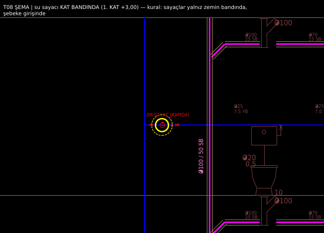
- **FAIL** [ŞEMA]: su sayacı KAT BANDINDA (2. KAT +6,00) — kural: sayaçlar yalnız zemin bandında, şebeke girişinde @ (15552, 1460)  
  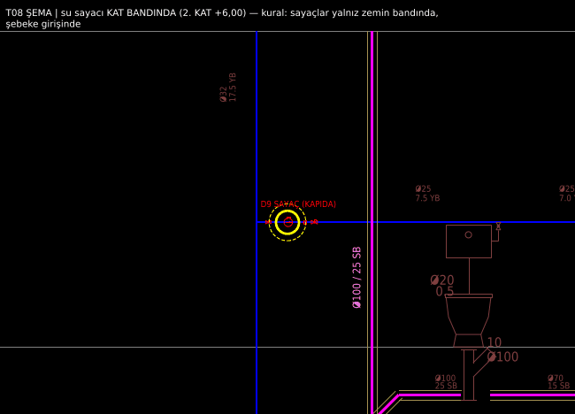
- **FAIL** [ŞEMA]: su sayacı daire bloğu içinde / kapı önünde (x=19162) — kural: sayaç grubu zemin bandının SOLUNDA, şebeke girişinde @ (19162, 800)
- **FAIL** [ŞEMA]: su sayacı KAT BANDINDA (1. KAT +3,00) — kural: sayaçlar yalnız zemin bandında, şebeke girişinde @ (19162, 1130)
- **FAIL** [ŞEMA]: su sayacı KAT BANDINDA (2. KAT +6,00) — kural: sayaçlar yalnız zemin bandında, şebeke girişinde @ (19162, 1460)
- **FAIL** [ŞEMA]: su sayacı daire bloğu içinde / kapı önünde (x=21962) — kural: sayaç grubu zemin bandının SOLUNDA, şebeke girişinde @ (21962, 800)
- **FAIL** [ŞEMA]: su sayacı KAT BANDINDA (1. KAT +3,00) — kural: sayaçlar yalnız zemin bandında, şebeke girişinde @ (21962, 1130)
- **FAIL** [ŞEMA]: su sayacı KAT BANDINDA (2. KAT +6,00) — kural: sayaçlar yalnız zemin bandında, şebeke girişinde @ (21962, 1460)
- **FAIL** [ŞEMA]: şemada "D1 SAYAÇ (KAPIDA)" yazısı: kapıda sayaç kurgusu reddedildi @ (15524, 816)
- **FAIL** [ŞEMA]: şemada "D6 SAYAÇ (KAPIDA)" yazısı: kapıda sayaç kurgusu reddedildi @ (15524, 1146)
- **FAIL** [ŞEMA]: şemada "D9 SAYAÇ (KAPIDA)" yazısı: kapıda sayaç kurgusu reddedildi @ (15524, 1476)
- **FAIL** [ŞEMA]: şemada "D2 SAYAÇ (KAPIDA)" yazısı: kapıda sayaç kurgusu reddedildi @ (19134, 816)
- **FAIL** [ŞEMA]: şemada "D4 SAYAÇ (KAPIDA)" yazısı: kapıda sayaç kurgusu reddedildi @ (19134, 1146)
- **FAIL** [ŞEMA]: şemada "D7 SAYAÇ (KAPIDA)" yazısı: kapıda sayaç kurgusu reddedildi @ (19134, 1476)
- **FAIL** [ŞEMA]: şemada "D3 SAYAÇ (KAPIDA)" yazısı: kapıda sayaç kurgusu reddedildi @ (21934, 816)
- **FAIL** [ŞEMA]: şemada "D5 SAYAÇ (KAPIDA)" yazısı: kapıda sayaç kurgusu reddedildi @ (21934, 1146)
- **FAIL** [ŞEMA]: şemada "D8 SAYAÇ (KAPIDA)" yazısı: kapıda sayaç kurgusu reddedildi @ (21934, 1476)

### T09 — Islak hacim başına yer süzgeci = 1

- **FAIL** [Z]: duş: yer süzgeci 0 (her ıslak hacimde tam 1) @ (7959, 2047)  
  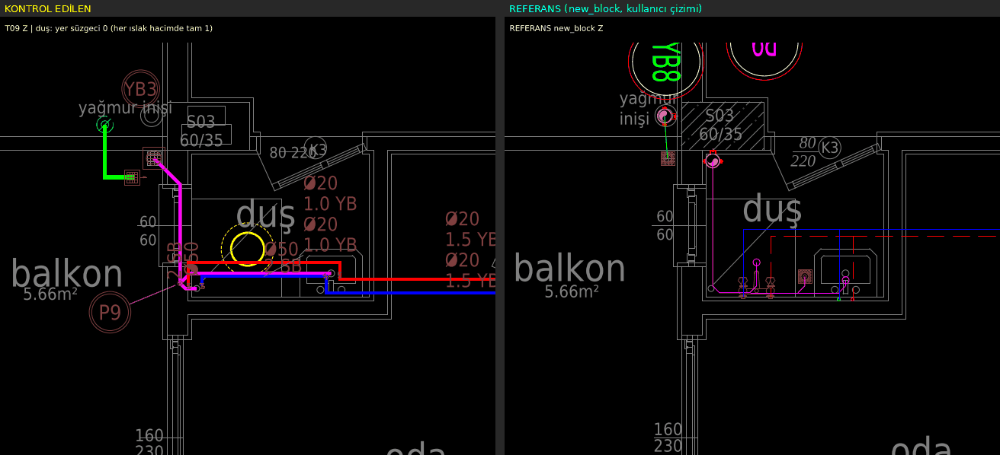
- **FAIL** [1]: wc-duş: yer süzgeci 0 (her ıslak hacimde tam 1) @ (10525, 2060)  
  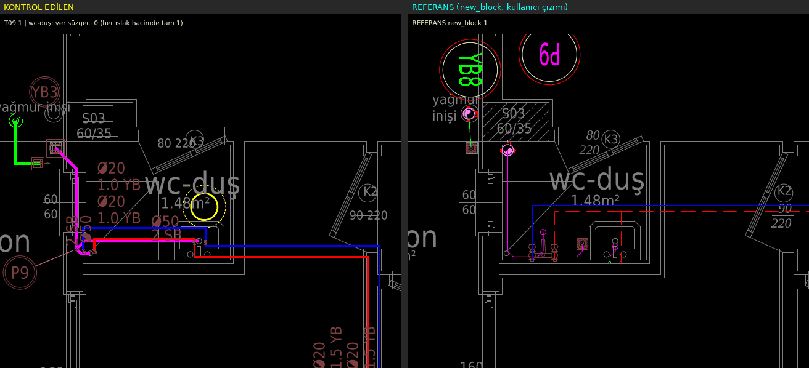
- **FAIL** [2]: duş: yer süzgeci 0 (her ıslak hacimde tam 1) @ (12999, 2055)  
  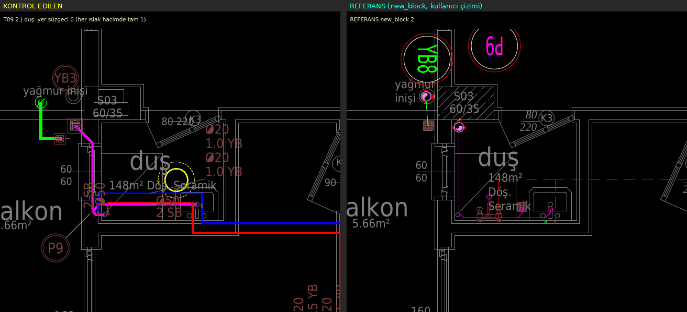

### T10 — Pis su kolonu ıslak hacim köşesinde (betonarme dışında)

- **FAIL** [Z]: kolon P1 ıslak hacim dışında (ortak alan / dış) — kural: kolon ıslak hacmin köşesinde @ (8733, 569)  
  
- **FAIL** [Z]: kolon P1 ıslak hacim dışında (ortak alan / dış) — kural: kolon ıslak hacmin köşesinde @ (8687, 569)  
  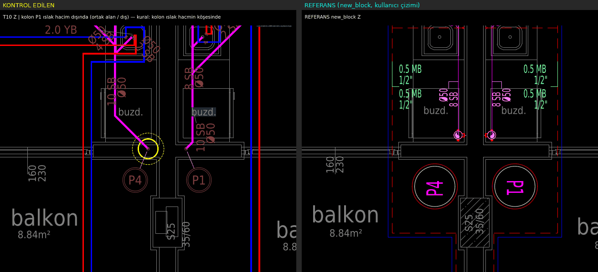
- **FAIL** [Z]: kolon P7 ıslak hacim dışında (ortak alan / dış) — kural: kolon ıslak hacmin köşesinde @ (8897, 2453)
- **FAIL** [1]: kolon P1 ıslak hacim dışında (ortak alan / dış) — kural: kolon ıslak hacmin köşesinde @ (11233, 569)  
  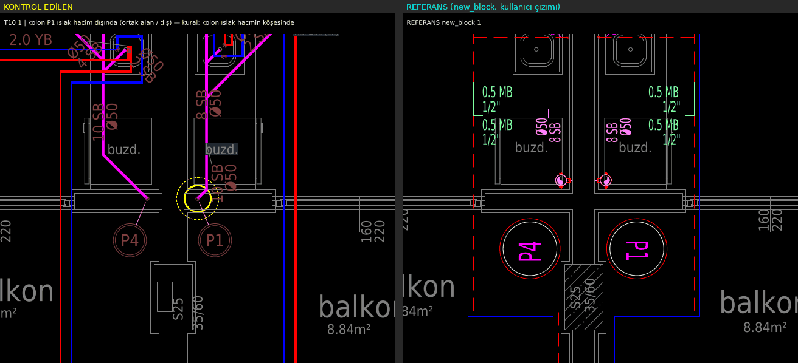
- **FAIL** [1]: kolon P1 ıslak hacim dışında (ortak alan / dış) — kural: kolon ıslak hacmin köşesinde @ (11187, 569)  
  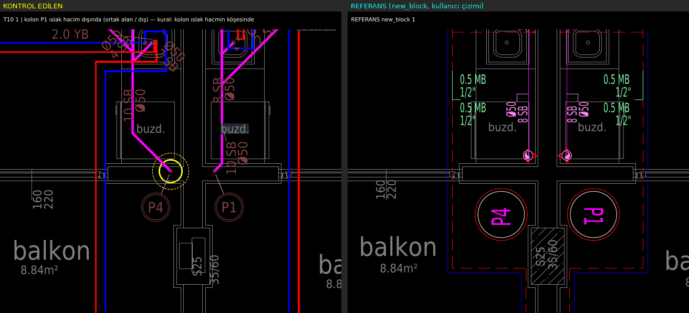
- **FAIL** [1]: kolon P7 ıslak hacim dışında (ortak alan / dış) — kural: kolon ıslak hacmin köşesinde @ (11397, 2453)
- **FAIL** [1]: kolon P9 ıslak hacim dışında (oda) — kural: kolon ıslak hacmin köşesinde @ (10410, 2022)
- **FAIL** [2]: kolon P1 ıslak hacim dışında (ortak alan / dış) — kural: kolon ıslak hacmin köşesinde @ (13733, 569)  
  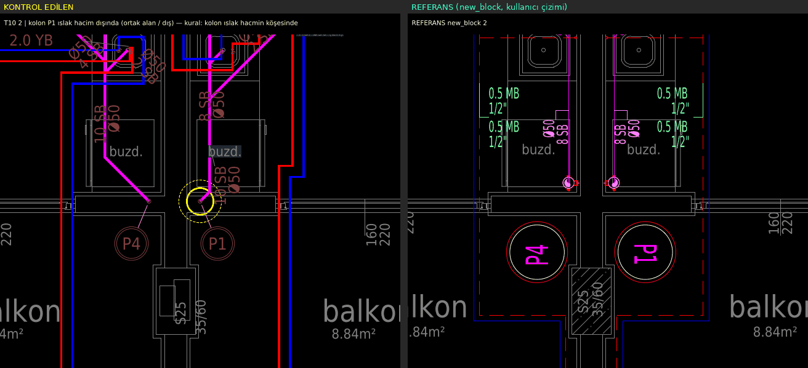
- **FAIL** [2]: kolon P1 ıslak hacim dışında (ortak alan / dış) — kural: kolon ıslak hacmin köşesinde @ (13687, 569)  
  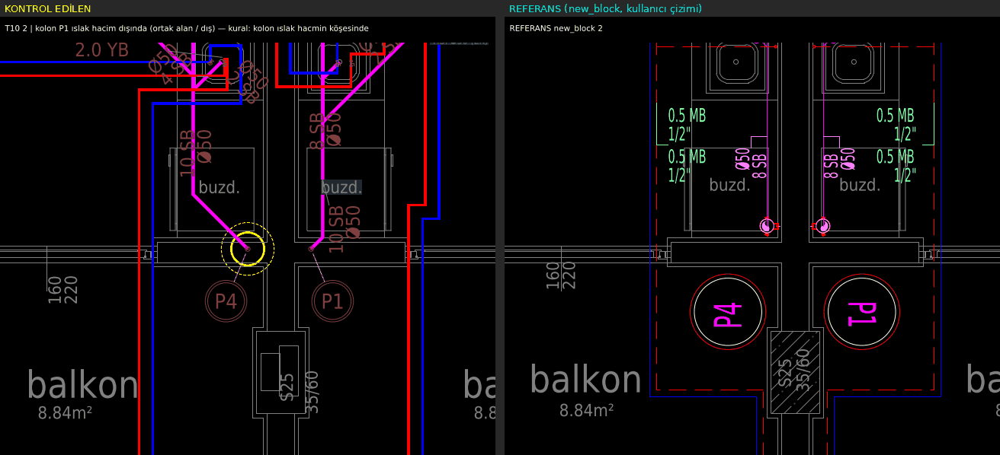
- **FAIL** [2]: kolon P7 ıslak hacim dışında (ortak alan / dış) — kural: kolon ıslak hacmin köşesinde @ (13897, 2453)

### T11 — denetle.py: MTY 0, ROTAS- öneki, köprü 0, kesişme 0, elektrik 0, yazı çakışması 0, lejant, audit

- **PASS**: MTY 0, önek 0, köprü 0, kesişme 0, elektrik 0, yazı 0, lejant var, audit 0
- **INFO**: pis su – temiz su üst üste geçiş (farklı düzlem, bilgi): 80

## Genel görünümler

- KAT Z: 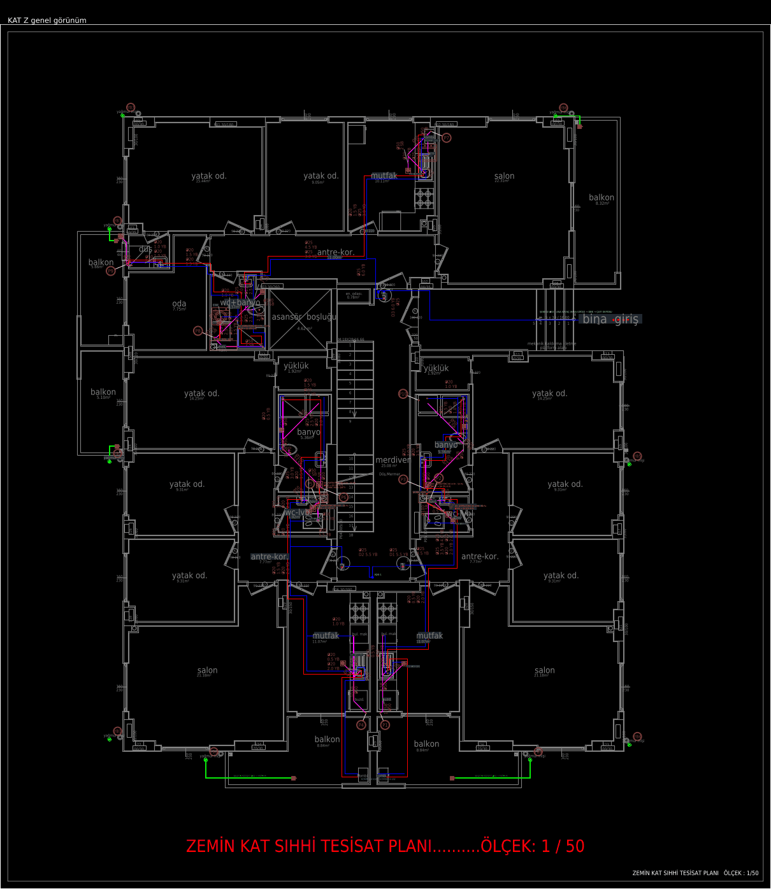
- KAT 1: 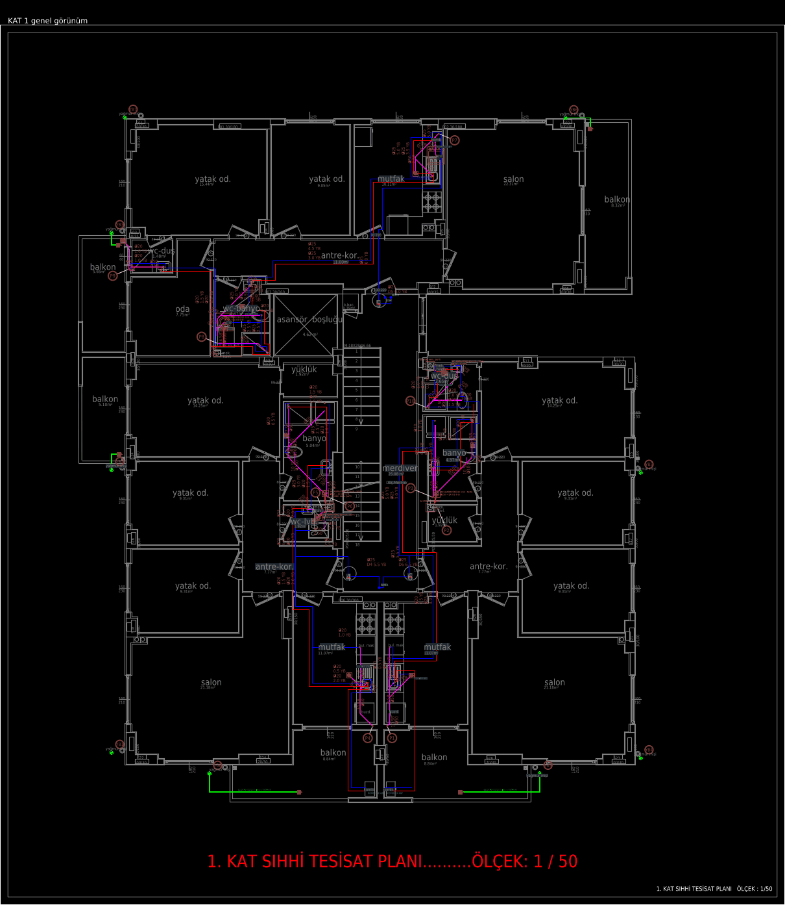
- KAT 2: 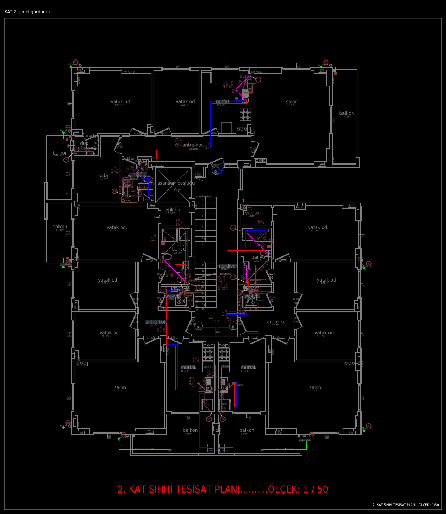
- ŞEMA: 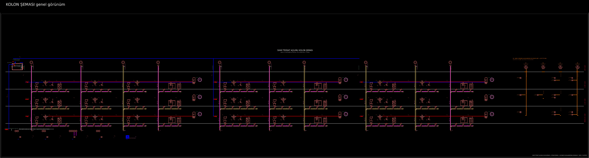

## Eşikler

- T01 balkon süzgeci–iniş hat boyu ≤ 300 cm; süzgecin bağlı olduğu ağda pis su katmanı/kolonu varsa FAIL.
- T02 armatür→kolon branşman yolu ≤ 300 cm; parça açıları {0,45,90} ± 4°; yol armatür mahalli + kolon mahalli (duvar payı 30 cm) dışına > 40 cm çıkarsa FAIL; WC/LV/DUŞ/EVİYE 50 cm içinde hat yoksa FAIL.
- T03 mahal poligonunun 30 cm içeri çekilmiş bölgesinde ≥ 30 cm pis su hattı → FAIL.
- T04 sıcak su bağlı ağı en çok örtüştüğü daire poligonu (mahaller + 20 cm duvar payı) dışında > 15 cm → FAIL; kombiye 80 cm içinde başlamıyorsa FAIL.
- T05 sıcak parçası (≥ 60 cm) boyunca soğuğa mesafe 3–30 cm olan örnek oranı ≥ %80; ofset std ≤ 6.0 cm; sıcak–soğuk kesişme (uçtan 15 cm dışı) FAIL.
- T06 koridor (antre-kor. / merdiven / hol) içindeki temiz su parçası: duvara mesafe / koridor genişliği < 0.25 → FAIL.
- T07 yazı kutuları ezdxf yazı tipi ölçüsüyle; herhangi örtüşme (> 0,2 cm²) FAIL; hat yazı kutusundan ≥ 3 cm geçiyorsa FAIL; çap etiketi yüksekliği ortanca 8–12.
- T08 sayaç sembolü y ≥ 1. kat bandı çizgisi → FAIL; x daire bloklarının (D1..) solunda değilse FAIL; "SAYAÇ (KAPIDA)" yazısı FAIL.
- T09 ıslak mahal poligonunda süzgeç sembolü (çizim + mimari ızgara, 15 cm kümeli) sayısı ≠ 1 → FAIL.
- T10 kolon sembolü ıslak mahal (20 cm pay) dışında / betonarme içinde / en yakın köşeye > 45 cm → FAIL.
- T11 `motor/deneme/denetim/denetle.py` ile aynı sayılar.
