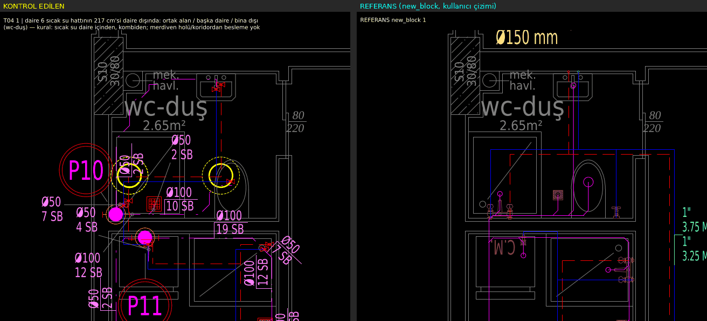
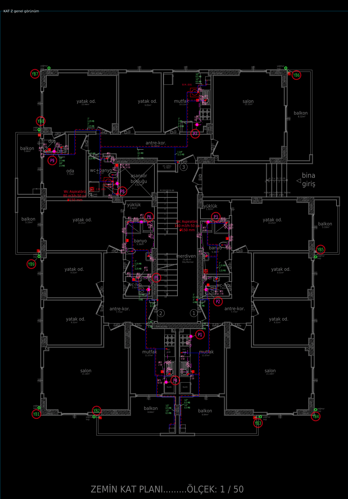
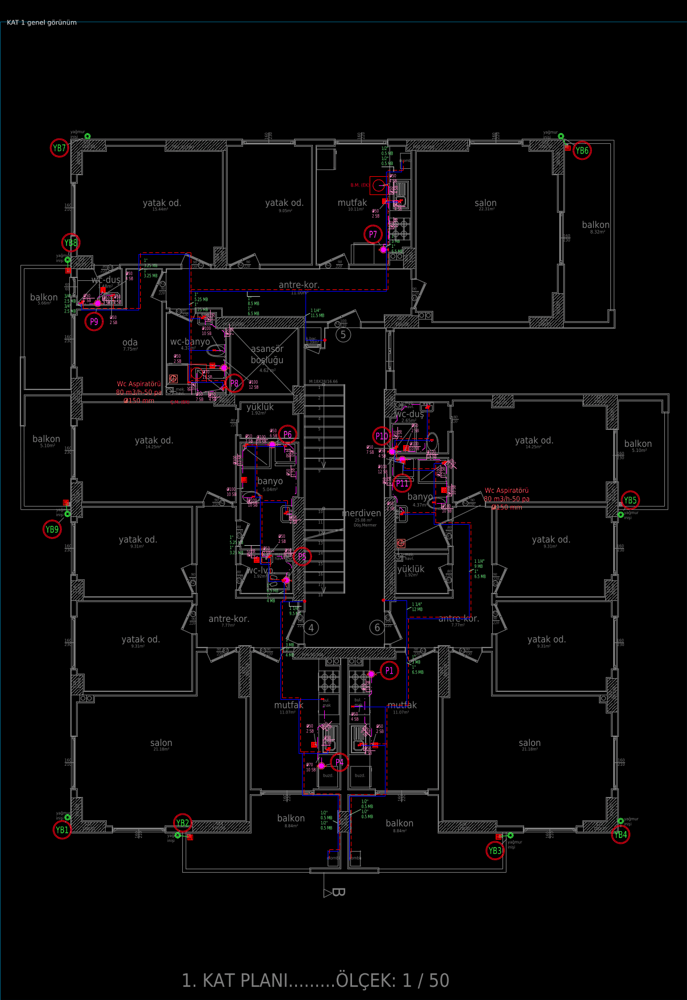
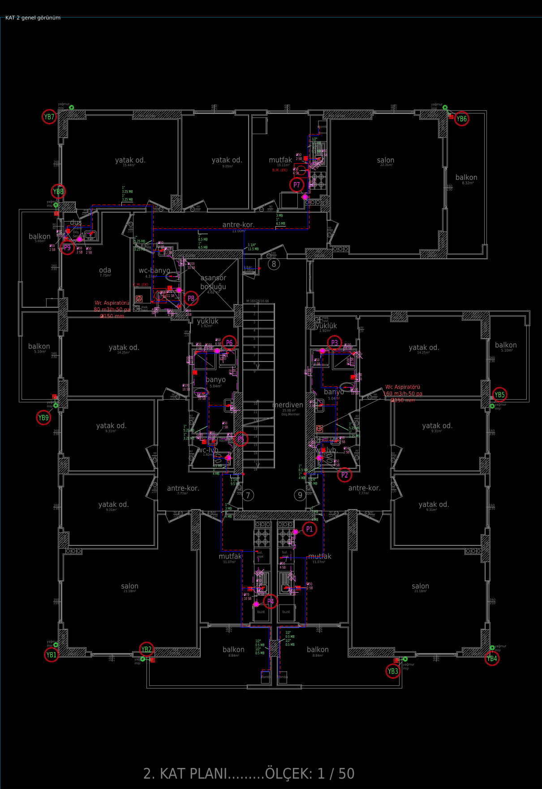
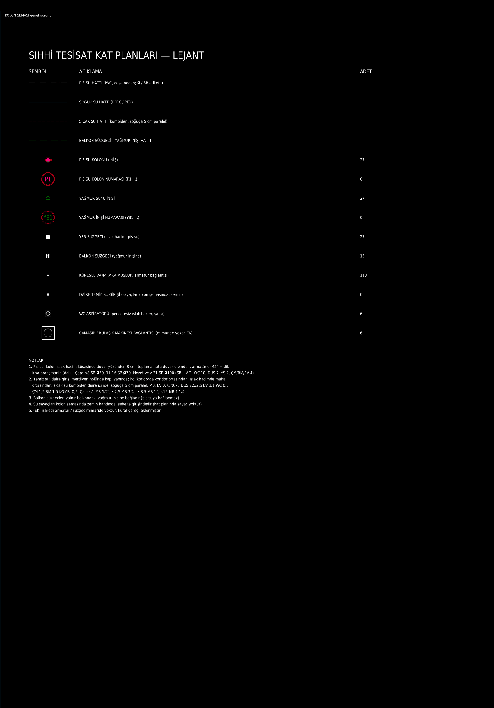

# KONTROLÖR RAPORU — NB_SIHHI_KAT_PLANLARI.dxf

Üretildi: 15.10.2026 01:46 — `python3 motor/kontrolor/kontrolor.py proje/denemeler/sihhi2/NB_SIHHI_KAT_PLANLARI.dxf --mimari ornekler/new_block.dxf.xz --rapor /tmp/claude-0/k1/rapor.md`

## SONUÇ: **RED — 1 madde**

Düzeltme listesi (üreten ajana geri):
1. [T04 1] daire 6 sıcak su hattının 217 cm'si daire dışında: ortak alan / başka daire / bina dışı (wc-duş) — kural: sıcak su daire içinden, kombiden; merdiven holü/koridordan besleme yok @ (255756, -442384)

## Özet

| Test | Ne ölçer | Sonuç | FAIL | INFO | Referans new_block FAIL/INFO (aynı ölçüm) |
|---|---|---|---|---|---|
| T01 | Balkon süzgeci bağlantı hedefi (yağmur inişi, kısa hat; pis su kolonuna ASLA) | ✓ PASS | 0 | 0 | 0 / 0 |
| T02 | Pis su branşmanı: uzunluk ≤ 300 cm, açı {0,45,90}, mahal dışından dolaşmaz, her armatür bağlı | ✓ PASS | 0 | 0 | 59 / 3 |
| T03 | Oda içi çapraz pis su hattı (duvardan > 30 cm iç bölge) | ✓ PASS | 0 | 1 | 0 / 21 |
| T04 | Sıcak su daire dışı uzunluk = 0, kombiden başlar | ✗ FAIL | 1 | 0 | 1 / 0 |
| T05 | Sıcak–soğuk paralellik (sabit ofset) ve kesişme | ✓ PASS | 0 | 0 | 0 / 6 |
| T06 | Koridor hatları koridor ortasında | bilgi | 0 | 31 | 0 / 39 |
| T07 | Etiket–etiket / etiket–mimari yazı / etiket–hat çakışması, etiket boyu | ✓ PASS | 0 | 0 | 175 / 3 |
| T08 | Kolon şeması: sayaçlar zemin bandında, şebeke girişinde (solda); kat bantlarında sayaç yok | bilgi | 0 | 1 | 0 / 1 |
| T09 | Islak hacim başına yer süzgeci = 1 | ✓ PASS | 0 | 0 | 16 / 0 |
| T10 | Pis su kolonu ıslak hacim köşesinde (betonarme dışında) | ✓ PASS | 0 | 0 | 0 / 3 |
| T11 | denetle.py: MTY 0, ROTAS- öneki, köprü 0, kesişme 0, elektrik 0, yazı çakışması 0, lejant, audit | ✓ PASS | 0 | 1 | 34 / 1 |

Referans sütunu: kullanıcının kendi `new_block.dxf` çizimi aynı testlerden geçirildiğinde çıkan sayılar (14.10.2026). Referansın kendisinde de görülen türden bulgular (ör. T07 etiket-hat, T02 serbest açı) tarz farkı değil kural C ihlali olarak listelenir; T11 MTY sayıları referans için beklenen durumdur.

## Dosya ve mimari eşleme

- dosya: proje/denemeler/sihhi2/NB_SIHHI_KAT_PLANLARI.dxf — çerçeve 4, kat paftası ['1', '2', 'Z'], şema paftası var
- mimari kaynak: ornekler/new_block.dxf.xz (30942 kayıt)
- kat Z: öteleme (0.0, 0.0) 260 yazı eşleşmesi; mahal 32 (ıslak 9, ortak 2, balkon 4), daire [1, 2, 3], armatür 29, betonarme 32 — 3.0 s
- kat 1: öteleme (0.0, 0.0) 255 yazı eşleşmesi; mahal 32 (ıslak 9, ortak 2, balkon 4), daire [4, 5, 6], armatür 29, betonarme 32 — 2.7 s
- kat 2: öteleme (0.0, 0.0) 255 yazı eşleşmesi; mahal 32 (ıslak 9, ortak 2, balkon 4), daire [7, 8, 9], armatür 28, betonarme 32 — 2.5 s

Süre 56 s.

## Ayrıntı (koordinatlar çizim birimi, cm)

### T01 — Balkon süzgeci bağlantı hedefi (yağmur inişi, kısa hat; pis su kolonuna ASLA)

- **PASS** [Z]: 4 balkon süzgeci yağmur inişine kısa hatla bağlı
- **PASS** [1]: 4 balkon süzgeci yağmur inişine kısa hatla bağlı
- **PASS** [2]: 4 balkon süzgeci yağmur inişine kısa hatla bağlı

### T02 — Pis su branşmanı: uzunluk ≤ 300 cm, açı {0,45,90}, mahal dışından dolaşmaz, her armatür bağlı

- **PASS** [Z]: 18 armatür branşmanı kısa/düz, açılar {0,45,90}
- **PASS** [1]: 19 armatür branşmanı kısa/düz, açılar {0,45,90}
- **PASS** [2]: 19 armatür branşmanı kısa/düz, açılar {0,45,90}

### T03 — Oda içi çapraz pis su hattı (duvardan > 30 cm iç bölge)

- **PASS** [Z]: pis su hatları duvar dibinden (iç bölgeden ≥ 100 cm geçen parça yok)
- **PASS** [1]: pis su hatları duvar dibinden (iç bölgeden ≥ 100 cm geçen parça yok)
- **INFO** [1]: pis su hattı wc-duş içinden, duvardan > 30 cm uzakta 32 cm geçiyor (kısa çapraz, bilgi) @ (255846, -442394)
- **PASS** [2]: pis su hatları duvar dibinden (iç bölgeden ≥ 100 cm geçen parça yok)

### T04 — Sıcak su daire dışı uzunluk = 0, kombiden başlar

- **PASS** [Z]: 3 sıcak su ağı daire içinde, kombiden
- **FAIL** [1]: daire 6 sıcak su hattının 217 cm'si daire dışında: ortak alan / başka daire / bina dışı (wc-duş) — kural: sıcak su daire içinden, kombiden; merdiven holü/koridordan besleme yok @ (255756, -442384)  
  
- **PASS** [2]: 3 sıcak su ağı daire içinde, kombiden

### T05 — Sıcak–soğuk paralellik (sabit ofset) ve kesişme

- **PASS** [Z]: 38 sıcak parçası soğukla sabit ofsetli paralel, kesişme yok
- **PASS** [1]: 37 sıcak parçası soğukla sabit ofsetli paralel, kesişme yok
- **PASS** [2]: 37 sıcak parçası soğukla sabit ofsetli paralel, kesişme yok

### T06 — Koridor hatları koridor ortasında

- **INFO** [Z]: 5 koridor parçası ortada, 10 duvar dibinde (BİLGİ: kullanıcının kendi new_block çiziminde antre hatları duvar dibinde; B kuralı koridor ortası — karar kullanıcıda)
- **INFO** [Z]: antre-kor. içinde temiz su hattı duvar dibinde: duvara 68 cm, koridor 314 cm (ROTAS-SIHHI-SOGUK-SU) — kural: koridorda hatlar ORTADAN @ (253376, -442936)
- **INFO** [Z]: antre-kor. içinde temiz su hattı duvar dibinde: duvara 63 cm, koridor 314 cm (ROTAS-SIHHI-SICAK-SU) — kural: koridorda hatlar ORTADAN @ (253381, -442932)
- **INFO** [Z]: antre-kor. içinde temiz su hattı duvar dibinde: duvara 75 cm, koridor 734 cm (ROTAS-SIHHI-SOGUK-SU) — kural: koridorda hatlar ORTADAN @ (253105, -441994)
- **INFO** [Z]: antre-kor. içinde temiz su hattı duvar dibinde: duvara 65 cm, koridor 724 cm (ROTAS-SIHHI-SOGUK-SU) — kural: koridorda hatlar ORTADAN @ (253105, -441922)
- **INFO** [Z]: antre-kor. içinde temiz su hattı duvar dibinde: duvara 144 cm, koridor 724 cm (ROTAS-SIHHI-SOGUK-SU) — kural: koridorda hatlar ORTADAN @ (253620, -441924)
- **INFO** [Z]: antre-kor. içinde temiz su hattı duvar dibinde: duvara 80 cm, koridor 734 cm (ROTAS-SIHHI-SICAK-SU) — kural: koridorda hatlar ORTADAN @ (253110, -441989)
- **INFO** [Z]: antre-kor. içinde temiz su hattı duvar dibinde: duvara 70 cm, koridor 724 cm (ROTAS-SIHHI-SICAK-SU) — kural: koridorda hatlar ORTADAN @ (253110, -441919)
- **INFO** [Z]: antre-kor. içinde temiz su hattı duvar dibinde: duvara 139 cm, koridor 724 cm (ROTAS-SIHHI-SICAK-SU) — kural: koridorda hatlar ORTADAN @ (253625, -441921)
- **INFO** [Z]: antre-kor. içinde temiz su hattı duvar dibinde: duvara 61 cm, koridor 314 cm (ROTAS-SIHHI-SOGUK-SU) — kural: koridorda hatlar ORTADAN @ (253751, -442934)
- **INFO** [Z]: antre-kor. içinde temiz su hattı duvar dibinde: duvara 66 cm, koridor 314 cm (ROTAS-SIHHI-SICAK-SU) — kural: koridorda hatlar ORTADAN @ (253756, -442933)
- **INFO** [1]: 9 koridor parçası ortada, 9 duvar dibinde (BİLGİ: kullanıcının kendi new_block çiziminde antre hatları duvar dibinde; B kuralı koridor ortası — karar kullanıcıda)
- **INFO** [1]: antre-kor. içinde temiz su hattı duvar dibinde: duvara 68 cm, koridor 314 cm (ROTAS-SIHHI-SOGUK-SU) — kural: koridorda hatlar ORTADAN @ (255410, -442936)
- **INFO** [1]: antre-kor. içinde temiz su hattı duvar dibinde: duvara 63 cm, koridor 314 cm (ROTAS-SIHHI-SICAK-SU) — kural: koridorda hatlar ORTADAN @ (255415, -442932)
- **INFO** [1]: antre-kor. içinde temiz su hattı duvar dibinde: duvara 65 cm, koridor 724 cm (ROTAS-SIHHI-SOGUK-SU) — kural: koridorda hatlar ORTADAN @ (255139, -441916)
- **INFO** [1]: antre-kor. içinde temiz su hattı duvar dibinde: duvara 75 cm, koridor 734 cm (ROTAS-SIHHI-SOGUK-SU) — kural: koridorda hatlar ORTADAN @ (255139, -441989)
- **INFO** [1]: antre-kor. içinde temiz su hattı duvar dibinde: duvara 74 cm, koridor 724 cm (ROTAS-SIHHI-SOGUK-SU) — kural: koridorda hatlar ORTADAN @ (255724, -441918)
- **INFO** [1]: antre-kor. içinde temiz su hattı duvar dibinde: duvara 70 cm, koridor 724 cm (ROTAS-SIHHI-SICAK-SU) — kural: koridorda hatlar ORTADAN @ (255144, -441914)
- **INFO** [1]: antre-kor. içinde temiz su hattı duvar dibinde: duvara 80 cm, koridor 734 cm (ROTAS-SIHHI-SICAK-SU) — kural: koridorda hatlar ORTADAN @ (255144, -441984)
- **INFO** [1]: antre-kor. içinde temiz su hattı duvar dibinde: duvara 61 cm, koridor 312 cm (ROTAS-SIHHI-SOGUK-SU) — kural: koridorda hatlar ORTADAN @ (255785, -442960)
- **INFO** [1]: antre-kor. içinde temiz su hattı duvar dibinde: duvara 66 cm, koridor 314 cm (ROTAS-SIHHI-SICAK-SU) — kural: koridorda hatlar ORTADAN @ (255790, -442960)
- **INFO** [2]: 5 koridor parçası ortada, 9 duvar dibinde (BİLGİ: kullanıcının kendi new_block çiziminde antre hatları duvar dibinde; B kuralı koridor ortası — karar kullanıcıda)
- **INFO** [2]: antre-kor. içinde temiz su hattı duvar dibinde: duvara 78 cm, koridor 314 cm (ROTAS-SIHHI-SOGUK-SU) — kural: koridorda hatlar ORTADAN @ (257448, -442936)
- **INFO** [2]: antre-kor. içinde temiz su hattı duvar dibinde: duvara 73 cm, koridor 314 cm (ROTAS-SIHHI-SICAK-SU) — kural: koridorda hatlar ORTADAN @ (257453, -442933)
- **INFO** [2]: antre-kor. içinde temiz su hattı duvar dibinde: duvara 67 cm, koridor 736 cm (ROTAS-SIHHI-SOGUK-SU) — kural: koridorda hatlar ORTADAN @ (257189, -441916)
- **INFO** [2]: antre-kor. içinde temiz su hattı duvar dibinde: duvara 77 cm, koridor 744 cm (ROTAS-SIHHI-SOGUK-SU) — kural: koridorda hatlar ORTADAN @ (257189, -441989)
- **INFO** [2]: antre-kor. içinde temiz su hattı duvar dibinde: duvara 94 cm, koridor 746 cm (ROTAS-SIHHI-SOGUK-SU) — kural: koridorda hatlar ORTADAN @ (257774, -441918)
- **INFO** [2]: antre-kor. içinde temiz su hattı duvar dibinde: duvara 72 cm, koridor 736 cm (ROTAS-SIHHI-SICAK-SU) — kural: koridorda hatlar ORTADAN @ (257194, -441914)
- **INFO** [2]: antre-kor. içinde temiz su hattı duvar dibinde: duvara 82 cm, koridor 746 cm (ROTAS-SIHHI-SICAK-SU) — kural: koridorda hatlar ORTADAN @ (257194, -441984)
- **INFO** [2]: antre-kor. içinde temiz su hattı duvar dibinde: duvara 58 cm, koridor 314 cm (ROTAS-SIHHI-SOGUK-SU) — kural: koridorda hatlar ORTADAN @ (257830, -442933)
- **INFO** [2]: antre-kor. içinde temiz su hattı duvar dibinde: duvara 63 cm, koridor 314 cm (ROTAS-SIHHI-SICAK-SU) — kural: koridorda hatlar ORTADAN @ (257835, -442933)

### T07 — Etiket–etiket / etiket–mimari yazı / etiket–hat çakışması, etiket boyu

- **PASS** [Z]: etiket-etiket 0, etiket-mimari yazı 0, etiket-hat 0 (toplam 184 etiket)
- **PASS** [1]: etiket-etiket 0, etiket-mimari yazı 0, etiket-hat 0 (toplam 188 etiket)
- **PASS** [2]: etiket-etiket 0, etiket-mimari yazı 0, etiket-hat 0 (toplam 186 etiket)

### T08 — Kolon şeması: sayaçlar zemin bandında, şebeke girişinde (solda); kat bantlarında sayaç yok

- **INFO** [ŞEMA]: şemada ZEMİN KAT bandı yazısı yok; sayaç bandı ölçülemedi

### T09 — Islak hacim başına yer süzgeci = 1

- **PASS** [Z]: 9 ıslak hacimde 1 süzgeç
- **PASS** [1]: 9 ıslak hacimde 1 süzgeç
- **PASS** [2]: 9 ıslak hacimde 1 süzgeç

### T10 — Pis su kolonu ıslak hacim köşesinde (betonarme dışında)

- **PASS** [Z]: 9 kolon ıslak hacim köşesinde
- **PASS** [1]: 9 kolon ıslak hacim köşesinde
- **PASS** [2]: 9 kolon ıslak hacim köşesinde

### T11 — denetle.py: MTY 0, ROTAS- öneki, köprü 0, kesişme 0, elektrik 0, yazı çakışması 0, lejant, audit

- **PASS**: MTY 0, önek 0, köprü 0, kesişme 0, elektrik 0, yazı 0, lejant var, audit 0
- **INFO**: pis su – temiz su üst üste geçiş (farklı düzlem, bilgi): 20

## Genel görünümler

- KAT Z: 
- KAT 1: 
- KAT 2: 
- ŞEMA: 

## Eşikler

- T01 balkon süzgeci–iniş hat boyu ≤ 300 cm; süzgecin bağlı olduğu ağda pis su katmanı/kolonu varsa FAIL.
- T02 armatür→kolon branşman yolu ≤ 300 cm; parça açıları {0,45,90} ± 4°; yol armatür mahalli + kolon mahalli (duvar payı 30 cm) dışına > 40 cm çıkarsa FAIL; WC/LV/DUŞ/EVİYE 50 cm içinde hat yoksa FAIL.
- T03 mahal poligonunun 30 cm içeri çekilmiş bölgesinde ≥ 30 cm pis su hattı → FAIL.
- T04 sıcak su bağlı ağı en çok örtüştüğü daire poligonu (mahaller + 20 cm duvar payı) dışında > 15 cm → FAIL; kombiye 80 cm içinde başlamıyorsa FAIL.
- T05 sıcak parçası (≥ 60 cm) boyunca soğuğa mesafe 3–30 cm olan örnek oranı ≥ %80; ofset std ≤ 6.0 cm; sıcak–soğuk kesişme (uçtan 15 cm dışı) FAIL.
- T06 koridor (antre-kor. / merdiven / hol) içindeki temiz su parçası: duvara mesafe / koridor genişliği < 0.25 → FAIL.
- T07 yazı kutuları ezdxf yazı tipi ölçüsüyle; herhangi örtüşme (> 0,2 cm²) FAIL; hat yazı kutusundan ≥ 3 cm geçiyorsa FAIL; çap etiketi yüksekliği ortanca 8–12.
- T08 sayaç sembolü y ≥ 1. kat bandı çizgisi → FAIL; x daire bloklarının (D1..) solunda değilse FAIL; "SAYAÇ (KAPIDA)" yazısı FAIL.
- T09 ıslak mahal poligonunda süzgeç sembolü (çizim + mimari ızgara, 15 cm kümeli) sayısı ≠ 1 → FAIL.
- T10 kolon sembolü ıslak mahal (20 cm pay) dışında / betonarme içinde / en yakın köşeye > 45 cm → FAIL.
- T11 `motor/deneme/denetim/denetle.py` ile aynı sayılar.
