# KONTROLÖR RAPORU — NB_SIHHI_SEMA.dxf

Üretildi: 15.10.2026 02:01 — `python3 motor/kontrolor/kontrolor.py proje/denemeler/sihhi2/NB_SIHHI_SEMA.dxf --mimari ornekler/new_block.dxf.xz --rapor /tmp/kt/k/K_NB_SIHHI_SEMA.md`

## SONUÇ: **RED — 20 madde**

Düzeltme listesi (üreten ajana geri):
1. [T09 Z] wc-lvb.: yer süzgeci 0 (her ıslak hacimde tam 1) @ (253341, -442786)
2. [T09 Z] duş: yer süzgeci 0 (her ıslak hacimde tam 1) @ (252807, -441953)
3. [T09 Z] mutfak: yer süzgeci 0 (her ıslak hacimde tam 1) @ (253581, -441683)
4. [T09 Z] mutfak: yer süzgeci 0 (her ıslak hacimde tam 1) @ (253724, -443208)
5. [T09 Z] mutfak: yer süzgeci 0 (her ıslak hacimde tam 1) @ (253389, -443230)
6. [T09 Z] wc-lvb.: yer süzgeci 0 (her ıslak hacimde tam 1) @ (253792, -442786)
   … T09 için toplam 20 bulgu (ayrıntı aşağıda)

## Özet

| Test | Ne ölçer | Sonuç | FAIL | INFO | Referans new_block FAIL/INFO (aynı ölçüm) |
|---|---|---|---|---|---|
| T01 | Balkon süzgeci bağlantı hedefi (yağmur inişi, kısa hat; pis su kolonuna ASLA) | ✓ PASS | 0 | 0 | 0 / 0 |
| T02 | Pis su branşmanı: uzunluk ≤ 300 cm, açı {0,45,90}, mahal dışından dolaşmaz, her armatür bağlı | bilgi | 0 | 3 | 59 / 3 |
| T03 | Oda içi çapraz pis su hattı (duvardan > 30 cm iç bölge) | ✓ PASS | 0 | 0 | 0 / 21 |
| T04 | Sıcak su daire dışı uzunluk = 0, kombiden başlar | bilgi | 0 | 3 | 1 / 0 |
| T05 | Sıcak–soğuk paralellik (sabit ofset) ve kesişme | bilgi | 0 | 3 | 0 / 6 |
| T06 | Koridor hatları koridor ortasında | ✓ PASS | 0 | 0 | 0 / 39 |
| T07 | Etiket–etiket / etiket–mimari yazı / etiket–hat çakışması, etiket boyu | bilgi | 0 | 3 | 175 / 3 |
| T08 | Kolon şeması: sayaçlar zemin bandında, şebeke girişinde (solda); kat bantlarında sayaç yok | ✓ PASS | 0 | 0 | 0 / 1 |
| T09 | Islak hacim başına yer süzgeci = 1 | ✗ FAIL | 20 | 0 | 16 / 0 |
| T10 | Pis su kolonu ıslak hacim köşesinde (betonarme dışında) | bilgi | 0 | 3 | 0 / 3 |
| T11 | denetle.py: MTY 0, ROTAS- öneki, köprü 0, kesişme 0, elektrik 0, yazı çakışması 0, lejant, audit | ✓ PASS | 0 | 1 | 34 / 1 |

Referans sütunu: kullanıcının kendi `new_block.dxf` çizimi aynı testlerden geçirildiğinde çıkan sayılar (14.10.2026). Referansın kendisinde de görülen türden bulgular (ör. T07 etiket-hat, T02 serbest açı) tarz farkı değil kural C ihlali olarak listelenir; T11 MTY sayıları referans için beklenen durumdur.

## Dosya ve mimari eşleme

- dosya: proje/denemeler/sihhi2/NB_SIHHI_SEMA.dxf — çerçeve 1, kat paftası [], şema paftası var
- mimari kaynak: ornekler/new_block.dxf.xz (30942 kayıt)
- kat paftası çerçevesi yok: kaynak kat pencereleri kullanıldı (öteleme 0)
- kat Z: öteleme (0.0, 0.0) 0 yazı eşleşmesi; mahal 32 (ıslak 9, ortak 2, balkon 4), daire [1, 2, 3], armatür 29, betonarme 32 — 2.9 s
- kat 1: öteleme (0.0, 0.0) 0 yazı eşleşmesi; mahal 32 (ıslak 9, ortak 2, balkon 4), daire [4, 5, 6], armatür 29, betonarme 32 — 2.6 s
- kat 2: öteleme (0.0, 0.0) 0 yazı eşleşmesi; mahal 32 (ıslak 9, ortak 2, balkon 4), daire [7, 8, 9], armatür 28, betonarme 32 — 2.4 s

Süre 57 s.

## Ayrıntı (koordinatlar çizim birimi, cm)

### T01 — Balkon süzgeci bağlantı hedefi (yağmur inişi, kısa hat; pis su kolonuna ASLA)

- **PASS** [Z]: 0 balkon süzgeci yağmur inişine kısa hatla bağlı
- **PASS** [1]: 0 balkon süzgeci yağmur inişine kısa hatla bağlı
- **PASS** [2]: 0 balkon süzgeci yağmur inişine kısa hatla bağlı

### T02 — Pis su branşmanı: uzunluk ≤ 300 cm, açı {0,45,90}, mahal dışından dolaşmaz, her armatür bağlı

- **INFO** [Z]: katta pis su hattı yok
- **INFO** [1]: katta pis su hattı yok
- **INFO** [2]: katta pis su hattı yok

### T03 — Oda içi çapraz pis su hattı (duvardan > 30 cm iç bölge)

- **PASS** [Z]: pis su hatları duvar dibinden (iç bölgeden ≥ 100 cm geçen parça yok)
- **PASS** [1]: pis su hatları duvar dibinden (iç bölgeden ≥ 100 cm geçen parça yok)
- **PASS** [2]: pis su hatları duvar dibinden (iç bölgeden ≥ 100 cm geçen parça yok)

### T04 — Sıcak su daire dışı uzunluk = 0, kombiden başlar

- **INFO** [Z]: katta sıcak su hattı yok
- **INFO** [1]: katta sıcak su hattı yok
- **INFO** [2]: katta sıcak su hattı yok

### T05 — Sıcak–soğuk paralellik (sabit ofset) ve kesişme

- **INFO** [Z]: sıcak (0) / soğuk (0) hat yok
- **INFO** [1]: sıcak (0) / soğuk (0) hat yok
- **INFO** [2]: sıcak (0) / soğuk (0) hat yok

### T06 — Koridor hatları koridor ortasında

- **PASS** [Z]: 0 koridor parçası ortada, 0 duvar dibinde (BİLGİ: kullanıcının kendi new_block çiziminde antre hatları duvar dibinde; B kuralı koridor ortası — karar kullanıcıda)
- **PASS** [1]: 0 koridor parçası ortada, 0 duvar dibinde (BİLGİ: kullanıcının kendi new_block çiziminde antre hatları duvar dibinde; B kuralı koridor ortası — karar kullanıcıda)
- **PASS** [2]: 0 koridor parçası ortada, 0 duvar dibinde (BİLGİ: kullanıcının kendi new_block çiziminde antre hatları duvar dibinde; B kuralı koridor ortası — karar kullanıcıda)

### T07 — Etiket–etiket / etiket–mimari yazı / etiket–hat çakışması, etiket boyu

- **INFO** [Z]: etiket yok
- **INFO** [1]: etiket yok
- **INFO** [2]: etiket yok

### T08 — Kolon şeması: sayaçlar zemin bandında, şebeke girişinde (solda); kat bantlarında sayaç yok

- **PASS** [ŞEMA]: 10 sayaç zemin bandında, şebeke girişinde; kat bantlarında sayaç yok

### T09 — Islak hacim başına yer süzgeci = 1

- **FAIL** [Z]: wc-lvb.: yer süzgeci 0 (her ıslak hacimde tam 1) @ (253341, -442786)  
  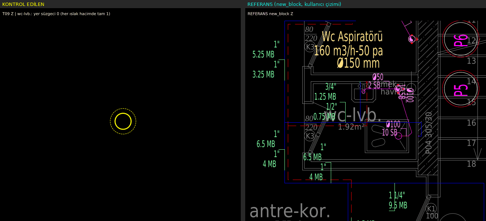
- **FAIL** [Z]: duş: yer süzgeci 0 (her ıslak hacimde tam 1) @ (252807, -441953)  
  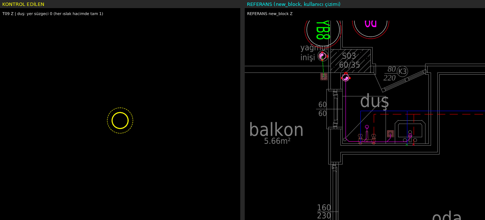
- **FAIL** [Z]: mutfak: yer süzgeci 0 (her ıslak hacimde tam 1) @ (253581, -441683)  
  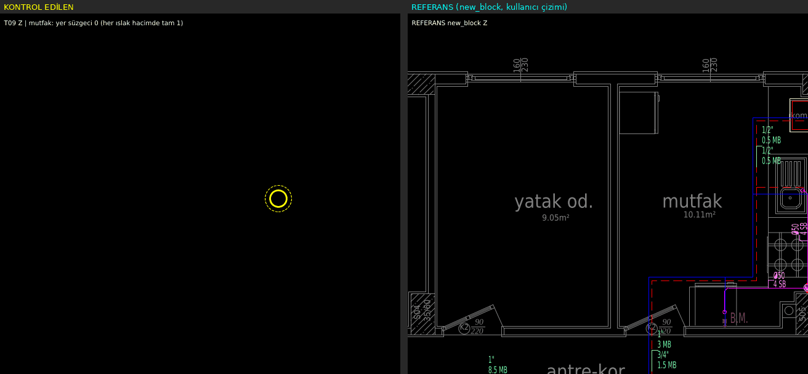
- **FAIL** [Z]: mutfak: yer süzgeci 0 (her ıslak hacimde tam 1) @ (253724, -443208)  
  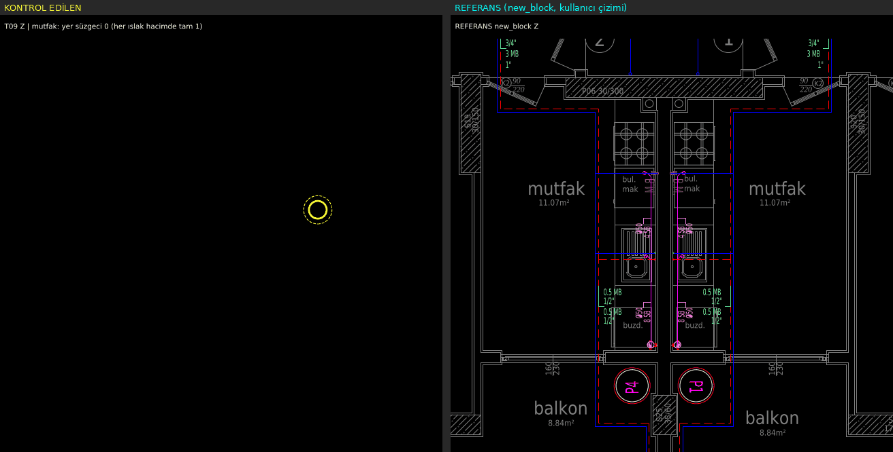
- **FAIL** [Z]: mutfak: yer süzgeci 0 (her ıslak hacimde tam 1) @ (253389, -443230)  
  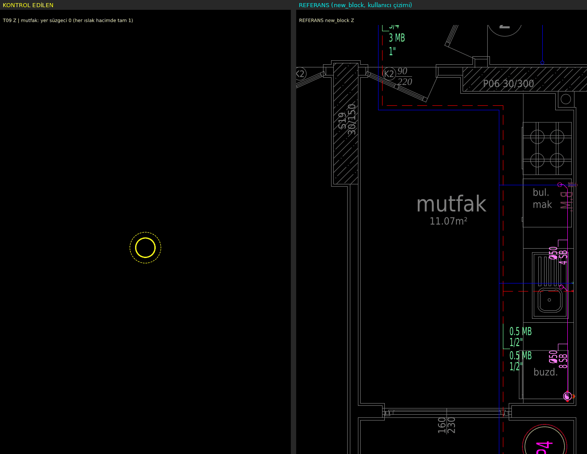
- **FAIL** [Z]: wc-lvb.: yer süzgeci 0 (her ıslak hacimde tam 1) @ (253792, -442786)  
  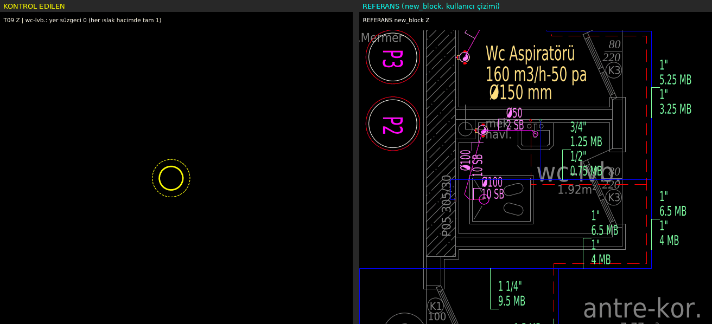
- **FAIL** [1]: wc-banyo: yer süzgeci 0 (her ıslak hacimde tam 1) @ (255155, -442115)  
  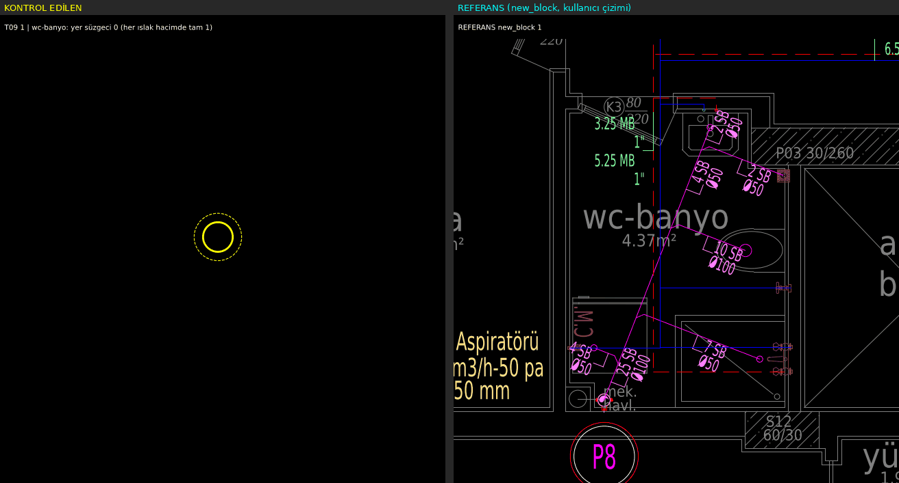
- **FAIL** [1]: mutfak: yer süzgeci 0 (her ıslak hacimde tam 1) @ (255615, -441683)  
  
- **FAIL** [1]: wc-duş: yer süzgeci 0 (her ıslak hacimde tam 1) @ (255821, -442360)  
  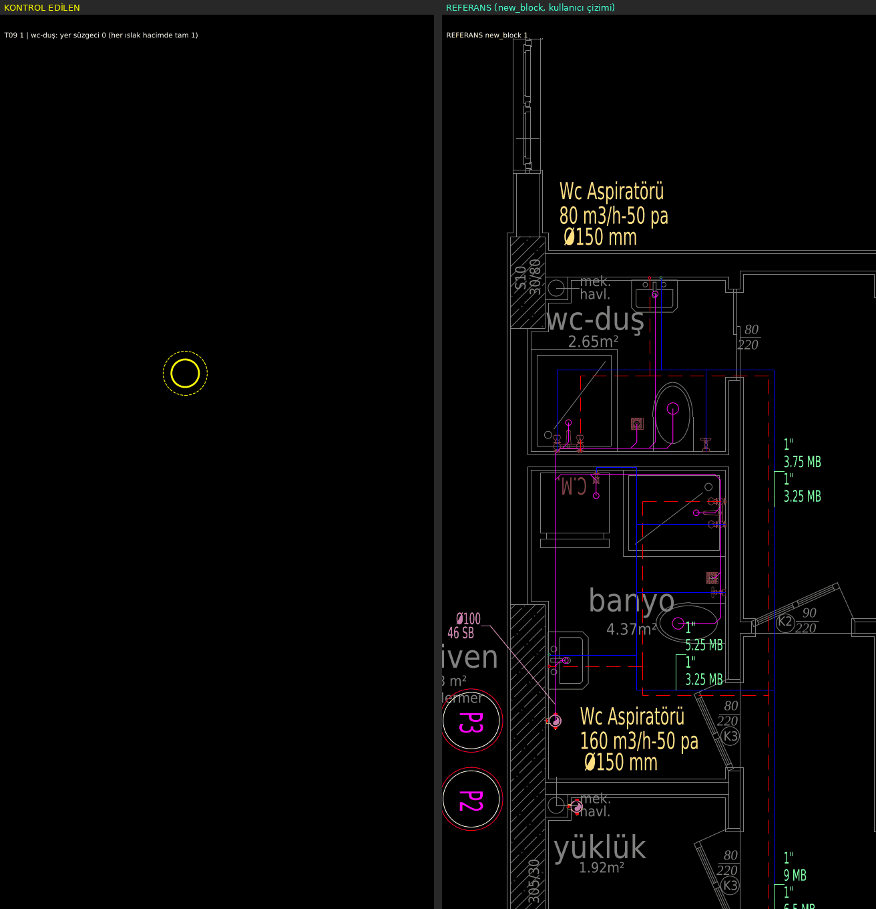
- **FAIL** [1]: mutfak: yer süzgeci 0 (her ıslak hacimde tam 1) @ (255758, -443208)  
  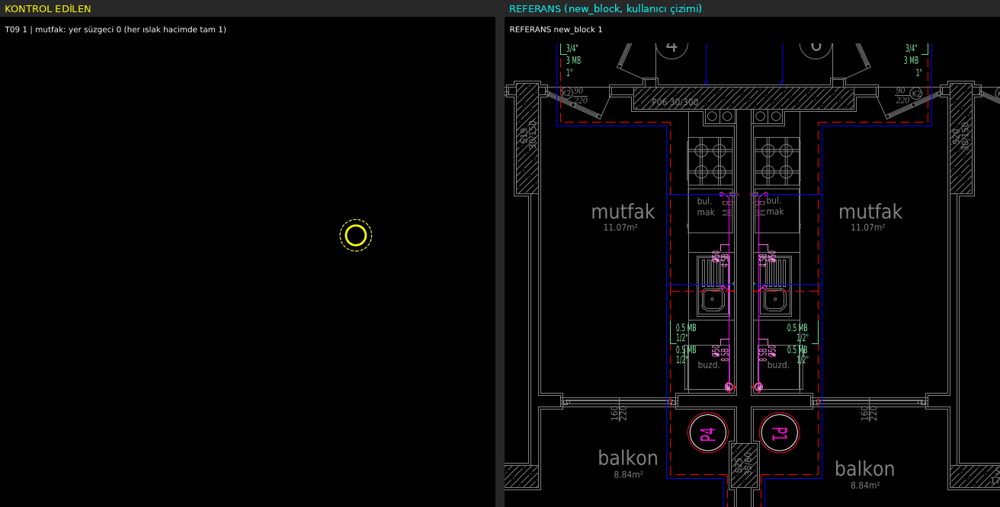
- **FAIL** [1]: wc-duş: yer süzgeci 0 (her ıslak hacimde tam 1) @ (254906, -441940)  
  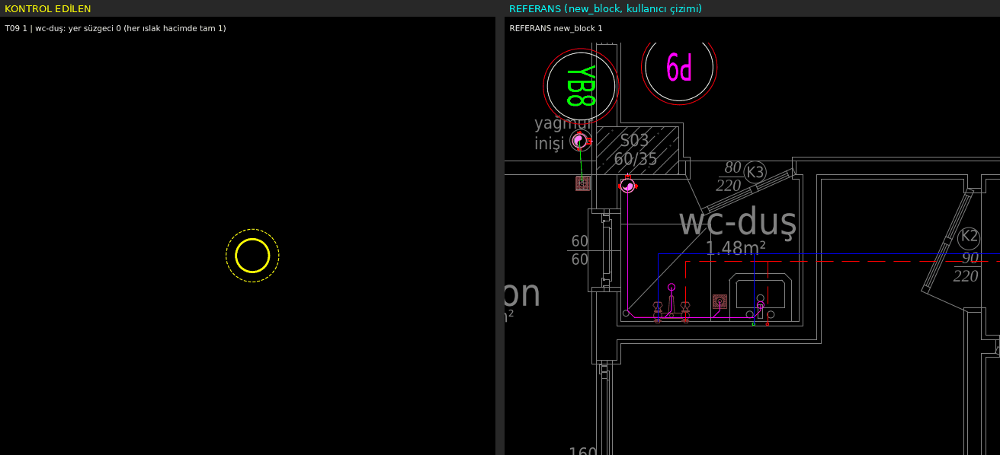
- **FAIL** [1]: mutfak: yer süzgeci 0 (her ıslak hacimde tam 1) @ (255423, -443230)  
  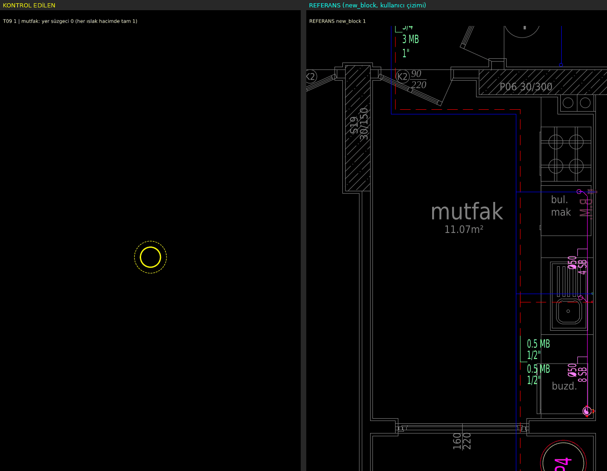
- **FAIL** [1]: wc-lvb.: yer süzgeci 0 (her ıslak hacimde tam 1) @ (255375, -442786)  
  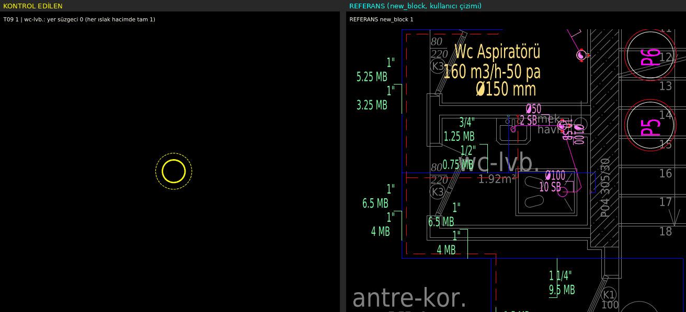
- **FAIL** [2]: wc-banyo: yer süzgeci 0 (her ıslak hacimde tam 1) @ (257203, -442115)  
  
- **FAIL** [2]: duş: yer süzgeci 0 (her ıslak hacimde tam 1) @ (256928, -441945)  
  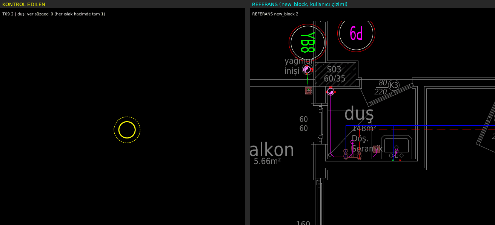
- **FAIL** [2]: mutfak: yer süzgeci 0 (her ıslak hacimde tam 1) @ (257663, -441683)  
  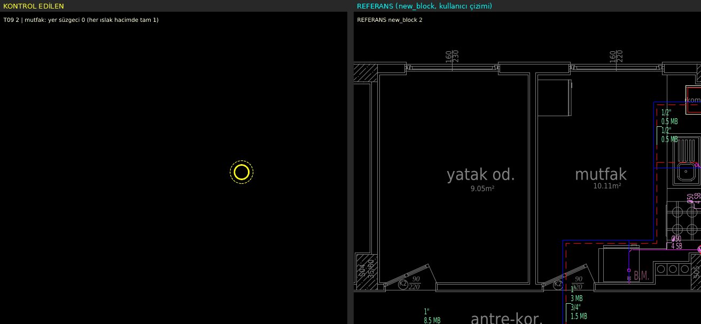
- **FAIL** [2]: mutfak: yer süzgeci 0 (her ıslak hacimde tam 1) @ (257807, -443208)  
  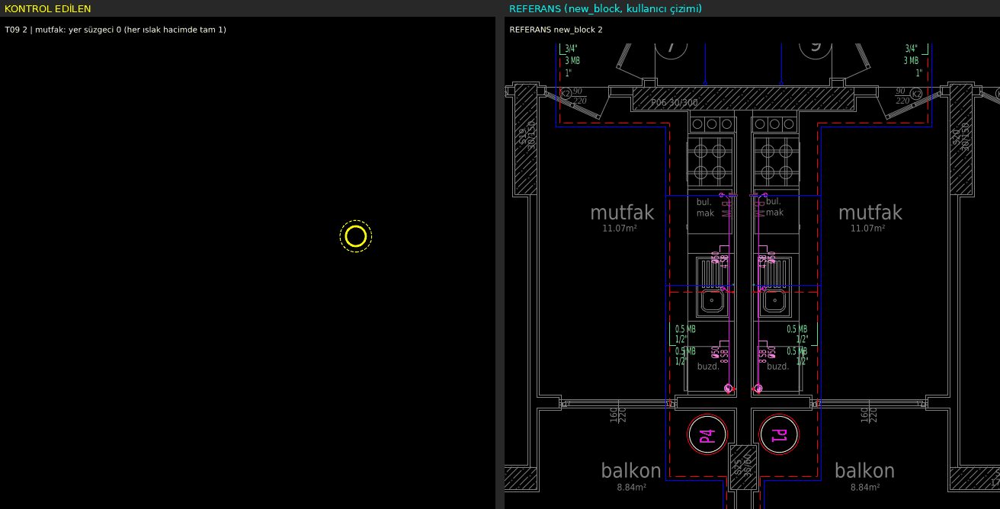
- **FAIL** [2]: mutfak: yer süzgeci 0 (her ıslak hacimde tam 1) @ (257471, -443230)  
  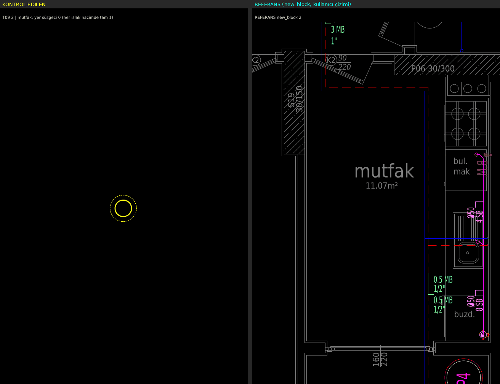
- **FAIL** [2]: wc-lvb.: yer süzgeci 0 (her ıslak hacimde tam 1) @ (257423, -442786)  
  
- **FAIL** [2]: wc-lvb.: yer süzgeci 0 (her ıslak hacimde tam 1) @ (257874, -442786)  
  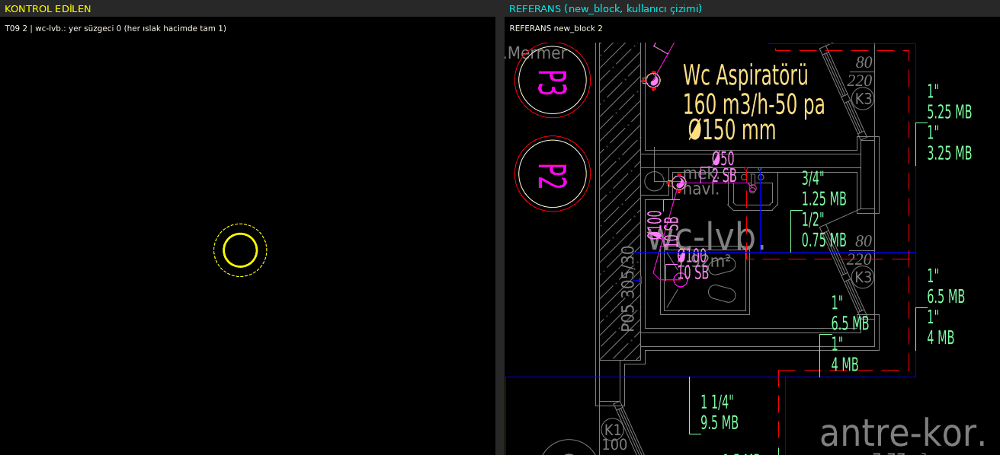

### T10 — Pis su kolonu ıslak hacim köşesinde (betonarme dışında)

- **INFO** [Z]: pis su kolon sembolü yok
- **INFO** [1]: pis su kolon sembolü yok
- **INFO** [2]: pis su kolon sembolü yok

### T11 — denetle.py: MTY 0, ROTAS- öneki, köprü 0, kesişme 0, elektrik 0, yazı çakışması 0, lejant, audit

- **PASS**: MTY 0, önek 0, köprü 0, kesişme 0, elektrik 0, yazı 0, lejant var, audit 0
- **INFO**: pis su – temiz su üst üste geçiş (farklı düzlem, bilgi): 56

## Genel görünümler

- KAT Z: 
- KAT 1: 
- KAT 2: 
- ŞEMA: 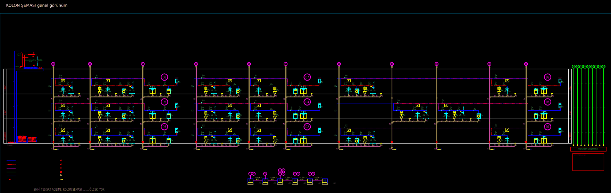

## Eşikler

- T01 balkon süzgeci–iniş hat boyu ≤ 300 cm; süzgecin bağlı olduğu ağda pis su katmanı/kolonu varsa FAIL.
- T02 armatür→kolon branşman yolu ≤ 300 cm; parça açıları {0,45,90} ± 4°; yol armatür mahalli + kolon mahalli (duvar payı 30 cm) dışına > 40 cm çıkarsa FAIL; WC/LV/DUŞ/EVİYE 50 cm içinde hat yoksa FAIL.
- T03 mahal poligonunun 30 cm içeri çekilmiş bölgesinde ≥ 30 cm pis su hattı → FAIL.
- T04 sıcak su bağlı ağı en çok örtüştüğü daire poligonu (mahaller + 20 cm duvar payı) dışında > 15 cm → FAIL; kombiye 80 cm içinde başlamıyorsa FAIL.
- T05 sıcak parçası (≥ 60 cm) boyunca soğuğa mesafe 3–30 cm olan örnek oranı ≥ %80; ofset std ≤ 6.0 cm; sıcak–soğuk kesişme (uçtan 15 cm dışı) FAIL.
- T06 koridor (antre-kor. / merdiven / hol) içindeki temiz su parçası: duvara mesafe / koridor genişliği < 0.25 → FAIL.
- T07 yazı kutuları ezdxf yazı tipi ölçüsüyle; herhangi örtüşme (> 0,2 cm²) FAIL; hat yazı kutusundan ≥ 3 cm geçiyorsa FAIL; çap etiketi yüksekliği ortanca 8–12.
- T08 sayaç sembolü y ≥ 1. kat bandı çizgisi → FAIL; x daire bloklarının (D1..) solunda değilse FAIL; "SAYAÇ (KAPIDA)" yazısı FAIL.
- T09 ıslak mahal poligonunda süzgeç sembolü (çizim + mimari ızgara, 15 cm kümeli) sayısı ≠ 1 → FAIL.
- T10 kolon sembolü ıslak mahal (20 cm pay) dışında / betonarme içinde / en yakın köşeye > 45 cm → FAIL.
- T11 `motor/deneme/denetim/denetle.py` ile aynı sayılar.
