# KONTROLÖR RAPORU — NB_SIHHI_PAFTA_DENEME.dxf

Üretildi: 15.10.2026 04:20 — `python3 motor/kontrolor/kontrolor.py proje/denemeler/sihhi2/NB_SIHHI_PAFTA_DENEME.dxf --mimari ornekler/new_block.dxf.xz --rapor /tmp/claude-0/k2/rapor.md`

## SONUÇ: **RED — 111 madde**

Düzeltme listesi (üreten ajana geri):
1. [T01 Z] balkon süzgeci (balkon) PİS SU kolonuna bağlanmış — kural: yalnız balkondaki yağmur inişine, kısa hatla @ (252746, -441887)
2. [T01 Z] pis su hattı balkon içinden geçiyor (balkon, 42 cm) @ (252868, -441971)
3. [T01 1] balkon süzgeci (balkon) PİS SU kolonuna bağlanmış — kural: yalnız balkondaki yağmur inişine, kısa hatla @ (254780, -441887)
4. [T01 1] pis su hattı balkon içinden geçiyor (balkon, 23 cm) @ (254831, -441893)
5. [T01 2] balkon süzgeci (balkon) PİS SU kolonuna bağlanmış — kural: yalnız balkondaki yağmur inişine, kısa hatla @ (256828, -441887)
6. [T01 2] pis su hattı balkon içinden geçiyor (balkon, 23 cm) @ (256880, -441893)
7. [T02 Z] WC (banyo) → ? branşmanı: uzun: 321 cm > 300 @ (253291, -442577)
8. [T02 Z] WC (banyo) → P2 branşmanı: uzun: 307 cm > 300 @ (253839, -442540)
9. [T02 Z] DUS (banyo) → P2 branşmanı: uzun: 375 cm > 300 @ (253858, -442414)
10. [T02 Z] DUS (banyo) → ? branşmanı: uzun: 375 cm > 300 @ (253273, -442414)
11. [T02 1] WC (banyo) → ? branşmanı: uzun: 316 cm > 300 @ (255326, -442560)
12. [T02 1] WC (wc-duş) → P3 branşmanı: uzun: 437 cm > 300; mahal dışından dolaşıyor: 212 cm (banyo) @ (255861, -442394)
   … T02 için toplam 18 bulgu (ayrıntı aşağıda)
13. [T03 Z] pis su hattı banyo içinden, duvardan > 30 cm uzakta 105 cm geçiyor (ÇAPRAZ UZUN HAT) @ (253380, -442513)
14. [T03 1] pis su hattı banyo içinden, duvardan > 30 cm uzakta 105 cm geçiyor (ÇAPRAZ UZUN HAT) @ (255414, -442507)
15. [T03 1] pis su hattı wc-duş içinden, duvardan > 30 cm uzakta 109 cm geçiyor (ÇAPRAZ UZUN HAT) @ (255776, -442394)
16. [T03 2] pis su hattı banyo içinden, duvardan > 30 cm uzakta 143 cm geçiyor (ÇAPRAZ UZUN HAT) @ (257838, -442545)
17. [T07 Z] etiket mimari yazı üstüne: "Wc Aspiratörü" / "banyo" @ (253184, -442507)
18. [T07 Z] etiket mimari yazı üstüne: "160 m3/h-50 pa" / "banyo" @ (253191, -442520)
19. [T07 Z] etiket mimari yazı üstüne: "Wc Aspiratörü" / "Döş.Mermer" @ (253747, -442645)
20. [T07 Z] etiket mimari yazı üstüne: "YB6" / "yağmur inişi" @ (254243, -441479)
21. [T07 Z] etiket mimari yazı üstüne: "YB7" / "yağmur inişi" @ (252832, -441474)
22. [T07 Z] etiket mimari yazı üstüne: "YB8" / "duş" @ (252698, -441922)
   … T07 için toplam 66 bulgu (ayrıntı aşağıda)
23. [T10 Z] kolon P1 ıslak hacim dışında (ortak alan / dış) — kural: kolon ıslak hacmin köşesinde @ (253578, -443414)
24. [T10 Z] kolon P2 banyo köşesinde değil (en yakın köşe 48 cm) @ (253716, -442662)
25. [T10 Z] kolon P1 ıslak hacim dışında (ortak alan / dış) — kural: kolon ıslak hacmin köşesinde @ (253553, -443414)
26. [T10 Z] kolon ? banyo köşesinde değil (en yakın köşe 48 cm) @ (253414, -442662)
27. [T10 Z] kolon P7 ıslak hacim dışında (antre-kor.) — kural: kolon ıslak hacmin köşesinde @ (253765, -441812)
28. [T10 1] kolon P4 ıslak hacim dışında (ortak alan / dış) — kural: kolon ıslak hacmin köşesinde @ (255587, -443414)
   … T10 için toplam 16 bulgu (ayrıntı aşağıda)
29. [T11] yazı-yazı çakışması (denetle %2): 60 — ROTAS-MIMARI-YAZI "yağmur
inişi" / 0 "YB6" (254214, -441485), ROTAS-MIMARI-YAZI "yağmur
inişi" / 0 "YB7" (252811, -441484), ROTAS-MIMARI-YAZI "banyo" / 0 "10 SB" (253265, -442516), ROTAS-MIMARI-YAZI "banyo" / ROTAS-SIHHI-HAVALANDIRMA-YAZI "160 m3/h-50 pa" (253265, -442516)

## Özet

| Test | Ne ölçer | Sonuç | FAIL | INFO | Referans new_block FAIL/INFO (aynı ölçüm) |
|---|---|---|---|---|---|
| T01 | Balkon süzgeci bağlantı hedefi (yağmur inişi, kısa hat; pis su kolonuna ASLA) | ✗ FAIL | 6 | 0 | 0 / 0 |
| T02 | Pis su branşmanı: uzunluk ≤ 300 cm, açı {0,45,90}, mahal dışından dolaşmaz, her armatür bağlı | ✗ FAIL | 18 | 2 | 59 / 3 — kullanıcı branşmanı serbest açılı çiziyor (kural C 45° ister) |
| T03 | Oda içi çapraz pis su hattı (duvardan > 30 cm iç bölge) | ✗ FAIL | 4 | 11 | 0 / 21 |
| T04 | Sıcak su daire dışı uzunluk = 0, kombiden başlar | ✓ PASS | 0 | 0 | 0 / 0 — kapı komşuluğuyla daire ataması: 0 (önceki 1 FAIL 1. kat wc-duş D5→D6 eşleme hatasıydı) |
| T05 | Sıcak–soğuk paralellik (sabit ofset) ve kesişme | ✓ PASS | 0 | 0 | 0 / 6 |
| T06 | Koridor hatları koridor ortasında | bilgi | 0 | 29 | 0 / 39 |
| T07 | Etiket–etiket / etiket–mimari yazı / etiket–hat çakışması, etiket boyu | ✗ FAIL | 66 | 3 | 208 / 5 — 208 = etiket–mimari yazı 80 + etiket–hat 128 (kullanıcı tarzı); yeni alt testler: etiket–etiket 0, tarama 0, eviye/BM/kombi/makine yeri 0, asansör 0 |
| T08 | Kolon şeması: sayaçlar zemin bandında, şebeke girişinde (solda); kat bantlarında sayaç yok | ✓ PASS | 0 | 0 | 0 / 1 |
| T09 | Islak hacim başına yer süzgeci = 1 | ✓ PASS | 0 | 0 | 16 / 0 — mutfak/wc-lvb.de süzgeç yok (B kuralı ister) |
| T10 | Pis su kolonu ıslak hacim köşesinde (betonarme dışında) | ✗ FAIL | 16 | 0 | 0 / 3 |
| T11 | denetle.py: MTY 0, ROTAS- öneki, köprü 0, kesişme 0, elektrik 0, yazı çakışması 0, lejant, audit | ✗ FAIL | 1 | 1 | 34 / 1 — MTY katmanları (beklenen) |
| T12 | Kolon düşey sürekliliği: aynı numara her katta aynı eksende (± 5 cm); referansta olmayan yeni numara yok | ✓ PASS | 0 | 0 | 0 / 0 |
| T13 | Ç.M./B.M. mimarideki yerinde (± 40 cm); kolon/aspiratör o yeri işgal etmiyor | ✓ PASS | 0 | 0 | 0 / 0 |
| T14 | Aspiratör notu kendi ıslak hacminde (≤ 60 cm), ortak alanda değil; kılavuz başka mahali kesmiyor | ✓ PASS | 0 | 0 | 0 / 0 |
| T15 | Penceresiz her ıslak hacimde aspiratör / mekanik havalandırma notu | ✓ PASS | 0 | 3 | 0 / 3 — BİLGİ: duş kabini (< 1 m²) havalandırma aranmadı |
| T16 | Paftada iç kural metni sızıntısı ("(EK)", "new_block", "otomatik", kural cümleleri) yok; ACI 250–255 renk yok | ✓ PASS | 0 | 0 | 0 / 0 |
| T17 | Pafta genişlikleri ve sırası ORNEK_DUZEN / ALTIN_REFERANS §1 ile (± %5) | ✓ PASS | 0 | 1 | 0 / 1 |

Referans sütunu: kullanıcının kendi `new_block.dxf` çizimi aynı testlerden geçirildiğinde çıkan sayılar (15.10.2026). Referansın kendisinde de görülen türden bulgular (ör. T07 etiket-hat, T02 serbest açı) tarz farkı değil kural C ihlali olarak listelenir; T11 MTY sayıları referans için beklenen durumdur.

## Dosya ve mimari eşleme

- dosya: proje/denemeler/sihhi2/NB_SIHHI_PAFTA_DENEME.dxf — çerçeve 11, kat paftası ['1', '2', 'Z'], şema paftası var
- mimari kaynak: ornekler/new_block.dxf.xz (30942 kayıt)
- kat Z: öteleme (0.0, 0.0) 260 yazı eşleşmesi; mahal 32 (ıslak 9, ortak 2, balkon 4), daire [1, 2, 3], armatür 29, betonarme 32 — 3.1 s
- kat 1: öteleme (0.0, 0.0) 255 yazı eşleşmesi; mahal 32 (ıslak 9, ortak 2, balkon 4), daire [4, 5, 6], armatür 29, betonarme 32 — 2.6 s
- kat 2: öteleme (0.0, 0.0) 255 yazı eşleşmesi; mahal 32 (ıslak 9, ortak 2, balkon 4), daire [7, 8, 9], armatür 28, betonarme 32 — 2.6 s
- kat 1: kapı komşuluğuyla daire ataması düzeltildi: wc-duş D5→D6
- kat 2: kapı komşuluğuyla daire ataması düzeltildi: yüklük D8→D9

Süre 149 s.

## Ayrıntı (koordinatlar çizim birimi, cm)

### T01 — Balkon süzgeci bağlantı hedefi (yağmur inişi, kısa hat; pis su kolonuna ASLA)

- **FAIL** [Z]: balkon süzgeci (balkon) PİS SU kolonuna bağlanmış — kural: yalnız balkondaki yağmur inişine, kısa hatla @ (252746, -441887)  
  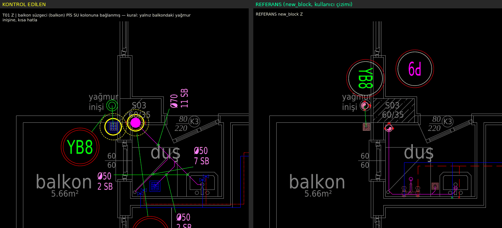
- **FAIL** [Z]: pis su hattı balkon içinden geçiyor (balkon, 42 cm) @ (252868, -441971)  
  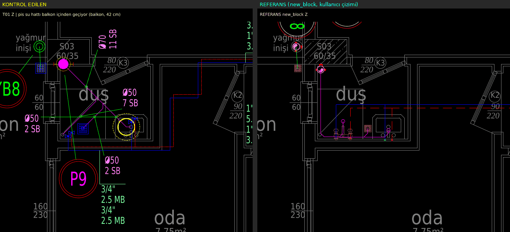
- **FAIL** [1]: balkon süzgeci (balkon) PİS SU kolonuna bağlanmış — kural: yalnız balkondaki yağmur inişine, kısa hatla @ (254780, -441887)  
  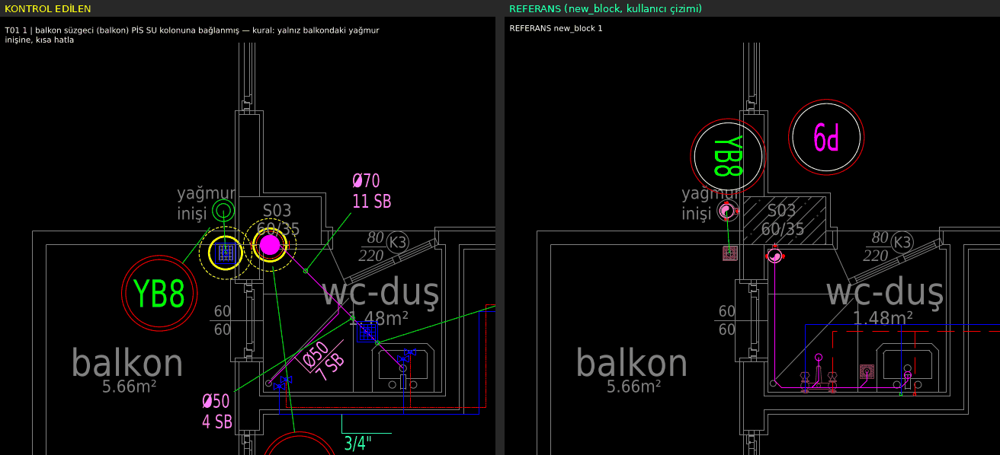
- **FAIL** [1]: pis su hattı balkon içinden geçiyor (balkon, 23 cm) @ (254831, -441893)  
  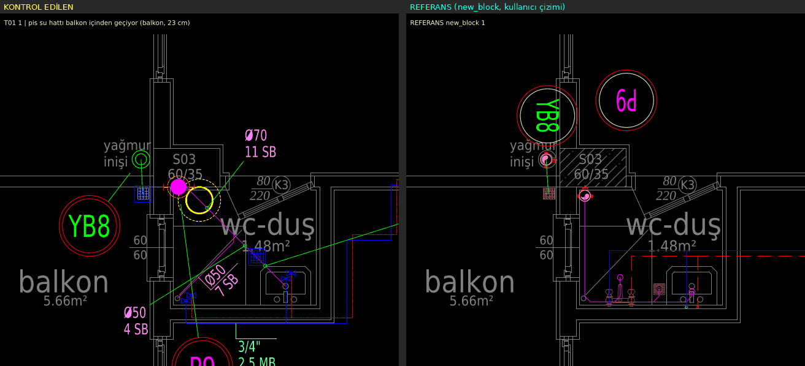
- **FAIL** [2]: balkon süzgeci (balkon) PİS SU kolonuna bağlanmış — kural: yalnız balkondaki yağmur inişine, kısa hatla @ (256828, -441887)  
  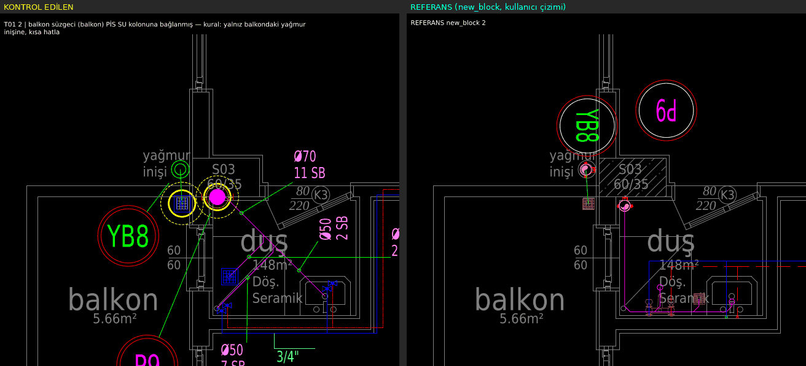
- **FAIL** [2]: pis su hattı balkon içinden geçiyor (balkon, 23 cm) @ (256880, -441893)  
  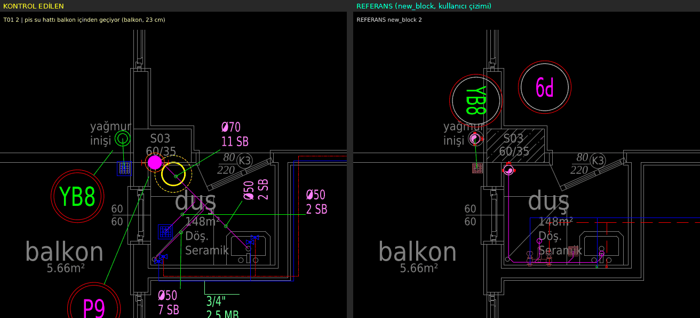

### T02 — Pis su branşmanı: uzunluk ≤ 300 cm, açı {0,45,90}, mahal dışından dolaşmaz, her armatür bağlı

- **FAIL** [Z]: WC (banyo) → ? branşmanı: uzun: 321 cm > 300 @ (253291, -442577)  
  
- **FAIL** [Z]: WC (banyo) → P2 branşmanı: uzun: 307 cm > 300 @ (253839, -442540)  
  
- **FAIL** [Z]: DUS (banyo) → P2 branşmanı: uzun: 375 cm > 300 @ (253858, -442414)  
  
- **FAIL** [Z]: DUS (banyo) → ? branşmanı: uzun: 375 cm > 300 @ (253273, -442414)  
  
- **INFO** [Z]: BM (mutfak) pis su hattına bağlı değil (50 cm içinde hat yok) @ (253502, -443181)
- **FAIL** [1]: WC (banyo) → ? branşmanı: uzun: 316 cm > 300 @ (255326, -442560)  
  
- **FAIL** [1]: WC (wc-duş) → P3 branşmanı: uzun: 437 cm > 300; mahal dışından dolaşıyor: 212 cm (banyo) @ (255861, -442394)  
  
- **FAIL** [1]: LV (wc-banyo) pis su hattına bağlı değil (50 cm içinde hat yok) @ (255186, -442031)  
  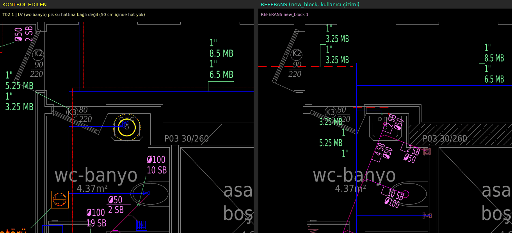
- **FAIL** [1]: LV (wc-duş) → ? branşmanı: mahal dışından dolaşıyor: 42 cm (yatak od.) @ (254909, -441971)  
  
- **FAIL** [1]: LV (wc-duş) → P3 branşmanı: uzun: 520 cm > 300; mahal dışından dolaşıyor: 212 cm (banyo) @ (255845, -442292)  
  
- **FAIL** [1]: DUS (banyo) → P3 branşmanı: uzun: 317 cm > 300 @ (255892, -442459)  
  
- **FAIL** [1]: DUS (banyo) → ? branşmanı: uzun: 375 cm > 300 @ (255307, -442414)  
  
- **FAIL** [1]: DUS (wc-duş) → P3 branşmanı: uzun: 306 cm > 300; mahal dışından dolaşıyor: 212 cm (banyo) @ (255752, -442413)  
  
- **INFO** [1]: BM (mutfak) pis su hattına bağlı değil (50 cm içinde hat yok) @ (255536, -443181)
- **FAIL** [2]: WC (banyo) → ? branşmanı: uzun: 359 cm > 300 @ (257374, -442560)  
  
- **FAIL** [2]: LV (wc-banyo) pis su hattına bağlı değil (50 cm içinde hat yok) @ (257235, -442031)  
  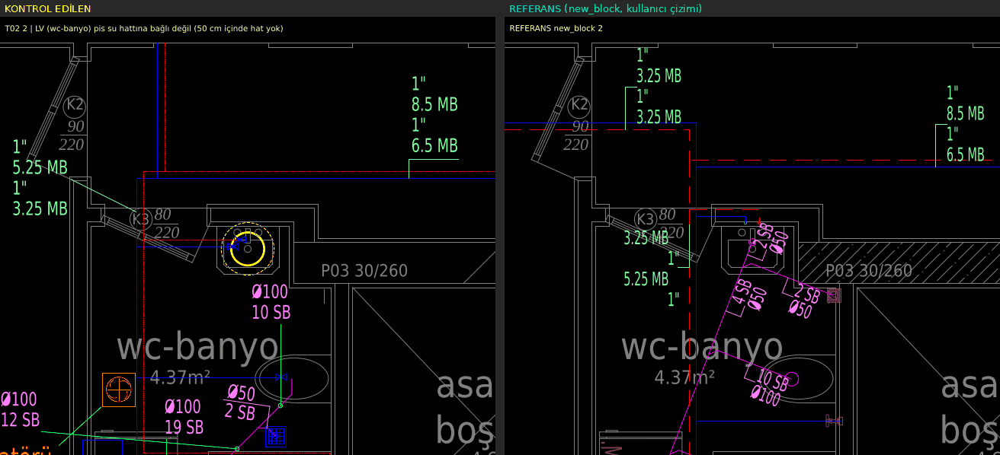
- **FAIL** [2]: DUS (banyo) → P2 branşmanı: uzun: 364 cm > 300 @ (257941, -442414)  
  
- **FAIL** [2]: DUS (banyo) → ? branşmanı: uzun: 375 cm > 300 @ (257355, -442414)  
  
- **FAIL** [2]: BM (mutfak) → P4 branşmanı: mahal dışından dolaşıyor: 233 cm (ortak alan/dış) @ (257584, -443181)  
  
- **FAIL** [2]: YS (banyo) → ? branşmanı: uzun: 312 cm > 300 @ (257350, -442485)  
  

### T03 — Oda içi çapraz pis su hattı (duvardan > 30 cm iç bölge)

- **INFO** [Z]: pis su hattı banyo içinden, duvardan > 30 cm uzakta 92 cm geçiyor (kısa çapraz, bilgi) @ (253751, -442502)
- **INFO** [Z]: pis su hattı banyo içinden, duvardan > 30 cm uzakta 40 cm geçiyor (kısa çapraz, bilgi) @ (253839, -442507)
- **FAIL** [Z]: pis su hattı banyo içinden, duvardan > 30 cm uzakta 105 cm geçiyor (ÇAPRAZ UZUN HAT) @ (253380, -442513)  
  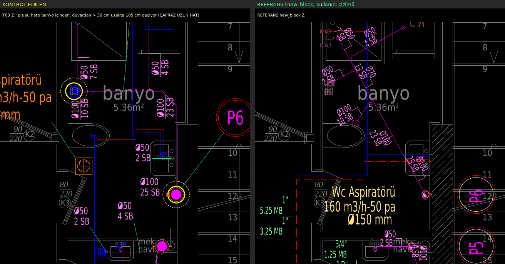
- **INFO** [Z]: pis su hattı wc+banyo içinden, duvardan > 30 cm uzakta 73 cm geçiyor (kısa çapraz, bilgi) @ (253162, -442110)
- **FAIL** [1]: pis su hattı banyo içinden, duvardan > 30 cm uzakta 105 cm geçiyor (ÇAPRAZ UZUN HAT) @ (255414, -442507)  
  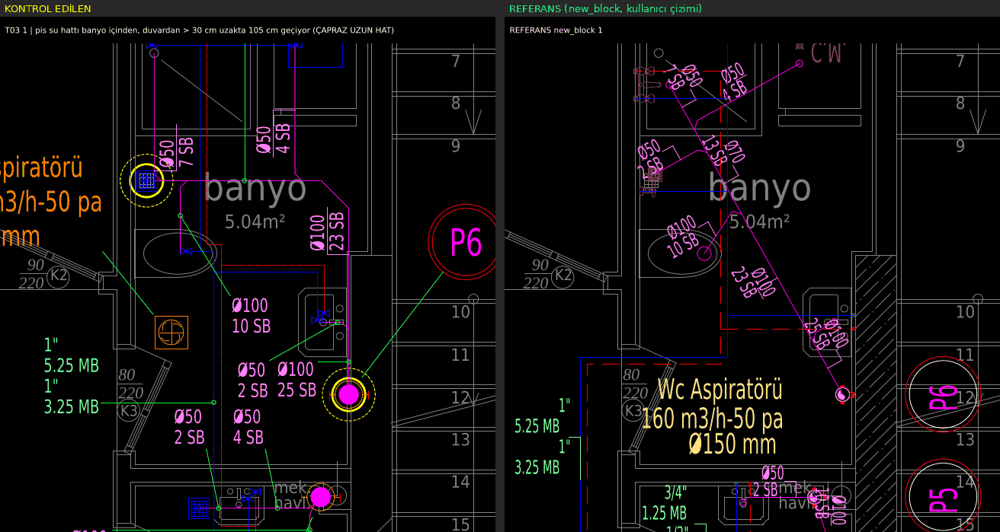
- **FAIL** [1]: pis su hattı wc-duş içinden, duvardan > 30 cm uzakta 109 cm geçiyor (ÇAPRAZ UZUN HAT) @ (255776, -442394)  
  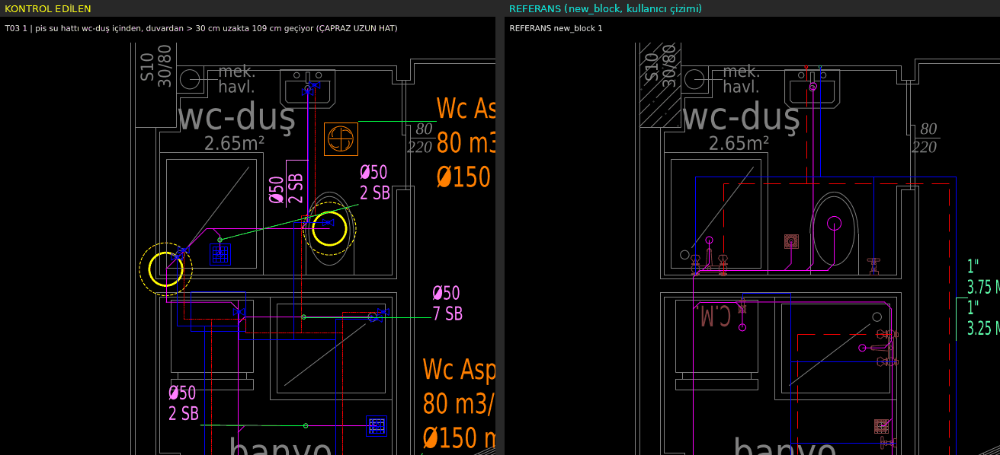
- **INFO** [1]: pis su hattı wc-duş içinden, duvardan > 30 cm uzakta 85 cm geçiyor (kısa çapraz, bilgi) @ (255845, -442389)
- **INFO** [1]: pis su hattı banyo içinden, duvardan > 30 cm uzakta 93 cm geçiyor (kısa çapraz, bilgi) @ (255794, -442582)
- **INFO** [1]: pis su hattı banyo içinden, duvardan > 30 cm uzakta 81 cm geçiyor (kısa çapraz, bilgi) @ (255799, -442577)
- **INFO** [1]: pis su hattı banyo içinden, duvardan > 30 cm uzakta 36 cm geçiyor (kısa çapraz, bilgi) @ (255843, -442538)
- **INFO** [2]: pis su hattı banyo içinden, duvardan > 30 cm uzakta 47 cm geçiyor (kısa çapraz, bilgi) @ (257379, -442485)
- **INFO** [2]: pis su hattı banyo içinden, duvardan > 30 cm uzakta 77 cm geçiyor (kısa çapraz, bilgi) @ (257374, -442490)
- **FAIL** [2]: pis su hattı banyo içinden, duvardan > 30 cm uzakta 143 cm geçiyor (ÇAPRAZ UZUN HAT) @ (257838, -442545)  
  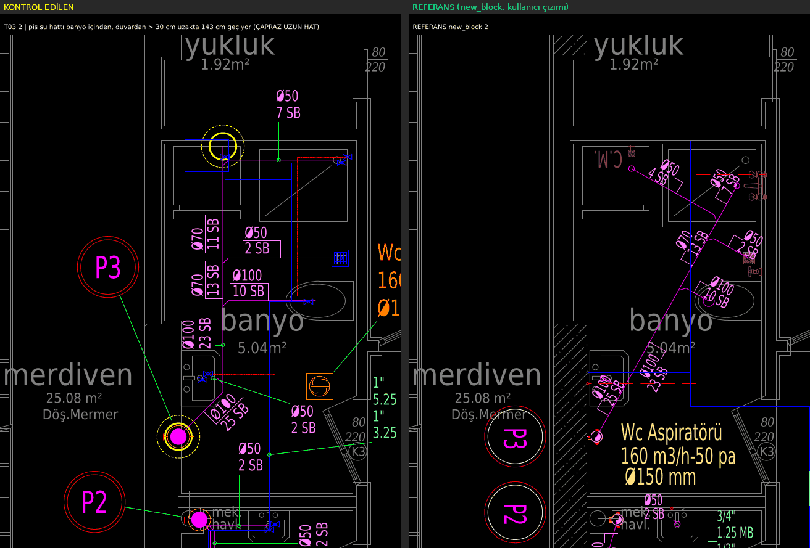
- **INFO** [2]: pis su hattı banyo içinden, duvardan > 30 cm uzakta 85 cm geçiyor (kısa çapraz, bilgi) @ (257843, -442540)
- **INFO** [2]: pis su hattı banyo içinden, duvardan > 30 cm uzakta 76 cm geçiyor (kısa çapraz, bilgi) @ (257843, -442502)

### T04 — Sıcak su daire dışı uzunluk = 0, kombiden başlar

- **PASS** [Z]: 3 sıcak su ağı daire içinde, kombiden
- **PASS** [1]: 3 sıcak su ağı daire içinde, kombiden
- **PASS** [2]: 3 sıcak su ağı daire içinde, kombiden

### T05 — Sıcak–soğuk paralellik (sabit ofset) ve kesişme

- **PASS** [Z]: 39 sıcak parçası soğukla sabit ofsetli paralel, kesişme yok
- **PASS** [1]: 39 sıcak parçası soğukla sabit ofsetli paralel, kesişme yok
- **PASS** [2]: 38 sıcak parçası soğukla sabit ofsetli paralel, kesişme yok

### T06 — Koridor hatları koridor ortasında

- **INFO** [Z]: 5 koridor parçası ortada, 10 duvar dibinde (BİLGİ: kullanıcının kendi new_block çiziminde antre hatları duvar dibinde; B kuralı koridor ortası — karar kullanıcıda)
- **INFO** [Z]: antre-kor. içinde temiz su hattı duvar dibinde: duvara 68 cm, koridor 314 cm (ROTAS-SIHHI-SOGUK-SU) — kural: koridorda hatlar ORTADAN @ (253376, -442936)
- **INFO** [Z]: antre-kor. içinde temiz su hattı duvar dibinde: duvara 63 cm, koridor 314 cm (ROTAS-SIHHI-SICAK-SU) — kural: koridorda hatlar ORTADAN @ (253381, -442932)
- **INFO** [Z]: antre-kor. içinde temiz su hattı duvar dibinde: duvara 149 cm, koridor 724 cm (ROTAS-SIHHI-SOGUK-SU) — kural: koridorda hatlar ORTADAN @ (253615, -441924)
- **INFO** [Z]: antre-kor. içinde temiz su hattı duvar dibinde: duvara 75 cm, koridor 734 cm (ROTAS-SIHHI-SOGUK-SU) — kural: koridorda hatlar ORTADAN @ (253105, -441994)
- **INFO** [Z]: antre-kor. içinde temiz su hattı duvar dibinde: duvara 65 cm, koridor 724 cm (ROTAS-SIHHI-SOGUK-SU) — kural: koridorda hatlar ORTADAN @ (253105, -441922)
- **INFO** [Z]: antre-kor. içinde temiz su hattı duvar dibinde: duvara 144 cm, koridor 724 cm (ROTAS-SIHHI-SICAK-SU) — kural: koridorda hatlar ORTADAN @ (253620, -441921)
- **INFO** [Z]: antre-kor. içinde temiz su hattı duvar dibinde: duvara 80 cm, koridor 734 cm (ROTAS-SIHHI-SICAK-SU) — kural: koridorda hatlar ORTADAN @ (253110, -441989)
- **INFO** [Z]: antre-kor. içinde temiz su hattı duvar dibinde: duvara 70 cm, koridor 724 cm (ROTAS-SIHHI-SICAK-SU) — kural: koridorda hatlar ORTADAN @ (253110, -441919)
- **INFO** [Z]: antre-kor. içinde temiz su hattı duvar dibinde: duvara 61 cm, koridor 314 cm (ROTAS-SIHHI-SOGUK-SU) — kural: koridorda hatlar ORTADAN @ (253751, -442934)
- **INFO** [Z]: antre-kor. içinde temiz su hattı duvar dibinde: duvara 66 cm, koridor 314 cm (ROTAS-SIHHI-SICAK-SU) — kural: koridorda hatlar ORTADAN @ (253756, -442933)
- **INFO** [1]: 8 koridor parçası ortada, 8 duvar dibinde (BİLGİ: kullanıcının kendi new_block çiziminde antre hatları duvar dibinde; B kuralı koridor ortası — karar kullanıcıda)
- **INFO** [1]: antre-kor. içinde temiz su hattı duvar dibinde: duvara 68 cm, koridor 314 cm (ROTAS-SIHHI-SOGUK-SU) — kural: koridorda hatlar ORTADAN @ (255410, -442936)
- **INFO** [1]: antre-kor. içinde temiz su hattı duvar dibinde: duvara 63 cm, koridor 314 cm (ROTAS-SIHHI-SICAK-SU) — kural: koridorda hatlar ORTADAN @ (255415, -442932)
- **INFO** [1]: antre-kor. içinde temiz su hattı duvar dibinde: duvara 45 cm, koridor 724 cm (ROTAS-SIHHI-SOGUK-SU) — kural: koridorda hatlar ORTADAN @ (255119, -441934)
- **INFO** [1]: antre-kor. içinde temiz su hattı duvar dibinde: duvara 129 cm, koridor 724 cm (ROTAS-SIHHI-SOGUK-SU) — kural: koridorda hatlar ORTADAN @ (255669, -441924)
- **INFO** [1]: antre-kor. içinde temiz su hattı duvar dibinde: duvara 50 cm, koridor 724 cm (ROTAS-SIHHI-SICAK-SU) — kural: koridorda hatlar ORTADAN @ (255124, -441929)
- **INFO** [1]: antre-kor. içinde temiz su hattı duvar dibinde: duvara 124 cm, koridor 724 cm (ROTAS-SIHHI-SICAK-SU) — kural: koridorda hatlar ORTADAN @ (255674, -441921)
- **INFO** [1]: antre-kor. içinde temiz su hattı duvar dibinde: duvara 26 cm, koridor 310 cm (ROTAS-SIHHI-SOGUK-SU) — kural: koridorda hatlar ORTADAN @ (255750, -442962)
- **INFO** [1]: antre-kor. içinde temiz su hattı duvar dibinde: duvara 31 cm, koridor 320 cm (ROTAS-SIHHI-SICAK-SU) — kural: koridorda hatlar ORTADAN @ (255755, -442960)
- **INFO** [2]: 5 koridor parçası ortada, 8 duvar dibinde (BİLGİ: kullanıcının kendi new_block çiziminde antre hatları duvar dibinde; B kuralı koridor ortası — karar kullanıcıda)
- **INFO** [2]: antre-kor. içinde temiz su hattı duvar dibinde: duvara 78 cm, koridor 314 cm (ROTAS-SIHHI-SOGUK-SU) — kural: koridorda hatlar ORTADAN @ (257448, -442936)
- **INFO** [2]: antre-kor. içinde temiz su hattı duvar dibinde: duvara 73 cm, koridor 314 cm (ROTAS-SIHHI-SICAK-SU) — kural: koridorda hatlar ORTADAN @ (257453, -442933)
- **INFO** [2]: antre-kor. içinde temiz su hattı duvar dibinde: duvara 31 cm, koridor 166 cm (ROTAS-SIHHI-SOGUK-SU) — kural: koridorda hatlar ORTADAN @ (257767, -441919)
- **INFO** [2]: antre-kor. içinde temiz su hattı duvar dibinde: duvara 47 cm, koridor 758 cm (ROTAS-SIHHI-SOGUK-SU) — kural: koridorda hatlar ORTADAN @ (257169, -441933)
- **INFO** [2]: antre-kor. içinde temiz su hattı duvar dibinde: duvara 26 cm, koridor 168 cm (ROTAS-SIHHI-SICAK-SU) — kural: koridorda hatlar ORTADAN @ (257772, -441914)
- **INFO** [2]: antre-kor. içinde temiz su hattı duvar dibinde: duvara 52 cm, koridor 760 cm (ROTAS-SIHHI-SICAK-SU) — kural: koridorda hatlar ORTADAN @ (257174, -441929)
- **INFO** [2]: antre-kor. içinde temiz su hattı duvar dibinde: duvara 58 cm, koridor 314 cm (ROTAS-SIHHI-SOGUK-SU) — kural: koridorda hatlar ORTADAN @ (257830, -442933)
- **INFO** [2]: antre-kor. içinde temiz su hattı duvar dibinde: duvara 63 cm, koridor 314 cm (ROTAS-SIHHI-SICAK-SU) — kural: koridorda hatlar ORTADAN @ (257835, -442933)

### T07 — Etiket–etiket / etiket–mimari yazı / etiket–hat çakışması, etiket boyu

- **INFO** [Z]: etiket-etiket 0, etiket-mimari yazı 18, etiket-hat 7, etiket-tarama 0, etiket-armatür/sembol 0, etiket-asansör boşluğu 0 (toplam 163 etiket)
- **FAIL** [Z]: etiket mimari yazı üstüne: "Wc Aspiratörü" / "banyo" @ (253184, -442507)  
  
- **FAIL** [Z]: etiket mimari yazı üstüne: "160 m3/h-50 pa" / "banyo" @ (253191, -442520)  
  
- **FAIL** [Z]: etiket mimari yazı üstüne: "Wc Aspiratörü" / "Döş.Mermer" @ (253747, -442645)  
  
- **FAIL** [Z]: etiket mimari yazı üstüne: "YB6" / "yağmur inişi" @ (254243, -441479)  
  
- **FAIL** [Z]: etiket mimari yazı üstüne: "YB7" / "yağmur inişi" @ (252832, -441474)  
  
- **FAIL** [Z]: etiket mimari yazı üstüne: "YB8" / "duş" @ (252698, -441922)  
  
- **FAIL** [Z]: etiket mimari yazı üstüne: "Ø50" / "mutfak" @ (253660, -443181)  
  
- **FAIL** [Z]: etiket mimari yazı üstüne: "Ø100" / "asansör boşluğu" @ (253159, -442151)  
  
- **FAIL** [Z]: etiket mimari yazı üstüne: "21 SB" / "asansör boşluğu" @ (253160, -442166)  
  
- **FAIL** [Z]: etiket mimari yazı üstüne: "10 SB" / "banyo" @ (253284, -442525)  
  
- **FAIL** [Z]: etiket mimari yazı üstüne: "Ø50" / "banyo" @ (253731, -442562)  
  
- **FAIL** [Z]: etiket mimari yazı üstüne: "1/2"" / "balkon" @ (253607, -443521)  
  
- **FAIL** [Z]: etiket mimari yazı üstüne: "0.5 MB" / "balkon" @ (253614, -443532)
- **FAIL** [Z]: etiket mimari yazı üstüne: "1"" / "antre-kor." @ (253772, -442922)
- **FAIL** [Z]: etiket mimari yazı üstüne: "3/4"" / "oda" @ (252842, -442093)
- **FAIL** [Z]: etiket mimari yazı üstüne: "2.5 MB" / "oda" @ (252849, -442104)
- **FAIL** [Z]: etiket mimari yazı üstüne: "1"" / "antre-kor." @ (253335, -441926)
- **FAIL** [Z]: etiket mimari yazı üstüne: "6.5 MB" / "antre-kor." @ (253347, -441937)
- **FAIL** [Z]: etiket hat üstüne biniyor: "Wc Aspiratörü" (19 cm hat yazı kutusunda) @ (253796, -442645)
- **FAIL** [Z]: etiket hat üstüne biniyor: "Wc Aspiratörü" (19 cm hat yazı kutusunda) @ (253801, -442645)
- **FAIL** [Z]: etiket hat üstüne biniyor: "160 m3/h-50 pa" (19 cm hat yazı kutusunda) @ (253796, -442670)
- **FAIL** [Z]: etiket hat üstüne biniyor: "160 m3/h-50 pa" (19 cm hat yazı kutusunda) @ (253801, -442670)
- **FAIL** [Z]: etiket hat üstüne biniyor: "Ø150 mm" (19 cm hat yazı kutusunda) @ (253796, -442695)
- **FAIL** [Z]: etiket hat üstüne biniyor: "Ø150 mm" (19 cm hat yazı kutusunda) @ (253801, -442695)
- **FAIL** [Z]: etiket hat üstüne biniyor: "23 SB" (14 cm hat yazı kutusunda) @ (253408, -442527)
- **INFO** [1]: etiket-etiket 0, etiket-mimari yazı 18, etiket-hat 0, etiket-tarama 0, etiket-armatür/sembol 0, etiket-asansör boşluğu 0 (toplam 166 etiket)
- **FAIL** [1]: etiket mimari yazı üstüne: "P2" / "yüklük" @ (255683, -442779)  
  
- **FAIL** [1]: etiket mimari yazı üstüne: "Wc Aspiratörü" / "banyo" @ (255218, -442505)  
  
- **FAIL** [1]: etiket mimari yazı üstüne: "160 m3/h-50 pa" / "banyo" @ (255225, -442517)  
  
- **FAIL** [1]: etiket mimari yazı üstüne: "YB6" / "yağmur inişi" @ (256277, -441479)  
  
- **FAIL** [1]: etiket mimari yazı üstüne: "YB7" / "yağmur inişi" @ (254866, -441474)  
  
- **FAIL** [1]: etiket mimari yazı üstüne: "YB8" / "wc-duş" @ (254732, -441915)  
  
- **FAIL** [1]: etiket mimari yazı üstüne: "Ø50" / "mutfak" @ (255694, -443181)  
  
- **FAIL** [1]: etiket mimari yazı üstüne: "10 SB" / "25.08 m²" @ (255812, -442628)  
  
- **FAIL** [1]: etiket mimari yazı üstüne: "Ø100" / "wc-lvb." @ (255259, -442770)  
  
- **FAIL** [1]: etiket mimari yazı üstüne: "10 SB" / "wc-lvb." @ (255260, -442781)  
  
- **FAIL** [1]: etiket mimari yazı üstüne: "Ø100" / "Döş.Mermer" @ (255781, -442646)  
  
- **FAIL** [1]: etiket mimari yazı üstüne: "44 SB" / "Döş.Mermer" @ (255789, -442651)  
  
- **FAIL** [1]: etiket mimari yazı üstüne: "2 SB" / "25.08 m²" @ (255839, -442627)
- **FAIL** [1]: etiket mimari yazı üstüne: "2 SB" / "asansör boşluğu" @ (255182, -442149)
- **FAIL** [1]: etiket mimari yazı üstüne: "1/2"" / "balkon" @ (255641, -443525)
- **FAIL** [1]: etiket mimari yazı üstüne: "0.5 MB" / "balkon" @ (255648, -443534)
- **FAIL** [1]: etiket mimari yazı üstüne: "8.5 MB" / "antre-kor." @ (255321, -441927)
- **FAIL** [1]: etiket mimari yazı üstüne: "1"" / "antre-kor." @ (255309, -441937)
- **INFO** [2]: etiket-etiket 0, etiket-mimari yazı 23, etiket-hat 0, etiket-tarama 0, etiket-armatür/sembol 0, etiket-asansör boşluğu 0 (toplam 169 etiket)
- **FAIL** [2]: etiket mimari yazı üstüne: "Wc Aspiratörü" / "banyo" @ (257266, -442505)  
  
- **FAIL** [2]: etiket mimari yazı üstüne: "160 m3/h-50 pa" / "banyo" @ (257273, -442517)  
  
- **FAIL** [2]: etiket mimari yazı üstüne: "YB6" / "yağmur inişi" @ (258325, -441479)  
  
- **FAIL** [2]: etiket mimari yazı üstüne: "YB7" / "yağmur inişi" @ (256914, -441474)  
  
- **FAIL** [2]: etiket mimari yazı üstüne: "YB8" / "duş" @ (256780, -441920)  
  
- **FAIL** [2]: etiket mimari yazı üstüne: "Ø50" / "mutfak" @ (257741, -443180)  
  
- **FAIL** [2]: etiket mimari yazı üstüne: "Ø100" / "banyo" @ (257353, -442511)  
  
- **FAIL** [2]: etiket mimari yazı üstüne: "10 SB" / "banyo" @ (257367, -442511)  
  
- **FAIL** [2]: etiket mimari yazı üstüne: "Ø100" / "banyo" @ (257808, -442562)  
  
- **FAIL** [2]: etiket mimari yazı üstüne: "23 SB" / "banyo" @ (257823, -442561)  
  
- **FAIL** [2]: etiket mimari yazı üstüne: "Ø100" / "wc-lvb." @ (257307, -442770)  
  
- **FAIL** [2]: etiket mimari yazı üstüne: "10 SB" / "wc-lvb." @ (257309, -442781)  
  
- **FAIL** [2]: etiket mimari yazı üstüne: "Ø100" / "Döş.Mermer" @ (257834, -442642)
- **FAIL** [2]: etiket mimari yazı üstüne: "Ø100" / "25.08 m²" @ (257844, -442629)
- **FAIL** [2]: etiket mimari yazı üstüne: "25 SB" / "Döş.Mermer" @ (257838, -442650)
- **FAIL** [2]: etiket mimari yazı üstüne: "25 SB" / "25.08 m²" @ (257856, -442631)
- **FAIL** [2]: etiket mimari yazı üstüne: "Ø50" / "asansör boşluğu" @ (257235, -442137)
- **FAIL** [2]: etiket mimari yazı üstüne: "2 SB" / "asansör boşluğu" @ (257235, -442151)
- **FAIL** [2]: etiket mimari yazı üstüne: "1/2"" / "balkon" @ (257691, -443521)
- **FAIL** [2]: etiket mimari yazı üstüne: "0.5 MB" / "balkon" @ (257698, -443532)
- **FAIL** [2]: etiket mimari yazı üstüne: "1"" / "antre-kor." @ (257851, -442922)
- **FAIL** [2]: etiket mimari yazı üstüne: "8.5 MB" / "antre-kor." @ (257371, -441927)
- **FAIL** [2]: etiket mimari yazı üstüne: "1"" / "antre-kor." @ (257359, -441937)

### T08 — Kolon şeması: sayaçlar zemin bandında, şebeke girişinde (solda); kat bantlarında sayaç yok

- **PASS** [ŞEMA]: 9 sayaç zemin bandında, şebeke girişinde; kat bantlarında sayaç yok

### T09 — Islak hacim başına yer süzgeci = 1

- **PASS** [Z]: 9 ıslak hacimde 1 süzgeç
- **PASS** [1]: 9 ıslak hacimde 1 süzgeç
- **PASS** [2]: 9 ıslak hacimde 1 süzgeç

### T10 — Pis su kolonu ıslak hacim köşesinde (betonarme dışında)

- **FAIL** [Z]: kolon P1 ıslak hacim dışında (ortak alan / dış) — kural: kolon ıslak hacmin köşesinde @ (253578, -443414)  
  
- **FAIL** [Z]: kolon P2 banyo köşesinde değil (en yakın köşe 48 cm) @ (253716, -442662)  
  
- **FAIL** [Z]: kolon P1 ıslak hacim dışında (ortak alan / dış) — kural: kolon ıslak hacmin köşesinde @ (253553, -443414)  
  
- **FAIL** [Z]: kolon ? banyo köşesinde değil (en yakın köşe 48 cm) @ (253414, -442662)  
  
- **FAIL** [Z]: kolon P7 ıslak hacim dışında (antre-kor.) — kural: kolon ıslak hacmin köşesinde @ (253765, -441812)  
  
- **FAIL** [1]: kolon P4 ıslak hacim dışında (ortak alan / dış) — kural: kolon ıslak hacmin köşesinde @ (255587, -443414)  
  
- **FAIL** [1]: kolon ? banyo köşesinde değil (en yakın köşe 48 cm) @ (255448, -442662)  
  
- **FAIL** [1]: kolon P7 ıslak hacim dışında (antre-kor.) — kural: kolon ıslak hacmin köşesinde @ (255799, -441812)  
  
- **FAIL** [1]: kolon ? ıslak hacim dışında (yatak od.) — kural: kolon ıslak hacmin köşesinde @ (254812, -441881)  
  
- **FAIL** [1]: kolon P4 ıslak hacim dışında (ortak alan / dış) — kural: kolon ıslak hacmin köşesinde @ (255612, -443414)  
  
- **FAIL** [1]: kolon P3 banyo köşesinde değil (en yakın köşe 48 cm) @ (255750, -442662)  
  
- **FAIL** [2]: kolon P4 ıslak hacim dışında (ortak alan / dış) — kural: kolon ıslak hacmin köşesinde @ (257635, -443414)  
  
- **FAIL** [2]: kolon ? banyo köşesinde değil (en yakın köşe 48 cm) @ (257496, -442662)  
  
- **FAIL** [2]: kolon P7 ıslak hacim dışında (antre-kor.) — kural: kolon ıslak hacmin köşesinde @ (257847, -441812)  
  
- **FAIL** [2]: kolon P4 ıslak hacim dışında (ortak alan / dış) — kural: kolon ıslak hacmin köşesinde @ (257660, -443414)  
  
- **FAIL** [2]: kolon P2 banyo köşesinde değil (en yakın köşe 48 cm) @ (257798, -442662)  
  

### T11 — denetle.py: MTY 0, ROTAS- öneki, köprü 0, kesişme 0, elektrik 0, yazı çakışması 0, lejant, audit

- **FAIL**: yazı-yazı çakışması (denetle %2): 60 — ROTAS-MIMARI-YAZI "yağmur
inişi" / 0 "YB6" (254214, -441485), ROTAS-MIMARI-YAZI "yağmur
inişi" / 0 "YB7" (252811, -441484), ROTAS-MIMARI-YAZI "banyo" / 0 "10 SB" (253265, -442516), ROTAS-MIMARI-YAZI "banyo" / ROTAS-SIHHI-HAVALANDIRMA-YAZI "160 m3/h-50 pa" (253265, -442516)
- **INFO**: pis su – temiz su üst üste geçiş (farklı düzlem, bilgi): 72

### T12 — Kolon düşey sürekliliği: aynı numara her katta aynı eksende (± 5 cm); referansta olmayan yeni numara yok

- **PASS**: 9 kolon her katta aynı eksende (± 5 cm), yeni numara yok

### T13 — Ç.M./B.M. mimarideki yerinde (± 40 cm); kolon/aspiratör o yeri işgal etmiyor

- **PASS** [Z]: 2 Ç.M./B.M. mimarideki yerinde (± 40 cm); kolon/aspiratör makine yerinde değil
- **PASS** [1]: 2 Ç.M./B.M. mimarideki yerinde (± 40 cm); kolon/aspiratör makine yerinde değil
- **PASS** [2]: 2 Ç.M./B.M. mimarideki yerinde (± 40 cm); kolon/aspiratör makine yerinde değil

### T14 — Aspiratör notu kendi ıslak hacminde (≤ 60 cm), ortak alanda değil; kılavuz başka mahali kesmiyor

- **PASS** [Z]: 3 aspiratör notu kendi ıslak hacminde (≤ 60 cm), kılavuz başka mahali kesmiyor
- **PASS** [1]: 4 aspiratör notu kendi ıslak hacminde (≤ 60 cm), kılavuz başka mahali kesmiyor
- **PASS** [2]: 3 aspiratör notu kendi ıslak hacminde (≤ 60 cm), kılavuz başka mahali kesmiyor

### T15 — Penceresiz her ıslak hacimde aspiratör / mekanik havalandırma notu

- **INFO** [Z]: duş D3 0.34 m² (duş kabini; ayrı havalandırma aranmadı)
- **PASS** [Z]: 5 penceresiz ıslak hacimde aspiratör var (0 pencereli)
- **INFO** [1]: wc-duş D5 0.48 m² (duş kabini; ayrı havalandırma aranmadı)
- **PASS** [1]: 4 penceresiz ıslak hacimde aspiratör var (1 pencereli)
- **INFO** [2]: duş D8 0.83 m² (duş kabini; ayrı havalandırma aranmadı)
- **PASS** [2]: 5 penceresiz ıslak hacimde aspiratör var (0 pencereli)

### T16 — Paftada iç kural metni sızıntısı ("(EK)", "new_block", "otomatik", kural cümleleri) yok; ACI 250–255 renk yok

- **PASS**: iç metin sızıntısı yok, ACI 250–255 / koyu renk yok

### T17 — Pafta genişlikleri ve sırası ORNEK_DUZEN / ALTIN_REFERANS §1 ile (± %5)

- **INFO** [PAFTA]: şerit (sihhi): antet 958, yerlesim 1682, temel 2471, Z 2065, kat:1 2039, kat:2 2039, cati 2058, sema 7418, detay 2065
- **PASS** [PAFTA]: 9 pafta genişliği referansla ± %5, sıra doğru

## Genel görünümler

- KAT Z: 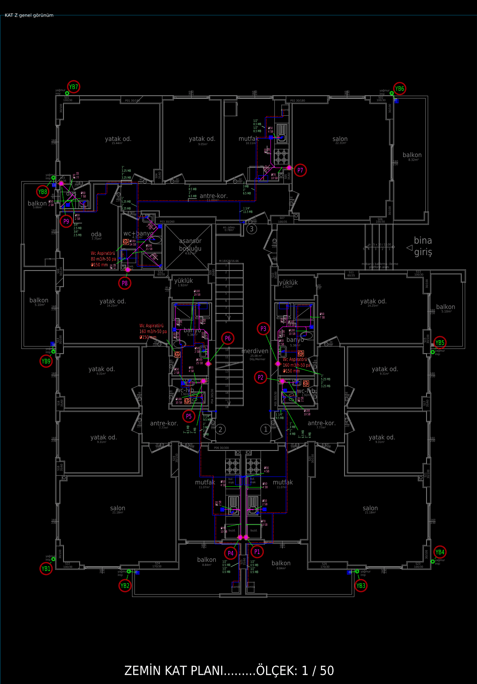
- KAT 1: 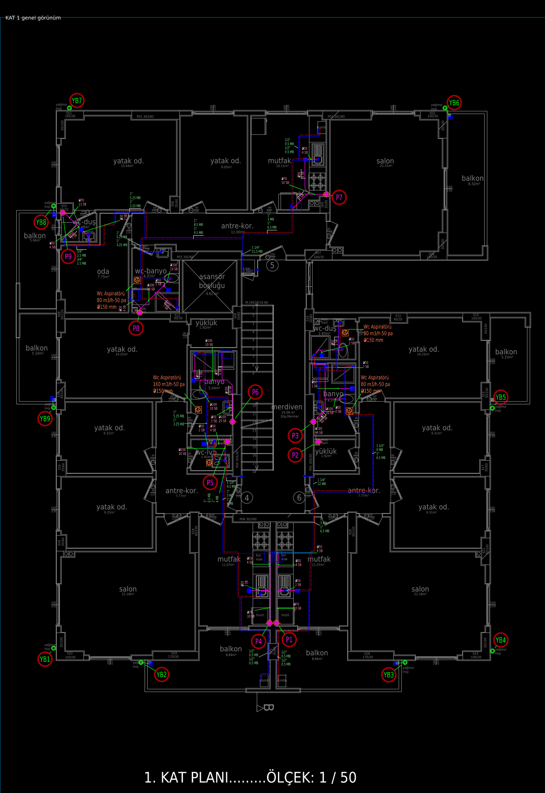
- KAT 2: 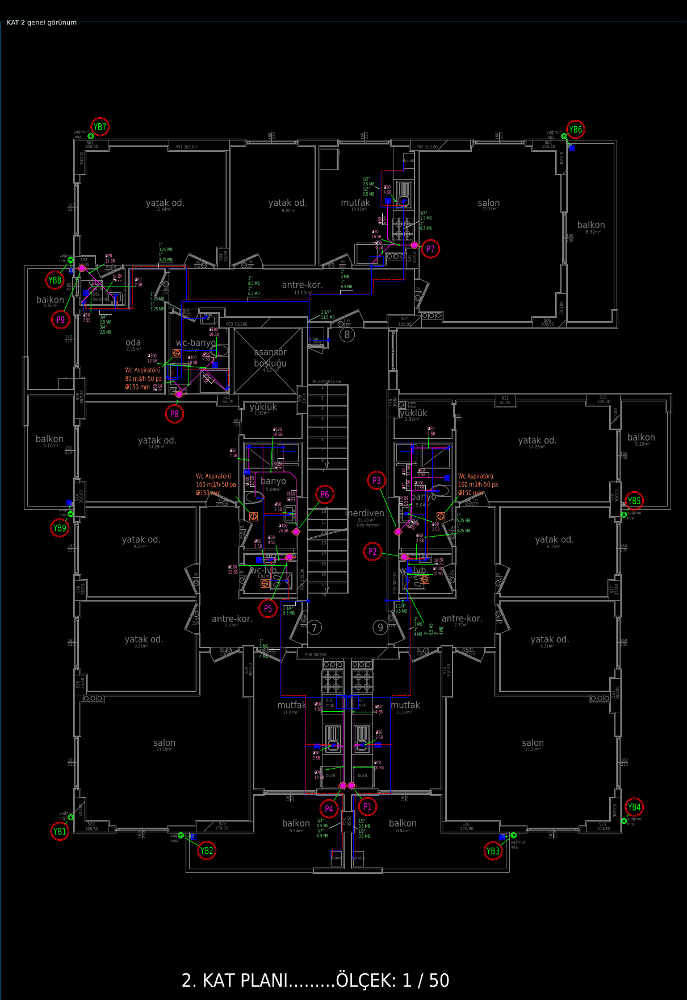
- ŞEMA: 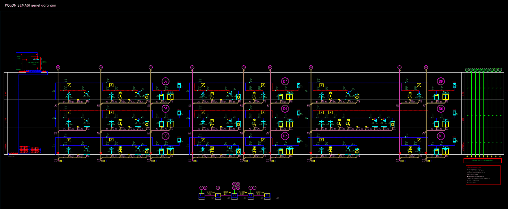

## Eşikler

- T01 balkon süzgeci–iniş hat boyu ≤ 300 cm; süzgecin bağlı olduğu ağda pis su katmanı/kolonu varsa FAIL.
- T02 armatür→kolon branşman yolu ≤ 300 cm; parça açıları {0,45,90} ± 4°; yol armatür mahalli + kolon mahalli (duvar payı 30 cm) dışına > 40 cm çıkarsa FAIL; WC/LV/DUŞ/EVİYE 50 cm içinde hat yoksa FAIL.
- T03 mahal poligonunun 30 cm içeri çekilmiş bölgesinde ≥ 30 cm pis su hattı → FAIL.
- T04 sıcak su bağlı ağı en çok örtüştüğü daire poligonu (mahaller + 20 cm duvar payı) dışında > 15 cm → FAIL; kombiye 80 cm içinde başlamıyorsa FAIL.
- T05 sıcak parçası (≥ 60 cm) boyunca soğuğa mesafe 3–30 cm olan örnek oranı ≥ %80; ofset std ≤ 6.0 cm; sıcak–soğuk kesişme (uçtan 15 cm dışı) FAIL.
- T06 koridor (antre-kor. / merdiven / hol) içindeki temiz su parçası: duvara mesafe / koridor genişliği < 0.25 → FAIL.
- T07 yazı kutuları ezdxf yazı tipi ölçüsüyle; herhangi örtüşme (> 0,2 cm²) FAIL; hat yazı kutusundan ≥ 3 cm geçiyorsa FAIL; çap etiketi yüksekliği ortanca 8–12.
- T08 sayaç sembolü y ≥ 1. kat bandı çizgisi → FAIL; x daire bloklarının (D1..) solunda değilse FAIL; "SAYAÇ (KAPIDA)" yazısı FAIL.
- T09 ıslak mahal poligonunda süzgeç sembolü (çizim + mimari ızgara, 15 cm kümeli) sayısı ≠ 1 → FAIL.
- T10 kolon sembolü ıslak mahal (20 cm pay) dışında / betonarme içinde / en yakın köşeye > 45 cm → FAIL.
- T11 `motor/deneme/denetim/denetle.py` ile aynı sayılar.
- T07 ek: gerçek yazı kutusu (`kutu.py`, ezdxf text_size; hizalama + döndürme, MTEXT mtext_size); etiket kutusunun > %25'i duvar/betonarme taramasında, > %25'i eviye/B.M./mimari Ç.M./kombi/makine/aspiratör sembolünde, > %30'i asansör boşluğunda → FAIL (merdiven holü BİLGİ).
- T12 aynı numaralı kolon katlar arasında ± 5 cm; bir katta eksik ya da referans new_block'ta olmayan numara → FAIL.
- T13 çizilen Ç.M./B.M. aynı mahal/daire içindeki mimari (+ referans) yerine > 40 cm → FAIL; kolon (r 8) / aspiratör mimari makine yerine < 15 cm → FAIL.
- T14 aspiratör notu kendi ıslak hacmine (kılavuz/sembolden) > 60 cm, ortak alanda ya da başka dairede → FAIL; kılavuz başka mahal içinde > 15 cm → FAIL.
- T15 pencere etiketi (S/P nn) olmayan ıslak hacimde (mutfak ve < 1 m² duş kabini hariç) aspiratör sembolü (40 cm) ya da not (60 cm) yok → FAIL.
- T16 "(EK)", new_block, otomatik, dosya adı, kural cümlesi kalıpları (`testler2.SIZINTI`); ACI 250–255 (BYLAYER/BYBLOCK çözülmüş) ya da çok koyu gerçek renk → FAIL (WIPEOUT hariç).
- T17 pafta genişliği referansın ± %5'i; tam şeritte (≥ 5 pafta) eksik / sırasız / tanımsız pafta → FAIL.
