# KONTROLÖR RAPORU — NB_YERDEN_ISITMA.dxf

Üretildi: 15.10.2026 18:44 — `python3 motor/kontrolor/kontrolor.py proje/denemeler/yerden2/NB_YERDEN_ISITMA.dxf --mimari /tmp/claude-0/y2/new_block.dxf --rapor proje/denemeler/yerden2/kontrolor_tur5/KONTROL_YERDEN.md --tur yerden --excel proje/denemeler/yerden2/NB_YERDEN_ISITMA.xlsx`

## SONUÇ: **RED — 15 madde**

Düzeltme listesi (üreten ajana geri):
1. [Y01 Z] antre-kor. D2: borusuz cep 0.87 m² > 0.6 (etiket cebi / doldurulmamış köşe) — serpantin mahali tam doldurmalı, etiket serpantin üstüne biner @ (253174, -442698)
2. [Y01 Z] antre-kor. D1: borusuz cep 0.94 m² > 0.6 (etiket cebi / doldurulmamış köşe) — serpantin mahali tam doldurmalı, etiket serpantin üstüne biner @ (253956, -442698)
3. [Y01 Z] salon D3: boru yoğunluğu 5.17 m/m² < 5.3 (115.3 m / 22.31 m² mimari) — serpantin mahali tam doldurmalı, etiket serpantin üstüne biner @ (253964, -441886)
4. [Y01 Z] yatak od. D3: boru yoğunluğu 5.29 m/m² < 5.3 (81.7 m / 15.44 m² mimari) — serpantin mahali tam doldurmalı, etiket serpantin üstüne biner @ (252983, -441687)
5. [Y01 1] antre-kor. D4: borusuz cep 0.87 m² > 0.6 (etiket cebi / doldurulmamış köşe) — serpantin mahali tam doldurmalı, etiket serpantin üstüne biner @ (255208, -442698)
6. [Y01 1] antre-kor. D5: borusuz cep 1.18 m² > 0.6 (etiket cebi / doldurulmamış köşe) — serpantin mahali tam doldurmalı, etiket serpantin üstüne biner @ (255643, -442014)
   … Y01 için toplam 15 bulgu (ayrıntı aşağıda)

## Özet

| Test | Ne ölçer | Sonuç | FAIL | INFO | Referans new_block FAIL/INFO (aynı ölçüm) |
|---|---|---|---|---|---|
| T11 | denetle.py: MTY 0, ROTAS- öneki, köprü 0, kesişme 0, elektrik 0, yazı çakışması 0, lejant, audit | ✓ PASS | 0 | 1 | 34 / 1 — MTY katmanları (beklenen) |
| T16 | Paftada iç kural metni sızıntısı yok; ACI 250–255 renk yok | ✓ PASS | 0 | 0 | 0 / 0 |
| T17 | Pafta genişlikleri ve sırası (ısıtma şeridi) YERDEN_ISITMA_ALTIN_REFERANS §1 ile (± %5) | ✓ PASS | 0 | 1 | 0 / 1 |
| Y01 | Boru yoğunluğu oda/salon/yatak/hol: hedef ≥ 6.0 m/m² (mimari m²; < 5.3 FAIL), borusuz cep ≤ 0.6 m²; ısıtılmayan mahalde boru yok | ✗ FAIL | 15 | 37 | 0 / 24 — FAIL 0; 24 BİLGİ = 5,38–5,98 m/m² mahaller (hedef 6,0; borusuz cep 0) |
| Y02 | Islak hacim doluluğu (banyo ≥ 3.0 m/m²); < 3 m devre yok; ≤ 2.65 m² wc-duş/duş için ayrı devre yok | ✓ PASS | 0 | 0 | 0 / 0 |
| Y03 | Devre etiketi kendi mahalinin içinde (ortak alan / bina dışı / başka mahal değil) | ✓ PASS | 0 | 0 | 0 / 0 |
| Y04 | Kılavuz çizgisi ≤ 100 cm ve başka mahali kesmiyor (referansta kılavuz yok) | ✓ PASS | 0 | 0 | 0 / 0 |
| Y05 | Devre etiketindeki hat uzunluğu = etiketin bindiği devrenin polyline uzunluğu (± 0,6 m; ET-2) | ✓ PASS | 0 | 0 | 6 / 0 — kullanıcının kendi etiket hatası: Z01 39,19↔40,66 m, Z03 (Z04'ten kopya) 56,90↔46,77 m, 3 katta (ALTIN §3.5 *) |
| Y06 | Plan W ↔ kolon şeması W ↔ Excel W aynı kaynaktan (± %1) | ✓ PASS | 0 | 0 | 0 / 1 — Excel yok (BİLGİ); plan W = şema W (81/81) |

Referans sütunu: kullanıcının kendi `new_block.dxf` çizimi aynı testlerden geçirildiğinde çıkan sayılar (15.10.2026). Referansın kendisinde de görülen türden bulgular (ör. T07 etiket-hat, T02 serbest açı) tarz farkı değil kural C ihlali olarak listelenir; T11 MTY sayıları referans için beklenen durumdur.

## Dosya ve mimari eşleme

- dosya: proje/denemeler/yerden2/NB_YERDEN_ISITMA.dxf — çerçeve 1, kat paftası [], şema paftası var
- mimari kaynak: ../../../tmp/claude-0/y2/new_block.dxf (30942 kayıt)
- kat paftası çerçevesi yok: kaynak kat pencereleri kullanıldı (öteleme 0)
- kat Z: öteleme (0.0, 0.0) 0 yazı eşleşmesi; mahal 32 (ıslak 9, ortak 2, balkon 4), daire [1, 2, 3], armatür 29, betonarme 32 — 3.1 s
- kat 1: öteleme (0.0, 0.0) 0 yazı eşleşmesi; mahal 32 (ıslak 9, ortak 2, balkon 4), daire [4, 5, 6], armatür 29, betonarme 32 — 2.8 s
- kat 2: öteleme (0.0, 0.0) 0 yazı eşleşmesi; mahal 32 (ıslak 9, ortak 2, balkon 4), daire [7, 8, 9], armatür 28, betonarme 32 — 3.3 s
- kat 1: kapı komşuluğuyla daire ataması düzeltildi: wc-duş D5→D6
- kat 2: kapı komşuluğuyla daire ataması düzeltildi: yüklük D8→D9

Süre 109 s.

## Ayrıntı (koordinatlar çizim birimi, cm)

### T11 — denetle.py: MTY 0, ROTAS- öneki, köprü 0, kesişme 0, elektrik 0, yazı çakışması 0, lejant, audit

- **PASS**: MTY 0, önek 0, köprü 0, kesişme 0, elektrik 0, yazı 0, lejant var, audit 0
- **INFO**: pis su – temiz su üst üste geçiş (farklı düzlem, bilgi): 0

### T16 — Paftada iç kural metni sızıntısı yok; ACI 250–255 renk yok

- **PASS**: iç metin sızıntısı yok, ACI 250–255 / koyu renk yok

### T17 — Pafta genişlikleri ve sırası (ısıtma şeridi) YERDEN_ISITMA_ALTIN_REFERANS §1 ile (± %5)

- **INFO** [PAFTA]: şerit (yerden): sema 6692
- **PASS** [PAFTA]: 1 pafta genişliği referansla ± %5, sıra doğru

### Y01 — Boru yoğunluğu oda/salon/yatak/hol: hedef ≥ 6.0 m/m² (mimari m²; < 5.3 FAIL), borusuz cep ≤ 0.6 m²; ısıtılmayan mahalde boru yok

- **FAIL** [Z]: antre-kor. D2: borusuz cep 0.87 m² > 0.6 (etiket cebi / doldurulmamış köşe) — serpantin mahali tam doldurmalı, etiket serpantin üstüne biner @ (253174, -442698)  
  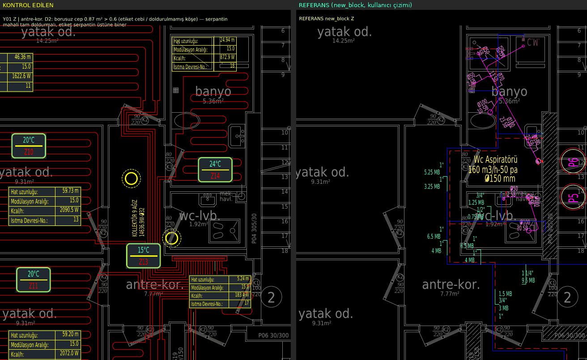
- **FAIL** [Z]: antre-kor. D1: borusuz cep 0.94 m² > 0.6 (etiket cebi / doldurulmamış köşe) — serpantin mahali tam doldurmalı, etiket serpantin üstüne biner @ (253956, -442698)  
  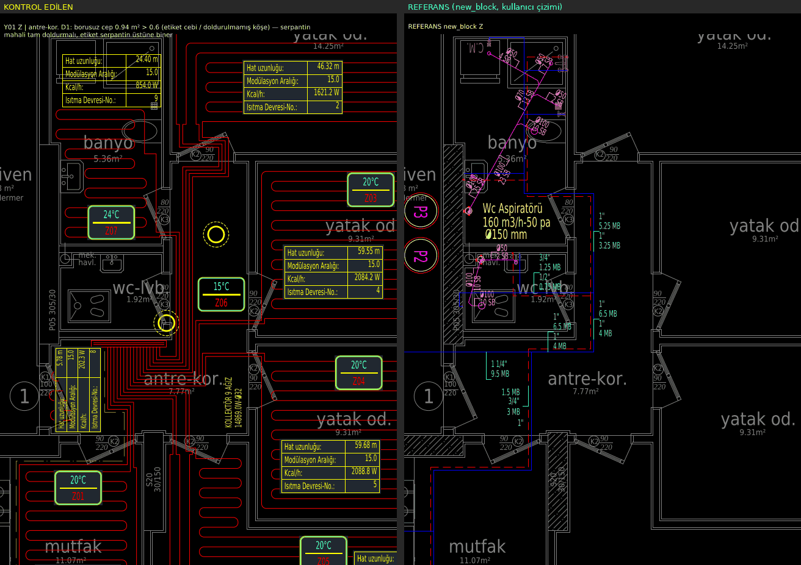
- **INFO** [Z]: salon D2: 5.77 m/m² (hedef 6.0; cep yok) — referans new_block'ta da 5,4–6,0 olan mahaller var @ (253036, -443328)
- **INFO** [Z]: mutfak D3: 2.15 m/m² (mutfak: tezgâh/buzdolabı altı boş; ölçüt dışı) @ (253581, -441683)
- **FAIL** [Z]: salon D3: boru yoğunluğu 5.17 m/m² < 5.3 (115.3 m / 22.31 m² mimari) — serpantin mahali tam doldurmalı, etiket serpantin üstüne biner @ (253964, -441886)  
  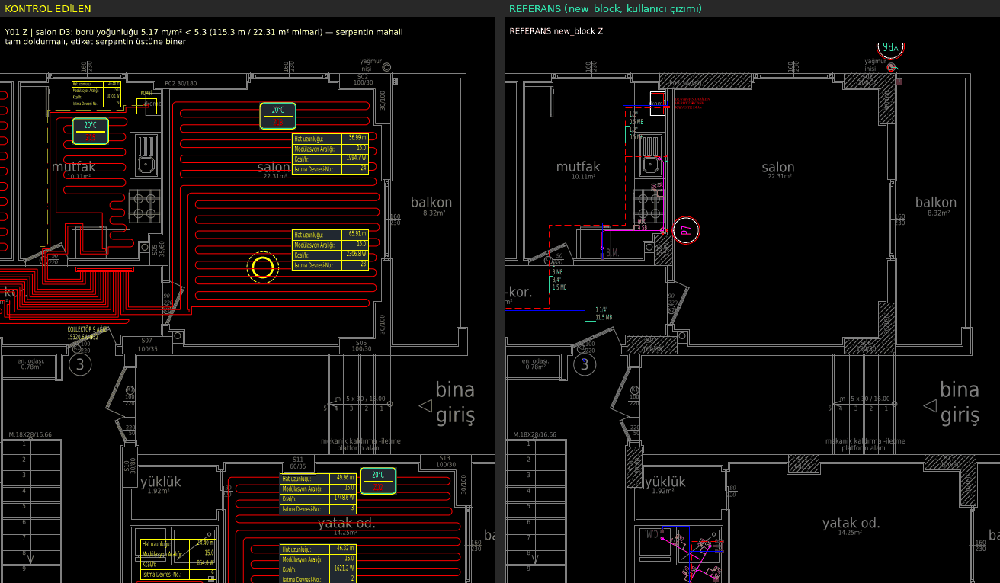
- **FAIL** [Z]: yatak od. D3: boru yoğunluğu 5.29 m/m² < 5.3 (81.7 m / 15.44 m² mimari) — serpantin mahali tam doldurmalı, etiket serpantin üstüne biner @ (252983, -441687)  
  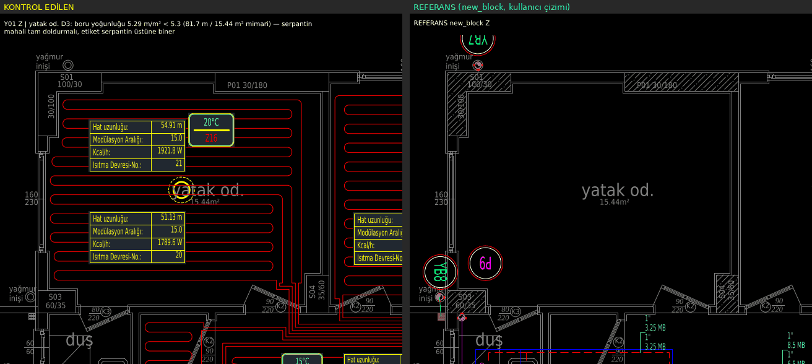
- **INFO** [Z]: yatak od. D3: 5.88 m/m² (hedef 6.0; cep yok) — referans new_block'ta da 5,4–6,0 olan mahaller var @ (253345, -441690)
- **INFO** [Z]: oda D3: 5.99 m/m² (hedef 6.0; cep yok) — referans new_block'ta da 5,4–6,0 olan mahaller var @ (252911, -442084)
- **INFO** [Z]: yatak od. D2: 5.89 m/m² (hedef 6.0; cep yok) — referans new_block'ta da 5,4–6,0 olan mahaller var @ (252943, -443008)
- **INFO** [Z]: yatak od. D3: 5.31 m/m² (hedef 6.0; cep yok) — referans new_block'ta da 5,4–6,0 olan mahaller var @ (254120, -442421)
- **INFO** [Z]: yatak od. D1: 5.66 m/m² (hedef 6.0; cep yok) — referans new_block'ta da 5,4–6,0 olan mahaller var @ (254202, -442724)
- **INFO** [Z]: mutfak D1: 3.97 m/m² (mutfak: tezgâh/buzdolabı altı boş; ölçüt dışı) @ (253724, -443208)
- **INFO** [Z]: mutfak D2: 3.21 m/m² (mutfak: tezgâh/buzdolabı altı boş; ölçüt dışı) @ (253389, -443230)
- **INFO** [Z]: salon D1: 5.76 m/m² (hedef 6.0; cep yok) — referans new_block'ta da 5,4–6,0 olan mahaller var @ (254097, -443328)
- **INFO** [Z]: yatak od. D1: 5.70 m/m² (hedef 6.0; cep yok) — referans new_block'ta da 5,4–6,0 olan mahaller var @ (254231, -443018)
- **INFO** [Z]: yatak od. D2: 5.66 m/m² (hedef 6.0; cep yok) — referans new_block'ta da 5,4–6,0 olan mahaller var @ (252930, -442723)
- **INFO** [Z]: yatak od. D2: 5.34 m/m² (hedef 6.0; cep yok) — referans new_block'ta da 5,4–6,0 olan mahaller var @ (252985, -442409)
- **INFO** [1]: salon D4: 5.76 m/m² (hedef 6.0; cep yok) — referans new_block'ta da 5,4–6,0 olan mahaller var @ (255071, -443328)
- **FAIL** [1]: antre-kor. D4: borusuz cep 0.87 m² > 0.6 (etiket cebi / doldurulmamış köşe) — serpantin mahali tam doldurmalı, etiket serpantin üstüne biner @ (255208, -442698)  
  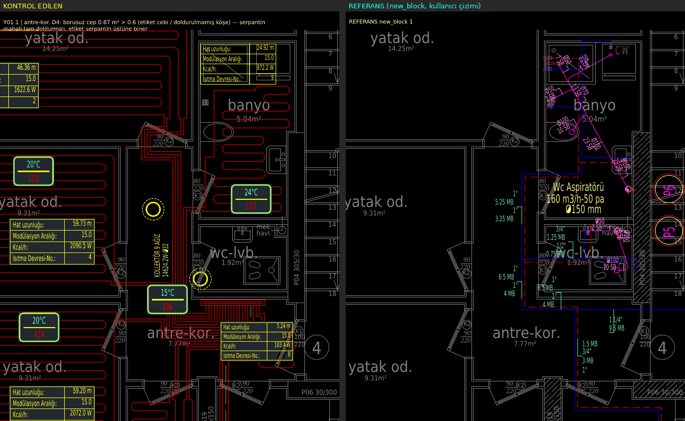
- **INFO** [1]: mutfak D5: 2.89 m/m² (mutfak: tezgâh/buzdolabı altı boş; ölçüt dışı) @ (255615, -441683)
- **FAIL** [1]: antre-kor. D5: borusuz cep 1.18 m² > 0.6 (etiket cebi / doldurulmamış köşe) — serpantin mahali tam doldurmalı, etiket serpantin üstüne biner @ (255643, -442014)  
  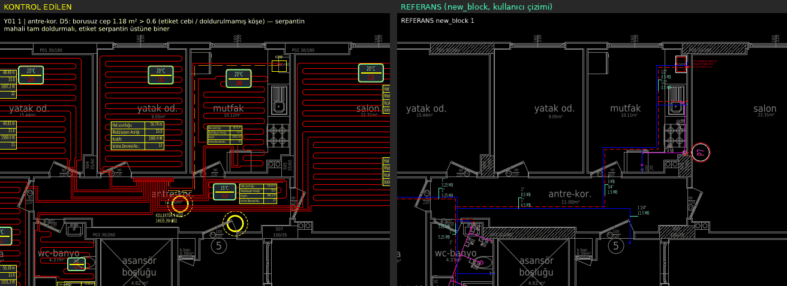
- **FAIL** [1]: salon D5: boru yoğunluğu 5.17 m/m² < 5.3 (115.4 m / 22.31 m² mimari); borusuz cep 1.51 m² > 0.6 (etiket cebi / doldurulmamış köşe) — serpantin mahali tam doldurmalı, etiket serpantin üstüne biner @ (256058, -442005)  
  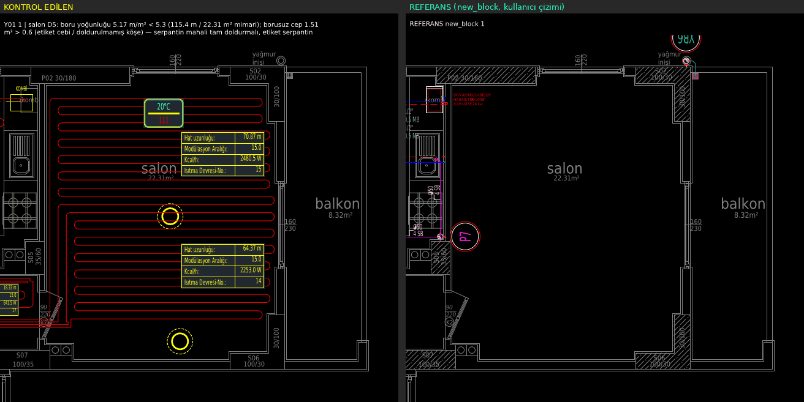
- **FAIL** [1]: yatak od. D5: boru yoğunluğu 5.26 m/m² < 5.3 (81.3 m / 15.44 m² mimari) — serpantin mahali tam doldurmalı, etiket serpantin üstüne biner @ (255017, -441687)  
  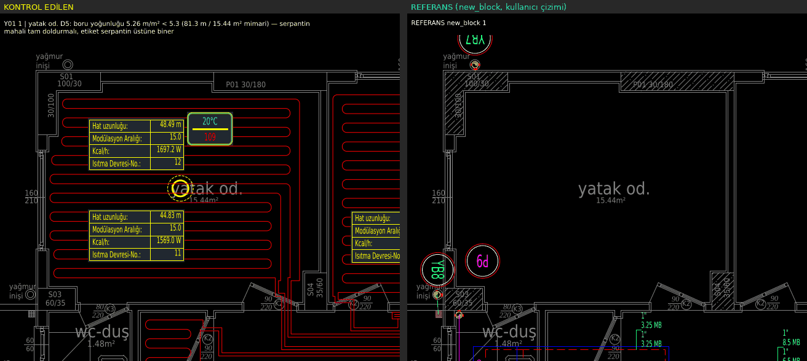
- **INFO** [1]: yatak od. D5: 5.90 m/m² (hedef 6.0; cep yok) — referans new_block'ta da 5,4–6,0 olan mahaller var @ (255379, -441690)
- **INFO** [1]: yatak od. D4: 5.88 m/m² (hedef 6.0; cep yok) — referans new_block'ta da 5,4–6,0 olan mahaller var @ (254976, -443009)
- **INFO** [1]: yatak od. D6: 5.33 m/m² (hedef 6.0; cep yok) — referans new_block'ta da 5,4–6,0 olan mahaller var @ (256154, -442421)
- **INFO** [1]: yatak od. D6: 5.67 m/m² (hedef 6.0; cep yok) — referans new_block'ta da 5,4–6,0 olan mahaller var @ (256236, -442724)
- **INFO** [1]: mutfak D6: 3.97 m/m² (mutfak: tezgâh/buzdolabı altı boş; ölçüt dışı) @ (255758, -443208)
- **FAIL** [1]: antre-kor. D6: borusuz cep 0.94 m² > 0.6 (etiket cebi / doldurulmamış köşe) — serpantin mahali tam doldurmalı, etiket serpantin üstüne biner @ (255990, -442698)  
  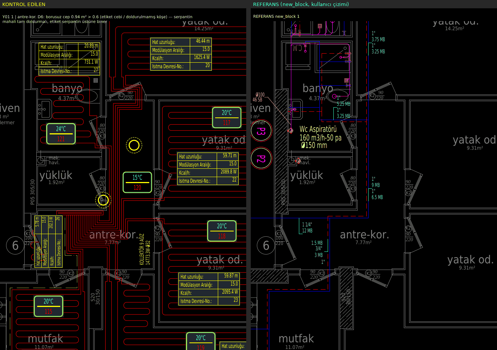
- **INFO** [1]: mutfak D4: 3.21 m/m² (mutfak: tezgâh/buzdolabı altı boş; ölçüt dışı) @ (255423, -443230)
- **INFO** [1]: salon D6: 5.77 m/m² (hedef 6.0; cep yok) — referans new_block'ta da 5,4–6,0 olan mahaller var @ (256131, -443328)
- **INFO** [1]: yatak od. D6: 5.72 m/m² (hedef 6.0; cep yok) — referans new_block'ta da 5,4–6,0 olan mahaller var @ (256265, -443018)
- **INFO** [1]: yatak od. D4: 5.66 m/m² (hedef 6.0; cep yok) — referans new_block'ta da 5,4–6,0 olan mahaller var @ (254964, -442723)
- **INFO** [1]: yatak od. D4: 5.34 m/m² (hedef 6.0; cep yok) — referans new_block'ta da 5,4–6,0 olan mahaller var @ (255019, -442409)
- **FAIL** [2]: antre-kor. D7: borusuz cep 0.87 m² > 0.6 (etiket cebi / doldurulmamış köşe) — serpantin mahali tam doldurmalı, etiket serpantin üstüne biner @ (257256, -442698)  
  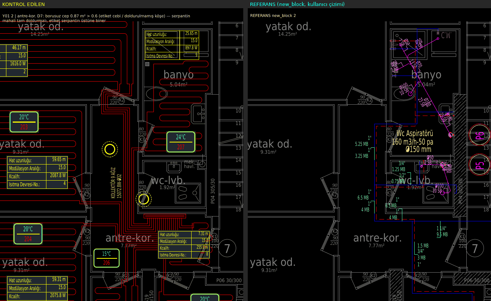
- **FAIL** [2]: antre-kor. D8: borusuz cep 1.03 m² > 0.6 (etiket cebi / doldurulmamış köşe) — serpantin mahali tam doldurmalı, etiket serpantin üstüne biner @ (257725, -441928)  
  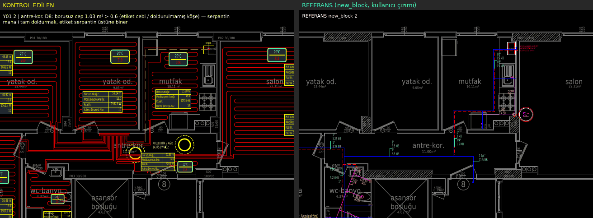
- **FAIL** [2]: antre-kor. D9: borusuz cep 0.86 m² > 0.6 (etiket cebi / doldurulmamış köşe) — serpantin mahali tam doldurmalı, etiket serpantin üstüne biner @ (258038, -442698)  
  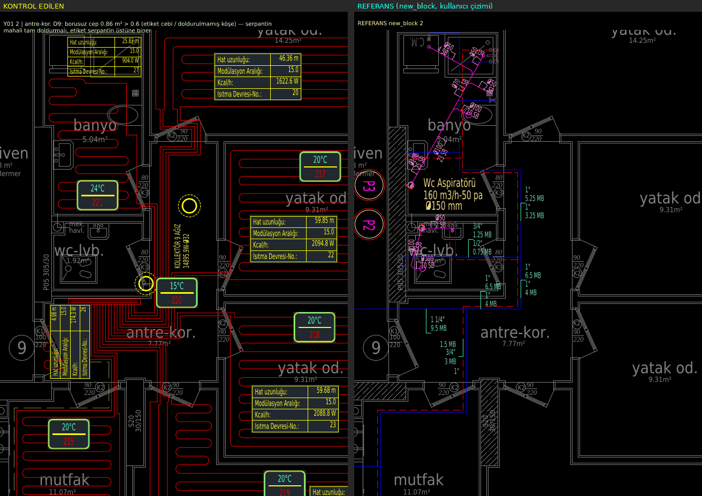
- **INFO** [2]: salon D7: 5.72 m/m² (hedef 6.0; cep yok) — referans new_block'ta da 5,4–6,0 olan mahaller var @ (257119, -443329)
- **INFO** [2]: mutfak D8: 3.24 m/m² (mutfak: tezgâh/buzdolabı altı boş; ölçüt dışı) @ (257663, -441683)
- **FAIL** [2]: salon D8: boru yoğunluğu 5.17 m/m² < 5.3 (115.3 m / 22.31 m² mimari); borusuz cep 1.43 m² > 0.6 (etiket cebi / doldurulmamış köşe) — serpantin mahali tam doldurmalı, etiket serpantin üstüne biner @ (258116, -442005)  
  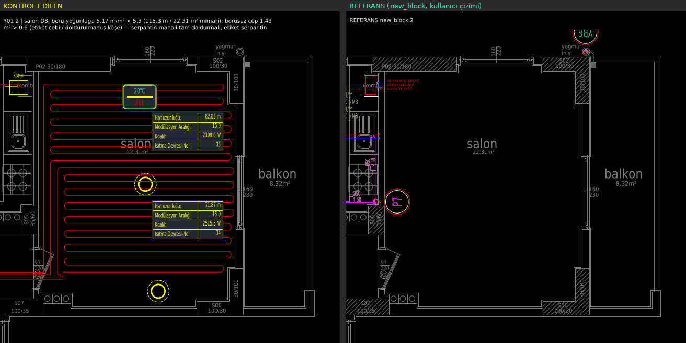
- **FAIL** [2]: yatak od. D8: boru yoğunluğu 5.25 m/m² < 5.3 (81.1 m / 15.44 m² mimari) — serpantin mahali tam doldurmalı, etiket serpantin üstüne biner @ (257065, -441687)  
  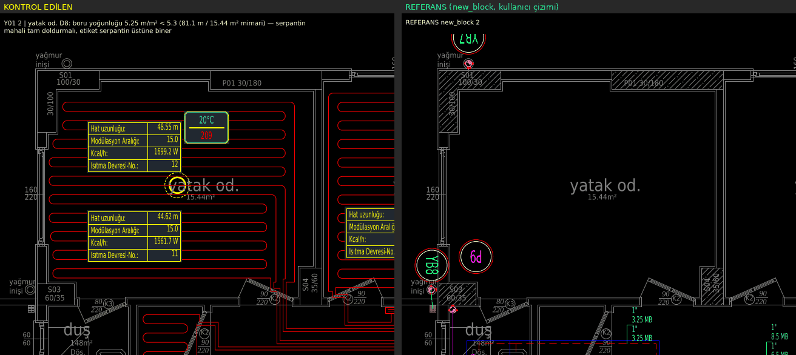
- **INFO** [2]: yatak od. D8: 5.89 m/m² (hedef 6.0; cep yok) — referans new_block'ta da 5,4–6,0 olan mahaller var @ (257427, -441690)
- **INFO** [2]: oda D8: 5.99 m/m² (hedef 6.0; cep yok) — referans new_block'ta da 5,4–6,0 olan mahaller var @ (256993, -442084)
- **INFO** [2]: yatak od. D7: 5.88 m/m² (hedef 6.0; cep yok) — referans new_block'ta da 5,4–6,0 olan mahaller var @ (257024, -443009)
- **FAIL** [2]: yatak od. D9: boru yoğunluğu 5.29 m/m² < 5.3 (75.3 m / 14.25 m² mimari) — serpantin mahali tam doldurmalı, etiket serpantin üstüne biner @ (258200, -442419)  
  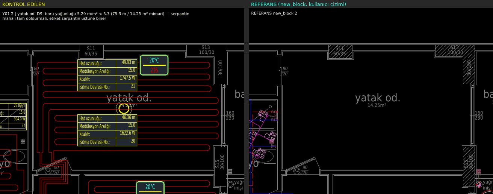
- **INFO** [2]: yatak od. D9: 5.61 m/m² (hedef 6.0; cep yok) — referans new_block'ta da 5,4–6,0 olan mahaller var @ (258284, -442724)
- **INFO** [2]: mutfak D9: 3.99 m/m² (mutfak: tezgâh/buzdolabı altı boş; ölçüt dışı) @ (257807, -443208)
- **INFO** [2]: mutfak D7: 4.21 m/m² (mutfak: tezgâh/buzdolabı altı boş; ölçüt dışı) @ (257471, -443230)
- **INFO** [2]: salon D9: 5.71 m/m² (hedef 6.0; cep yok) — referans new_block'ta da 5,4–6,0 olan mahaller var @ (258178, -443328)
- **INFO** [2]: yatak od. D9: 5.69 m/m² (hedef 6.0; cep yok) — referans new_block'ta da 5,4–6,0 olan mahaller var @ (258313, -443018)
- **INFO** [2]: yatak od. D7: 5.65 m/m² (hedef 6.0; cep yok) — referans new_block'ta da 5,4–6,0 olan mahaller var @ (257012, -442723)
- **INFO** [2]: yatak od. D7: 5.31 m/m² (hedef 6.0; cep yok) — referans new_block'ta da 5,4–6,0 olan mahaller var @ (257067, -442409)

### Y02 — Islak hacim doluluğu (banyo ≥ 3.0 m/m²); < 3 m devre yok; ≤ 2.65 m² wc-duş/duş için ayrı devre yok

- **PASS** [Z]: 4 ıslak hacim dolu (≥ 3.0 m/m²), kısa devre yok
- **PASS** [1]: 5 ıslak hacim dolu (≥ 3.0 m/m²), kısa devre yok
- **PASS** [2]: 4 ıslak hacim dolu (≥ 3.0 m/m²), kısa devre yok

### Y03 — Devre etiketi kendi mahalinin içinde (ortak alan / bina dışı / başka mahal değil)

- **PASS** [Z]: 27 devre etiketi kendi mahalinde
- **PASS** [1]: 27 devre etiketi kendi mahalinde
- **PASS** [2]: 27 devre etiketi kendi mahalinde

### Y04 — Kılavuz çizgisi ≤ 100 cm ve başka mahali kesmiyor (referansta kılavuz yok)

- **PASS** [Z]: 0 kılavuz (≤ 100 cm, mahal kesmiyor)
- **PASS** [1]: 0 kılavuz (≤ 100 cm, mahal kesmiyor)
- **PASS** [2]: 0 kılavuz (≤ 100 cm, mahal kesmiyor)

### Y05 — Devre etiketindeki hat uzunluğu = etiketin bindiği devrenin polyline uzunluğu (± 0,6 m; ET-2)

- **PASS** [Z]: 27 devre etiketinde hat uzunluğu = devre uzunluğu (± 0,6 m)
- **PASS** [1]: 27 devre etiketinde hat uzunluğu = devre uzunluğu (± 0,6 m)
- **PASS** [2]: 27 devre etiketinde hat uzunluğu = devre uzunluğu (± 0,6 m)

### Y06 — Plan W ↔ kolon şeması W ↔ Excel W aynı kaynaktan (± %1)

- **PASS**: plan devre W değerleri (81) kolon şemasında aynen var
- **PASS**: 63 zonda plan W = Excel W

## Genel görünümler

- KAT Z: 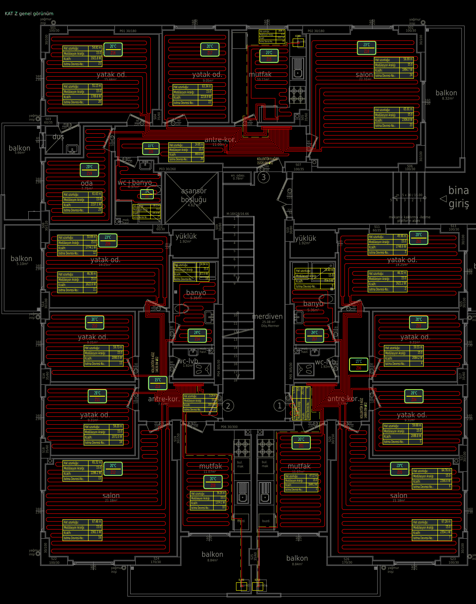
- KAT 1: 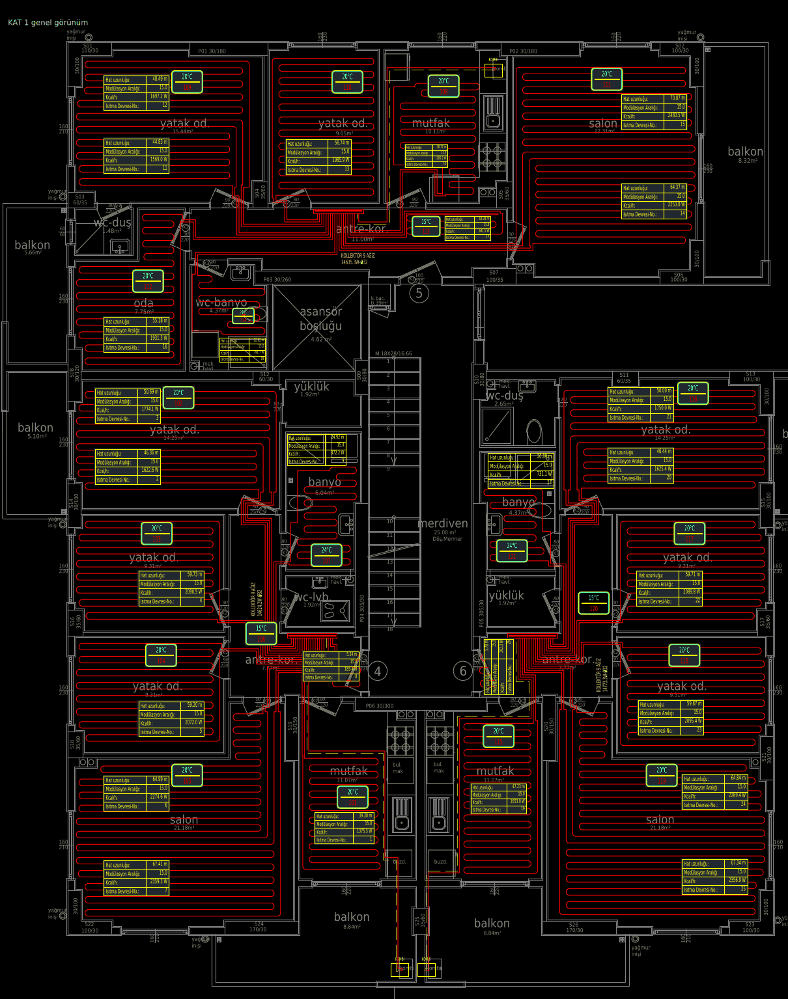
- KAT 2: 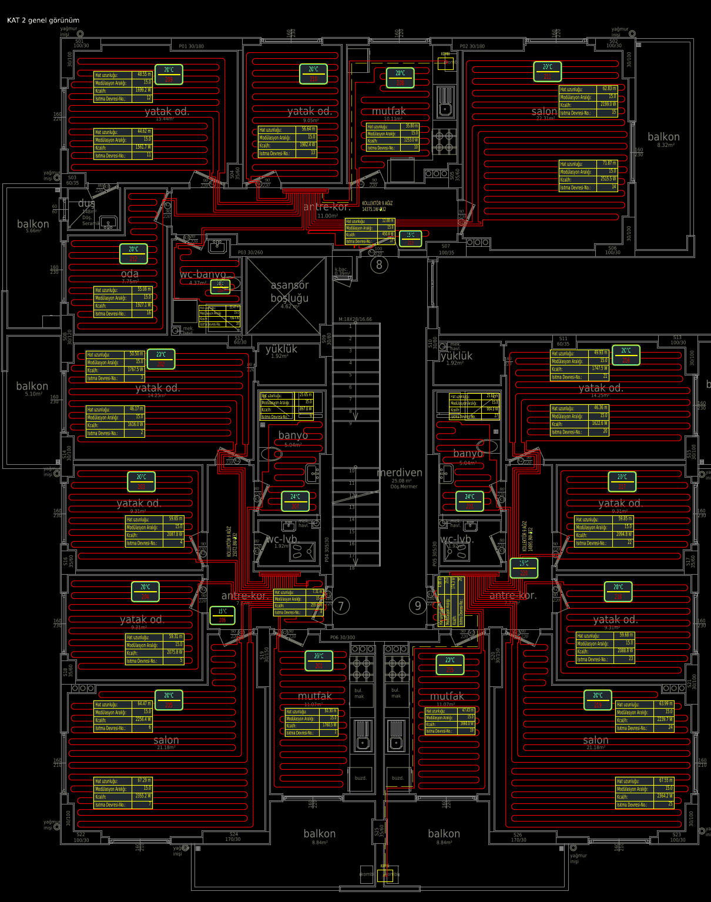
- ŞEMA: 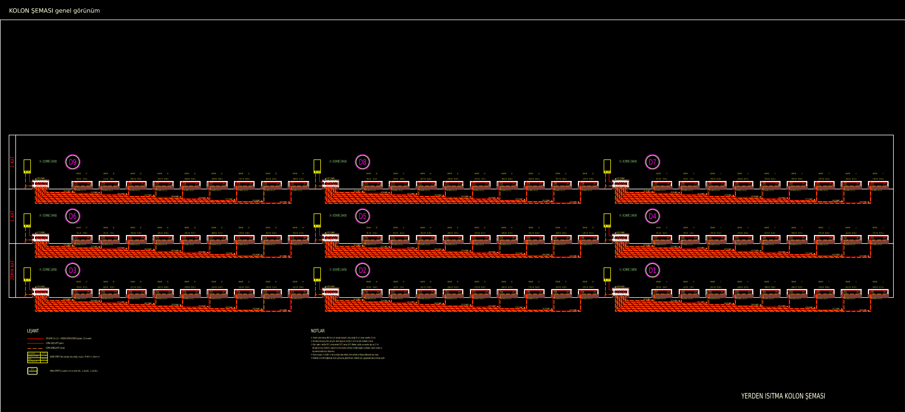

## Eşikler (yerden)

- T11 denetle.py: MTY 0, ROTAS- öneki, köprü 0, kesişme 0, elektrik 0, yazı çakışması 0, lejant, audit
- T16 Paftada iç kural metni sızıntısı yok; ACI 250–255 renk yok
- T17 Pafta genişlikleri ve sırası (ısıtma şeridi) YERDEN_ISITMA_ALTIN_REFERANS §1 ile (± %5)
- Y01 Boru yoğunluğu oda/salon/yatak/hol: hedef ≥ 6.0 m/m² (mimari m²; < 5.3 FAIL), borusuz cep ≤ 0.6 m²; ısıtılmayan mahalde boru yok
- Y02 Islak hacim doluluğu (banyo ≥ 3.0 m/m²); < 3 m devre yok; ≤ 2.65 m² wc-duş/duş için ayrı devre yok
- Y03 Devre etiketi kendi mahalinin içinde (ortak alan / bina dışı / başka mahal değil)
- Y04 Kılavuz çizgisi ≤ 100 cm ve başka mahali kesmiyor (referansta kılavuz yok)
- Y05 Devre etiketindeki hat uzunluğu = etiketin bindiği devrenin polyline uzunluğu (± 0,6 m; ET-2)
- Y06 Plan W ↔ kolon şeması W ↔ Excel W aynı kaynaktan (± %1)
